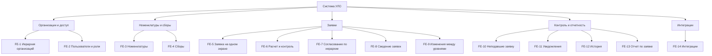

# Документ о концепции и границах кейса

| Поле | Значение |
|------|----------|
| Кейс | 05 - УЛО: управление лекарственным обеспечением |
| Индустриальный партнер | Комитет здравоохранения Волгоградской области (КЗВО) |
| Версия | `0.1-draft` |
| Дата | 2026-10-09 |
| Статус | черновик |
| Авторы | Колузаев К.М. (тимлид), Иванов Р.С., Архипов А.А. |

## 1. Введение

### Кейс
05 — УЛО: управление лекарственным обеспечением.
Партнер: Комитет здравоохранения Волгоградской области (КЗВО).

### Суть
Заменяем ручной сбор заявок в Excel и согласование в чатах единой программной средой.

Работник создает заявку в системе. Система сама считает сумму и проверяет ограничения.
Администратор модерирует и объединяет заявки. Маршрут согласования идет снизу вверх по иерархии.

### Проблема
Сейчас каждый ведет свою таблицу. Администратор все пересчитывает вручную.
Хронология теряется в мессенджерах. Не видно статусы и должников.

### Отличие от текущего способа
Вместо файлов на дисках и переписки — один контур с ролями, статусами и журналом изменений.
Человек остается decision-maker, система убирает рутину и ошибки.

## 2. Бизнес-контекст и цели

### 2.1. Исходные данные

1. Работник ведет свою таблицу Excel. Он сам проверяет наличие у поставщика.
2. Он сам считает сумму и сравнивает с лимитом.
3. Заявка файлом уходит администратору. Администратор все пересчитывает и сводит вручную.
4. Замечания и согласование идут в мессенджерах. Хронология не восстанавливается.
5. Справочник обновляется вручную. Пропуск обновления дает ошибку с долгим исправлением.
6. Создание заявки разрознено: много вкладок и переключений.
7. Контроль лимитов, превышение лимита блокирует отправку выше.
8. Нет напоминаний об открытых сборах. Нет списка подразделений-должников.
9. Excel зависает на рабочих ПК. Есть план по цифровизации.

Последствия: долго, легко ошибиться, непонятно на каком этапе потерялась заявка.
Ошибки объединения приводят к коллапсам в выдаче. Разбор виновных без журнала невозможен.

### 2.2. Возможности бизнеса

- Единый экран заявки: товары, количество, сумма, лимиты и остатки видны сразу.
- Автопроверки: сумма, разрешенный ассортимент, остатки, сроки сбора.
- Напоминания об открытых сборах.
- Модерация и объединение заявок в системе, без скачивания файлов.
- Контроль должников: видно, кто не отправил заявку.
- Журнал изменений для разбора инцидентов.
- Позже: централизованный реестр потребностей, REST API для поставщиков и МИС.

### 2.3. Бизнес-цели

> Пороги ниже — проект для согласования с КЗВО на встрече. База = замеры Excel-процесса.

| ID | Цель | Масштаб | Способ измерения | База | План | Обязательный порог | Срок |
|----|------|---------|------------------|------|------|--------------------|------|
| BO-1 | Сократить время составления и сведения заявки | Все МО и КЗВО в пилоте | Замер времени от создания до согласования | Excel, [замерить] | -30% | -20% | Выпуск 1 + 1 месяц |
| BO-2 | Снизить долю заявок с ошибками | Все заявки пилота | Ошибки / всего заявок, по журналу возвратов на доработку | Excel, [замерить] | -50% | -30% | Выпуск 1 + 1 месяц |
| BO-3 | Перевести сбор в единый контур | Все плановые сборы пилота | Заявки в системе / всего заявок | 0% | 100% | 90% | Выпуск 1 |
| BO-4 | Сделать процесс прозрачным | Администратор, руководитель | Доля заявок со статусом и историей, доля должников на дашборде | 0% | 100% | 100% для Выпуска 1 | Выпуск 1 |

### 2.4. Видение решения

Для работника МО, который собирает заявку на лекарства, система «УЛО» — это веб-приложение для создания и согласования заявок, которое считает сумму, проверяет лимиты и остатки и ведет статусы.
В отличие от Excel-файлов и чатов, решение держит все в одном контуре с ролями и журналом.

## 3. Стейкхолдеры

### 3.1. Профили заинтересованных лиц

| Заинтересованное лицо | Основная ценность | Отношение | Основные интересы | Ограничения |
|-----------------------|-------------------|-----------|-------------------|-------------|
| КЗВО (Комитет здравоохранения Волгоградской области, заказчик) | Прозрачное, управляемое и экономное лекарственное обеспечение | Инициатор, активный сторонник | Прослеживаемость процесса, меньше ошибок и разбирательств, недопущение дробления закупок по 44-ФЗ, целевое расходование средств, единая система вместо файлов и мессенджеров, следование плану цифровизации | Нет бюджета на новое оборудование, массовое обновление рабочих мест маловероятно; данные хранятся на серверах КЗВО и государственного уровня |
| Сотрудник-заявитель | Быстро составить корректную заявку (сейчас около 4 рабочих дней на одну) | Заинтересован | Единый экран, автоматический расчет суммы и проверка ограничений, поиск товаров в номенклатурах, напоминания об открытых сборах | Часть рабочих мест устарела (ПК 2004 г., Windows 2000) |
| Модератор заявок | Свести заявки нижестоящих организаций без ручного пересчета и потерь файлов | Заинтересован | Единая очередь заявок, замечания внутри системы вместо мессенджеров, сведение заявок, видимость неподавших, хронология | Большой объем заявок; число нижестоящих организаций заранее неизвестно (от 1 до 100+) |
| Руководитель (согласующий) | Принять решение по готовой и проверенной заявке | Нейтральное / положительное | Видеть заявку целиком, быстро одобрить или вернуть, передать выше по иерархии | Ограниченное время, ответственность за итоговую закупку; число уровней согласования не ограничено |
| Системный администратор | Выдавать пользователям нужные права без участия программистов | Заинтересован | Конструктор ролей из заложенных действий, создание пользователей своего уровня, несколько ролей у одного человека | Права только вниз по иерархии; принципиально новое действие требует доработки разработчиками |
| Подведомственные организации (больницы, аптеки и др.) | Своевременно и без претензий подать заявку | Нейтральное | Понятный порядок подачи, напоминания о сроках, свои даты внутри срока вышестоящего сбора | Число организаций неизвестно; разный уровень оснащения; сроки и лимит сбора нарушать нельзя |
| Поставщики (в т.ч. ГУП «Волгофарм») | Актуальные цены и остатки в заявках | Участник процесса | Самостоятельно вести свою номенклатуру (цены, остатки, ассортимент), сохранение истории изменений товаров | Доступ только к своей номенклатуре; сотни тысяч товаров, цены меняются часто |
| Ответственные должностные лица (разбор спорных ситуаций) | Возможность восстановить ход событий | Заинтересованы | История всех решений и действий, страница истории по каждой сущности | Система фиксирует решения, но не ищет виновных; история хранится 3 года |
| ВОМИАЦ | Работа системы в региональном контуре | Участник внедрения | Подключение и сопровождение системы (роль уточнить) | Требования к инфраструктуре не определены |
| МИС «БАРС.Здравоохранение» | Корректный обмен данными для аналитики | Внешняя система | API и тестовый стенд для обмена данными |Интеграция зависит от наличия API и тестового стенда у МИС
| Тендерный отдел | Получать проверенную потребность для проведения закупок | Потребитель результата | Сводная потребность в удобном виде | Работает вне системы: тендеры и контракты в систему не входят |

### 3.2. Матрица влияния / интереса

| Стейкхолдер | Влияние (низкое / среднее / высокое) | Интерес (низкий / средний / высокий) | Стратегия работы |
|-------------|--------------------------------------|--------------------------------------|------------------|
| КЗВО (Комитет здравоохранения Волгоградской области, заказчик) | Высокое | Высокий | Управлять тесно: регулярные согласования, приемка по критериям |
| Сотрудник-заявитель | Среднее | Высокий | Интервью, тестирование прототипа, обратная связь по удобству |
| Модератор заявок | Среднее | Высокий | Включить в проектирование, основной источник требований |
| Руководитель (согласующий) | Высокое | Средний | Вовлекать в проектирование сценария согласования, показывать прототипы |
| Системный администратор | Среднее | Высокий | Согласовать модель ролей и иерархии, показать конструктор ролей на прототипе |
| Подведомственные организации (больницы, аптеки и др.) | Низкое | Средний | Информировать, обучать перед запуском |
| Поставщики (в т.ч. ГУП «Волгофарм») | Среднее | Высокий | Вовлечь в проектирование номенклатур: согласовать состав полей, права доступа и порядок изменения цен |
| Ответственные должностные лица (разбор спорных ситуаций) | Среднее | Средний | Согласовать состав истории и срок хранения, показывать страницы истории |
| ВОМИАЦ | Среднее | Средний | Уточнить роль и требования к развертыванию, держать в курсе |
| МИС «БАРС.Здравоохранение» | Низкое | Низкий | Информировать; запросить API и тестовый стенд для интеграции
| Тендерный отдел | Среднее | Средний | Согласовать состав и формат сводной потребности, передаваемой для закупки |

## 4. Функциональные требования

### 4.1. Основные функции

| ID | Функция | Краткое описание |
|----|---------|------------------|
| FE-1 | Управление иерархией организаций | Создание организаций и подразделений в иерархии любой глубины; привязка пользователей и сборов; права и сборы распространяются только вниз |
| FE-2 | Управление пользователями и ролями | Вход по логину и паролю; пользователей создает администратор своего уровня иерархии; роль - набор заранее заложенных действий, собирается в конструкторе ролей без программистов; несколько ролей у одного пользователя; временная блокировка входа после неверных вводов пароля |
| FE-3 | Ведение номенклатур | Поставщик ведет свою номенклатуру и видит только ее; номенклатуры организаций без привязки к поставщику (без цен или с примерными ценами); произвольные свойства товаров и гибкие категории; ввод в системе и импорт из файла; проверка на дубли |
| FE-4 | Управление сборами | Вышестоящая организация создает сбор: даты, финансовый лимит сбора, допустимые категории товаров; нижестоящие организации задают свои даты внутри срока вышестоящей |
| FE-5 | Создание заявки на едином экране | Выбор товаров из номенклатур и ввод количества; на одном экране видны состав заявки, итог, остаток лимита сбора, срок и допустимые категории |
| FE-6 | Автоматический расчет и контроль ограничений | Подсчет стоимости позиций и заявки; блокировка отправки заявки выше при превышении лимита сбора, недопустимой категории товара или истекшем сроке сбора |
| FE-7 | Согласование заявок по иерархии | Маршрут любой глубины (например, врач, заведующий отделением, главный врач, комитет); статусы заявки; замечания и возврат на доработку внутри системы; передача одобренной заявки выше |
| FE-8 | Сведение заявок | Объединение одобренных заявок нижестоящих организаций в сводную заявку вышестоящей в пределах одного сбора без ручного пересчета |
| FE-9 | Согласование изменений между уровнями иерархии | Если заявку изменили на верхнем уровне, нижестоящие уровни узнают об этом и заявки приводятся в согласованное состояние (механизм определить) |
| FE-10 | Контроль неподавших заявку | Вышестоящая организация видит организации и пользователей, не сдавших заявку по сбору |
| FE-11 | Уведомления и напоминания | Электронная почта, мессенджер Max и уведомления в системе; об открытых сборах, приближении срока и статусе заявки |
| FE-12 | История изменений | История всех действий (заявки, сборы, пользователи, роли, номенклатуры, товары) хранится 3 года; у каждой сущности страница истории; записи нельзя изменить или удалить |
| FE-13 | Отчет по заявке | Кто и когда создал, кто одобрил или отклонил, товары, количество, стоимость каждого товара и общая стоимость; выгрузка в XLSX и PDF |
| FE-14 | Интеграция с внешними системами | REST API для номенклатур поставщиков и обмен с МИС «БАРС.Здравоохранение» для аналитики |

### 4.2. Дерево функций

### 4.3. Пользовательские истории / варианты использования

| Основное действующее лицо | Варианты использования |
|---------------------------|------------------------|
| Сотрудник-заявитель | UC-1. Создать заявку |
| Модератор заявок | UC-2. Проверить заявку и вернуть или передать выше; UC-3. Свести заявки в сводную; UC-4. Открыть сбор и задать ограничения; UC-5. Вести номенклатуру (номенклатуры организации); UC-6. Контролировать неподавших заявку |
| Руководитель (согласующий) | UC-7. Согласовать заявку; UC-8. Согласовать изменение заявки между уровнями иерархии |
| Системный администратор | UC-9. Управлять организациями, пользователями и ролями |
| Поставщики | UC-5. Вести номенклатуру |
| Ответственные должностные лица (разбор спорных ситуаций) | UC-10. Просмотреть историю и получить отчет по заявке |

### 4.4. Детальный сценарий (минимум один)

#### UC-1. Создать заявку

| Поле | Значение |
|------|----------|
| Автор / дата | Иванов Р.С. / 2026-10-24 |
| Основное действующее лицо | Сотрудник-заявитель |
| Дополнительные действующие лица | Модератор заявок (получатель заявки) |
| Описание | Сотрудник формирует заявку в рамках открытого сбора: выбирает товары из номенклатур, указывает количество, система считает стоимость и проверяет ограничения, после чего заявка отправляется на согласование |
| Условие-триггер | Сотрудник получил напоминание об открытом сборе, открыл список открытых сборов или получил уведомление о возврате заявки на доработку |
| Предварительные условия | PRE-1. Пользователь авторизован и имеет роль, разрешающую создавать заявки. PRE-2. Сбор открыт для организации сотрудника, срок не истек. PRE-3. В номенклатурах есть товары допустимых категорий. |
| Выходные условия | POST-1. Заявка сохранена в статусе «На согласовании». POST-2. Получатель заявки уведомлен. POST-3. Действия записаны в историю. |
| Приоритет | высокий |
| Частота использования | Каждый сбор, каждым сотрудником, составляющим заявки (периодичность сборов уточнить) |
| Бизнес-правила | BR-1. Стоимость заявки вместе с остальными заявками сбора не превышает лимит сбора. BR-2. В заявку допускаются только товары категорий, разрешенных для сбора. BR-3. Количество товара не превышает остаток, указанный поставщиком. BR-4. Отправка возможна только в сроки сбора организации; после окончания срока исправить заявку нельзя. |

**Нормальное направление**

1. Сотрудник открывает список открытых сборов своей организации и выбирает нужный.
2. Система создает черновик заявки и показывает единый экран: каталог товаров, состав заявки, итоговую стоимость, остаток лимита сбора, срок сбора и допустимые категории.
3. Сотрудник находит товар в номенклатуре, добавляет его в заявку и указывает количество.
4. Система пересчитывает стоимость позиции и заявки, проверяет BR-1, BR-2, BR-3 и показывает остаток лимита.
5. Сотрудник повторяет шаги 3-4 для остальных позиций.
6. Сотрудник нажимает «Отправить».
7. Система повторно проверяет все ограничения, включая срок (BR-4), меняет статус на «На согласовании», уведомляет получателя и записывает действия в историю.

**Альтернативные направления**

- 1.1 Заявка возвращена на доработку: сотрудник открывает ее из списка своих заявок, видит замечания, вносит правки и продолжает с шага 6.
- 3.1 Сотрудник сохраняет черновик и возвращается к нему позже.
- 3.2 Сотрудник ищет товар по названию или фильтрует по категории и номенклатуре.
- 3.3 Товар взят из номенклатуры организации без цены или с примерной ценой: система помечает позицию как ориентировочную.

**Исключения**

- 4.0.E1 Товар не относится к разрешенной категории: система не добавляет его и объясняет причину.
- 4.0.E2 Стоимость превышает остаток лимита сбора: система предупреждает, отправка блокируется до исправления.
- 4.0.E3 Количество превышает остаток у поставщика: система показывает доступное количество и просит скорректировать.
- 7.0.E1 Срок сбора истек: отправка блокируется, исправить заявку нельзя (BR-4).
- 7.0.E2 Цена или остаток товара изменились с момента добавления (поставщик изменил номенклатуру): система предупреждает и просит пересмотреть позицию.

**Другая информация**

- Все необходимое для составления заявки должно быть на одном экране, без переключения между вкладками и файлами (NFR-U1).
- Отдельного типа экстренных заявок нет: срочность задается только более коротким сроком сбора.
- Сейчас составление одной заявки занимает около 4 рабочих дней (интервью с заказчиком); сокращение времени проверяется критерием SM-1.

**Предположения**

- Сотрудник относится к одной организации.
- Перечень статусов заявки (черновик, на согласовании, возвращена на доработку, одобрена, отклонена) нужно уточнить у заказчика.
- Уведомления приходят по каналам из FE-11: электронная почта, мессенджер Max, уведомления в системе.

### 4.5. Сжатые сценарии (по образцу Вигерса)

#### UC-2. Проверить заявку и вернуть или передать выше

- Описание: модератор заявок просматривает заявки нижестоящих сотрудников, проверяет их, оставляет замечания и либо возвращает на доработку, либо передает дальше по маршруту согласования.
- Исключения: заявка уже обработана другим модератором того же уровня.
- Приоритет: высокий
- Бизнес-правила: BR-5. Замечания к заявке фиксируются только в системе. BR-7. Права и видимость распространяются только вниз по иерархии.
- Другая информация: проверяющему не нужно заново искать товары у поставщиков, так как система уже проверила лимит, категории и остатки (BR-1, BR-2, BR-3). Хронология замечаний и решений доступна в карточке заявки.

#### UC-3. Свести заявки в сводную

- Описание: модератор заявок выбирает одобренные заявки нижестоящих организаций в рамках сбора; система формирует сводную заявку без ручного пересчета и передает ее вышестоящей организации.
- Исключения: среди выбранных есть неодобренные заявки; позиции дублируются в нескольких заявках; сводная стоимость превышает лимит сбора вышестоящей организации.
- Приоритет: высокий
- Бизнес-правила: BR-1; BR-7; объединяются только одобренные заявки; одинаковые позиции суммируются по количеству.
- Другая информация: сведение идет вверх по иерархии в пределах одного сбора и исключает разрозненные закупки одних и тех же товаров (NFR-L1, RI-9). Контракты не объединяются (LI-6).

#### UC-4. Открыть сбор и задать ограничения

- Описание: организация открывает сбор: задает даты, финансовый лимит сбора и допустимые категории товаров; нижестоящие организации видят сбор и задают свои даты внутри его срока; система уведомляет участников.
- Исключения: даты нижестоящей организации выходят за срок вышестоящей; пересечение с другим открытым сбором для той же организации (уточнить).
- Приоритет: высокий
- Бизнес-правила: BR-1; BR-2; BR-6. Даты сбора нижестоящей организации лежат внутри срока вышестоящей. BR-9 (изменение ограничений фиксируется в истории).
- Другая информация: сроки и лимит нарушить нельзя (LI-7). Кто именно в организации открывает сбор, зависит от настроенных ролей (уточнить).

#### UC-5. Вести номенклатуру

- Описание: поставщик создает и изменяет товары, цены и остатки своей номенклатуры, а модератор заявок ведет номенклатуры своей организации; система сохраняет историю изменений товаров и уведомляет авторов заявок, затронутых изменением.
- Исключения: дубль или нарушение уникальности товара; ошибка формата при загрузке из файла; попытка изменить чужую номенклатуру (отклоняется).
- Приоритет: высокий
- Бизнес-правила: BR-8. Поставщик изменяет только свою номенклатуру. BR-9.
- Другая информация: в выпуске 1 ввод в системе и импорт из файла, в выпуске 2 REST API (NFR-C2). Поля товара задает тот, кто создает номенклатуру; допускаются номенклатуры организации без цен или с примерными ценами. Изменение номенклатуры не должно молча менять уже отправленные заявки (проектное решение, подтвердить с заказчиком).

#### UC-6. Контролировать неподавших заявку

- Описание: вышестоящая организация видит нижестоящие организации и пользователей, не сдавших заявку по сбору, и может отправить им напоминание.
- Исключения: у пользователя не настроен канал уведомлений (AS-3).
- Приоритет: средний
- Бизнес-правила: BR-7; ожидаемые участники определяются настройками сбора (UC-6).
- Другая информация: видимость не сдавших заявку требуется критерием SM-4. Каналы уведомлений: электронная почта, мессенджер Max, уведомления в системе.

#### UC-7. Согласовать заявку

- Описание: руководитель просматривает заявку целиком, одобряет ее или возвращает с комментарием; одобренная заявка передается на уровень выше.
- Исключения: срок сбора истек до принятия решения, одобрение невозможно (BR-4).
- Приоритет: высокий
- Бизнес-правила: BR-4; BR-5; возврат или отклонение только с комментарием (проектное решение).
- Другая информация: маршрут любой глубины: заведующий отделением, главный врач больницы, комитет области и выше. Делегирование на время отсутствия не определено (уточнить).

#### UC-8. Согласовать изменение заявки между уровнями иерархии

- Описание: руководитель верхнего уровня изменяет заявку (например, количество товара); система уведомляет нижестоящие уровни и приводит их заявки в согласованное состояние.
- Исключения: нижестоящая организация уже передала заявку выше; срок сбора нижестоящей организации истек (BR-4).
- Приоритет: высокий
- Бизнес-правила: BR-4. BR-9. Записи истории нельзя изменить или удалить, хранятся 3 года. BR-10. Изменение заявки на верхнем уровне отражается на нижестоящих (механизм определить).
- Другая информация: заказчик попросил продумать этот механизм, готового решения нет. Варианты (автоматическое обновление нижних заявок или возврат им на подтверждение) нужно согласовать с заказчиком; сценарий связан с риском RI-7.

#### UC-9. Управлять организациями, пользователями и ролями

- Описание: системный администратор создает организации и подразделения в иерархии и пользователей своего уровня, собирает роли из заранее заложенных действий в конструкторе ролей и назначает пользователю одну или несколько ролей.
- Исключения: попытка создать пользователя вне своей ветви иерархии (отклоняется); нужно действие, которого нет в системе (требуется доработка разработчиками); блокировка учетной записи после неверных вводов пароля (снимает администратор или истечение времени, NFR-S4).
- Приоритет: высокий
- Бизнес-правила: BR-7; BR-9; BR-11. Роль состоит только из заранее заложенных действий.
- Другая информация: в малых организациях один человек может совмещать несколько ролей. Администратор не видит вышестоящие и соседние организации (NFR-S5).

#### UC-10. Просмотреть историю и получить отчет по заявке

- Описание: пользователь с нужной ролью открывает страницу истории сущности (заявка, сбор, пользователь, роль, номенклатура, товар) и видит, кто, когда и что менял; для заявки формирует отчет.
- Исключения: нет прав на просмотр данных организации вне своей ветви иерархии.
- Приоритет: высокий
- Бизнес-правила: BR-7; BR-9.
- Другая информация: отчет содержит автора и время создания заявки, кто ее одобрил или отклонил, товары, количество, стоимость каждого товара и общую стоимость; выгрузка в XLSX и PDF (NFR-C4). Система фиксирует решения, но не ищет виновных: это ответственность должностных лиц.

## 5. Нефункциональные требования

Требования сформулированы по материалам заказчика (письмо КЗВО, протокол совещания от 27.06.2025, дорожные карты, опросники) и уточнены в ходе интервью с заказчиком. Значения с источником «оценка команды» заказчиком не задавались и предложены командой как целевые.

| ID | Категория | Требование | Метрика / порог | Источник |
|----|-----------|------------|-----------------|----------|
| NFR-P1 | Производительность | Экран заявки с каталогом открывается быстро, итог и остаток лимита пересчитываются сразу после изменения позиции | открытие не более 3 с, пересчет не более 1 с для 95% запросов | Оценка команды; письмо КЗВО: Excel зависает, заявки должны составляться быстрее |
| NFR-P2 | Производительность | Поиск товара по номенклатуре | не более 2 с при номенклатуре до 500 000 позиций | Интервью с заказчиком: у поставщика сотни тысяч товаров; время поиска - оценка команды |
| NFR-P3 | Масштабируемость | Система работает при любом числе организаций и любой глубине иерархии без изменения кода; выдерживает пиковую нагрузку в последний день сбора | от 1 до 100+ организаций; не менее 200 одновременных пользователей на пилоте | Интервью с заказчиком: число организаций может быть любым, иерархия не ограничена; число пользователей - оценка команды |
| NFR-A1 | Доступность | Система доступна в рабочее время в период сбора | не менее 99% времени с 8:00 до 18:00 | Оценка команды; интервью с заказчиком: сроки сбора нарушать нельзя |
| NFR-A2 | Надежность | Регулярное резервное копирование базы данных | ежедневно; потеря данных не более чем за 24 часа | Оценка команды; письмо КЗВО: на сервере уже есть RAID 5 и ленточная библиотека |
| NFR-S1 | Безопасность | Вход по логину и паролю; ролевая модель: роль - набор разрешенных действий; администратор собирает роли из заранее заложенных действий без участия программистов; пользователю можно назначить несколько ролей | 100% действий доступны только через роли; новая роль создается без изменения кода | Интервью с заказчиком: конструктор ролей, совмещение должностей в малых больницах |
| NFR-S2 | Безопасность | Полная история всех действий: заявки, сборы, пользователи, роли, номенклатуры и товары; у каждой сущности есть страница истории изменений; записи нельзя изменить или удалить | хранение 3 года | Интервью с заказчиком; письмо КЗВО: найти виновных |
| NFR-S3 | Безопасность | Защита передаваемых данных и персональных данных сотрудников | HTTPS на всех соединениях; обработка персональных данных по 152-ФЗ | Федеральный закон № 152-ФЗ; в заявках хранятся ФИО сотрудников |
| NFR-S4 | Безопасность | Защита от подбора пароля: временная блокировка учетной записи после серии неверных вводов | после 5 неверных вводов за 1 мин - блокировка на 1 мин, затем 5 мин, 10 мин, 1 час; досрочно снимает администратор | Интервью с заказчиком: требования безопасности государственных систем |
| NFR-S5 | Безопасность | Иерархическая видимость: пользователь и администратор видят и управляют только своей организацией и нижестоящими; доступа к вышестоящим и соседним организациям и к другим регионам нет | 100% запросов к чужим ветвям иерархии отклоняются | Интервью с заказчиком |
| NFR-S6 | Безопасность | Размещение серверов на территории РФ, на мощностях главной организации региона (КЗВО) или государственного уровня, в физически защищенном месте (сейф, закрытый на ключ) | соответствие при приемке инфраструктуры | Интервью с заказчиком: требования к серверам государственных систем |
| NFR-S7 | Безопасность | Поставщик имеет доступ только к своей номенклатуре; изменять ее может только он | 100% попыток изменить чужую номенклатуру отклоняются | Интервью с заказчиком |
| NFR-L1 | Соответствие законодательству | Сбор и сведение заявок по иерархии организаций в пределах одного сбора, без разрозненных закупок одних и тех же товаров | отсутствие признаков дробления закупок по 44-ФЗ | Интервью с заказчиком: без единой системы закупки могут признать дроблением по 44-ФЗ |
| NFR-C1 | Совместимость | Работа через веб-браузер без установки программ на рабочие места | актуальные версии браузеров на базе Chromium (в т.ч. Яндекс Браузер) и Firefox | Дорожная карта: стиль Госуслуг; письмо КЗВО: единая программная среда |
| NFR-C2 | Совместимость | Поставщик ведет свою номенклатуру непосредственно в системе; дополнительно - загрузка из файла и обмен через API | выпуск 1 - ведение в системе и импорт из файла; выпуск 2 - REST API, формат JSON | Интервью с заказчиком: поставщик сам заводит и меняет свою номенклатуру; дорожная карта: API для поставщиков |
| NFR-C3 | Совместимость | Обмен данными с МИС «БАРС.Здравоохранение» для аналитики | REST API (выпуск 3) | Протокол: данные из БАРС для аналитики; дорожная карта: API для МИС БАРС |
| NFR-C4 | Совместимость | Выгрузка отчетов по заявкам в файлы | форматы XLSX и PDF | Интервью с заказчиком: нужен отчет по каждой заявке; форматы - оценка команды |
| NFR-C5 | Совместимость | Работа на рабочих местах заказчика, в том числе необновленных | соответствие одному из вариантов доступа из раздела 7.4 | Интервью с заказчиком: массовое обновление рабочих мест маловероятно, нужны и надежная работа, и красивый интерфейс |
| NFR-E1 | Расширяемость | Номенклатуры с произвольным набором свойств (строка, целое и дробное число, дата, логическое значение, ссылка на другую номенклатуру) и гибкие категории товаров настраиваются без изменения кода; допускаются номенклатуры организаций без привязки к поставщику (без цен или с примерными ценами); система применима не только к медицинским организациям | новое свойство, категория или номенклатура добавляются без участия программистов | Интервью с заказчиком |
| NFR-E2 | Расширяемость | Архитектура допускает добавление процесса поставок в последующих версиях без переработки существующих функций | процесс поставок добавляется как отдельный модуль | Интервью с заказчиком: поставки сейчас не нужны, но будут позднее |
| NFR-U1 | Удобство | Все данные для составления заявки видны на одном экране | в UC-1 не требуется переход между вкладками и файлами | Письмо КЗВО: видно все и сразу |
| NFR-U2 | Удобство | Единый визуальный стиль в духе портала Госуслуг | макет согласован с КЗВО | Дорожная карта: стиль Госуслуг; интервью с заказчиком: нужен красивый интерфейс |
| NFR-U3 | Обучение | Новый сотрудник осваивает составление заявки самостоятельно | не более 1 часа обучения; видеоинструкция не длиннее 5 минут | Оценка команды; дорожная карта: мануалы и обучение |

## 6. Границы кейса

### 6.1. In Scope

- Создание заявки: выбор позиций из копии номенклатуры, количество, автоподсчет суммы.
- Редактирование черновика до отправки на модерацию.
- Автопроверки при вводе: лимит суммы, разрешенный ассортимент, остатки, сроки сбора.
- Единый экран заявки: товары, количество, сумма, лимиты и остатки видны сразу.
- Просмотр синхронизированной копии номенклатуры ГУП «Волгофарм». См. LI-2.
- Роли и права: работник, администратор, руководитель. Только для организаций, подведомственных КЗВО. См. LI-5.
- Конструктор ролей для администратора: настройка прав без программиста.
- Модерация администратором: возврат на доработку с комментарием в системе.
- Объединение заявок в сводную потребность. Не равно единому контракту. См. LI-6.
- Учет индивидуальных контрактов больниц как входных данных. См. LI-6.
- Согласование руководителем.
- Статусы заявки и история изменений для разбора инцидентов.
- Напоминания об открытых сборах.
- Дашборд должников: кто не отправил заявку.
- Отчет по заявке для печати и согласования.

### 6.2. Out of Scope

- LI-1: тендерные процедуры и заключение контрактов выполняются тендерным отделом вне системы.
- LI-2: мастер-база номенклатуры остается в системе ГУП «Волгофарм»; УЛО хранит синхронизированную копию и не является источником истины для справочника.
- LI-3: складской и бухгалтерский учет в медицинских организациях и оплата поставок не входят в систему.
- LI-4: бюджет на закупку нового оборудования не выделен.
- LI-5: система предназначена только для организаций, подведомственных КЗВО, в контуре Волгоградской области.
- LI-6: контракты заключаются индивидуально с каждой больницей, а не централизованно; система учитывает контракты как входные данные.
- LI-7: сроки и лимит сбора задаются регламентом КЗВО; система только контролирует их соблюдение.
- Торги по 44-ФЗ / 223-ФЗ и интеграция с ЕИС.
- МИС «БАРС.Здравоохранение» в Выпуске 1. Это Выпуск 3.
- Внешний API поставщиков в Выпуске 1. Это Выпуск 2.
- Дезинфекторы и медизделия как отдельные каталоги в Выпуске 1. Это Выпуск 2.
- Кастомный дизайн вне стиля госуслуг.
- Миграция всех исторических Excel-архивов.
- Мобильное приложение.

### 6.3. Состав первого и последующих выпусков

| Функция | Выпуск 1 — Базовый контур | Выпуск 2 — Реестр + API поставщиков | Выпуск 3 — МИС + масштаб |
|---------|---------------------------|--------------------------------------|---------------------------|
| FE-1 Управление иерархией организаций | + | + | + |
| FE-2 Управление пользователями и ролями | + | + | + |
| FE-3 Ведение номенклатур | копия из Волгофарм, базовый просмотр | расширенный, свои номенклатуры поставщиков | + |
| FE-4 Управление сборами | + | + | + |
| FE-5 Создание заявки на едином экране | + | + | + |
| FE-6 Авторасчет и контроль ограничений | + | + | + |
| FE-7 Согласование заявок по иерархии | + | + | + |
| FE-8 Сведение заявок | + | + | + |
| FE-9 Согласование изменений между уровнями | + | + | + |
| FE-10 Контроль неподавших заявку | + | + | + |
| FE-11 Уведомления и напоминания | в системе | + Max и e-mail | + |
| FE-12 История изменений | + | + | + |
| FE-13 Отчет по заявке | + | + | + |
| FE-14 Интеграция с внешними системами | - | REST API поставщиков | + МИС БАРС |
| Опытно-промышленная эксплуатация | пилот | гибридный сбор | полный контур |

## 7. Ограничения и допущения

### 7.1. Ограничения и исключения

| ID | Формулировка |
|----|--------------|
| LI-1 | Тендерные процедуры и заключение контрактов выполняются тендерным отделом вне системы |
| LI-2 | Номенклатуру поставщика (состав товаров и цены) изменяет только сам поставщик; организации не могут ее редактировать |
| LI-3 | Процесс поставок, складской и бухгалтерский учет, оплата не входят в текущую версию системы; поставки будут добавлены позднее |
| LI-4 | Обновление рабочих мест возможно лишь для части организаций и требует отдельного согласования; для большинства бюджет не выделен |
| LI-5 | Пилот проводится для организаций, подведомственных КЗВО; пользователь имеет доступ только к своей организации и нижестоящим, доступа к вышестоящим, соседним организациям и другим регионам нет |
| LI-6 | Контракты заключаются индивидуально с каждой больницей; система учитывает их как входные данные и объединяет только потребности, но не контракты |
| LI-7 | Сроки сбора и финансовый лимит сбора нельзя нарушить ни при каких условиях: это несет юридические риски |

### 7.2. Предположения и зависимости

| ID | Тип | Формулировка |
|----|-----|--------------|
| AS-1 | допущение | Часть организаций обновит рабочие места до минимальной конфигурации; остальные работают на имеющемся оборудовании через терминальный доступ (7.4) |
| AS-2 | допущение | Поставщики сами заводят свои номенклатуры в системе и поддерживают актуальность цен и остатков |
| AS-3 | допущение | У каждого пользователя есть хотя бы один канал уведомлений: электронная почта, мессенджер Max или уведомления в самой системе |
| AS-4 | допущение | Вышестоящая организация создает сбор с датами и лимитом до начала работы нижестоящих организаций |
| DE-1 | зависимость | Работа сборов зависит от того, заведут ли поставщики свои номенклатуры до первого сбора |
| DE-2 | зависимость | Интеграция выпуска 3 зависит от наличия API и тестового стенда у МИС «БАРС.Здравоохранение» |
| DE-3 | зависимость | Развертывание зависит от серверных мощностей главной организации региона (КЗВО) и государственного уровня и от выделения защищенного места для сервера |
| DE-4 | зависимость | Уведомления в мессенджер Max зависят от возможности интеграции с ним |

### 7.3. Приоритеты проекта

| Область | Ограничения | Движущая сила | Степень свободы |
|---------|-------------|---------------|-----------------|
| Функции | Все функции выпуска 1 из 6.3 реализуются полностью | | Функции выпусков 2-3 можно переносить |
| Качество | | Сокращение времени подготовки заявки и доли ошибочных заявок - критерии успеха, названные заказчиком | |
| Сроки | Сроки разработки определяются условиями гранта (уточнить у заказчика) | | |
| Расходы | Бюджет разработки ограничен грантом (размер уточнить у заказчика); бюджет на массовое обновление оборудования не выделен | | |
| Персонал | Разработку ведет команда из 3 программистов | | |

### 7.4. Особенности развертывания

**Серверы.** Система размещается на серверах главной организации региона (КЗВО) и государственного уровня, на территории РФ, в физически защищенном месте (NFR-S6). Требований к СУБД заказчик не предъявляет.

**Рабочие места.** У заказчика в основном компьютеры 2004 года: Pentium III 1 ГГц, 256 МБ ОЗУ, Windows 2000 Professional, ЭЛТ-монитор 1024×768. Заказчику нужны и надежная работа, и современный интерфейс, при этом массовое обновление оборудования маловероятно. Современный браузер на Windows 2000 не устанавливается, а 256 МБ ОЗУ для него недостаточно, поэтому предлагаются два варианта доступа:

| Вариант | Для каких рабочих мест | Как работает |
|---------|------------------------|--------------|
| Прямой доступ через браузер | Обновленные рабочие места | Браузер работает на компьютере пользователя; минимальная конфигурация: 2-ядерный процессор от 2 ГГц, 4 ГБ ОЗУ, SSD от 128 ГБ, монитор от 1366×768, ОС с поддержкой актуальных браузеров (Windows 10/11 или отечественный Linux-дистрибутив) |
| Терминальный доступ | Необновленные рабочие места | Браузер запускается на терминальном сервере организации, а старый компьютер через удаленный рабочий стол только показывает изображение и передает нажатия; требует серверных мощностей и проверки совместимости клиента удаленного доступа Windows 2000 |

Выбор варианта для каждой организации согласуется с КЗВО (риск RI-1).

**Обучение и документация.** Видеоинструкции (NFR-U3) и обучающие сессии для пользователей и администраторов; руководства пользователя по ролям; руководство администратора по ролям, иерархии организаций и настройке.

## 8. Риски

| ID | Риск | Вероятность (0-1) | Ущерб (1-10) | Митигация |
|----|------|-------------------|--------------|-----------|
| RI-1 | Большинство рабочих мест не обновят, а терминальный доступ окажется медленным или несовместимым со старыми компьютерами | 0,8 | 9 | Ранняя проверка терминального доступа на старом компьютере; легкий интерфейс; согласование с КЗВО вариантов для каждой организации (7.4) |
| RI-2 | Сотрудники продолжат вести заявки в Excel и мессенджерах | 0,4 | 7 | Обучение (NFR-U3); прием заявок только через систему по распоряжению КЗВО; контроль по метрике SM-3 |
| RI-3 | Поставщики не заведут или не будут вовремя обновлять свои номенклатуры (сотни тысяч позиций, частая смена цен) | 0,5 | 7 | Импорт из файла; API в выпуске 2; обучение поставщиков; контроль актуальности по истории изменений товаров |
| RI-4 | Дубли и ошибки в номенклатурах: неверные наименования, нулевые и противоречивые цены | 0,7 | 5 | Проверка номенклатуры на дубли при вводе и загрузке; очистка данных до запуска |
| RI-5 | Требования расширяются (поставки, аналитика, немедицинские организации) и срывают выпуск 1 | 0,5 | 6 | Жесткие границы выпусков (раздел 6); новые пожелания только в выпуски 2-3 |
| RI-6 | Пиковая нагрузка в последний день сбора | 0,4 | 6 | Нагрузочное тестирование по NFR-P3; напоминания о закрытии сбора |
| RI-7 | Изменение заявки на верхнем уровне иерархии не отражается в заявках нижних уровней, и данные расходятся | 0,6 | 7 | Механизм согласования изменений между уровнями в функциональных требованиях (раздел 4); фиксация всех изменений в истории (NFR-S2) |
| RI-8 | Команда из трех программистов не успеет реализовать выпуск 1 в сроки гранта | 0,5 | 8 | Жесткий состав выпуска 1; перенос остального в выпуски 2-3; конструктор ролей и гибкая номенклатура вместо доработок под каждую организацию |
| RI-9 | Закупку признают дроблением по 44-ФЗ из-за разрозненных заявок | 0,3 | 10 | Сбор заявок только через систему; сводные заявки по иерархии (NFR-L1); лимиты и категории на сбор; полная история действий |

> [!WARNING]
> RI-1 может сорвать приемку выпуска 1: если ни прямой, ни терминальный доступ не обеспечат работу на рабочих местах заказчика, критерий AC-3 не будет выполнен. Проверить терминальный доступ на компьютере с Windows 2000 нужно до начала разработки интерфейса.

## 9. Критерии приемки

| ID | Критерий | Как проверяется | Порог | Срок |
|----|----------|-----------------|-------|------|
| SM-1 | Время подготовки и согласования заявок сократилось (BO-1) | По журналу системы: составление одной заявки (сейчас около 4 рабочих дней) и согласование сбора по подразделению (сейчас 8-12 рабочих дней) | не менее -20% | выпуск 1 + 1 месяц |
| SM-2 | Доля ошибочных заявок снизилась (BO-2) | Доля заявок, возвращенных на доработку, по журналу системы (сейчас 20-25%) | не менее -30% | выпуск 1 + 1 месяц |
| SM-3 | Сбор заявок переведен в единый контур (BO-3) | Число заявок в системе к общему числу заявок плановых сборов пилота | не менее 90% | выпуск 1 |
| SM-4 | Процесс прозрачен (BO-4) | Доля заявок со статусом и историей изменений; все организации, не сдавшие заявку, видны вышестоящей организации | 100% | выпуск 1 |
| AC-1 | Функции выпуска 1 реализованы | Чек-лист функций выпуска 1 из 6.3 | 100% | приемка выпуска 1 |
| AC-2 | Качество | Приемочные тесты по вариантам использования выпуска 1 | не менее 95% тестов пройдено; 0 критических дефектов | приемка выпуска 1 |
| AC-3 | Производительность и совместимость на рабочих местах заказчика | Замер NFR-P1…NFR-P3 и проверка NFR-C5 при прямом и терминальном доступе | пороги из раздела 5 | приемка выпуска 1 |
| AC-4 | Безопасность и соответствие законодательству | Проверка NFR-S1…NFR-S7 и NFR-L1: роли, история, блокировка входа, видимость по иерархии, размещение серверов, доступ поставщиков, сведение заявок | 100% требований выполнено | приемка выпуска 1 |
| AC-5 | Документация и обучение | Руководства по ролям, руководство администратора, проведенное обучение | все материалы переданы, обучение проведено | приемка выпуска 1 |

Партнер принимает выпуск 1, если выполнены AC-1…AC-5. Метрики SM-1…SM-4 подтверждают достижение бизнес-целей после запуска: по словам заказчика, успех определяется сокращением времени и доли ошибок. Пороги SM-1…SM-4 совпадают с обязательными порогами BO-1…BO-4.