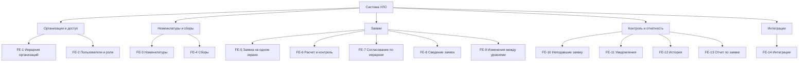

# Документ о концепции и границах кейса

| Поле | Значение |
|------|----------|
| Кейс | 05 - УЛО: управление лекарственным обеспечением |
| Индустриальный партнер | Комитет здравоохранения Волгоградской области (КЗВО) |
| Версия | `0.1-draft` |
| Дата | 2026-10-09 |
| Статус | черновик |
| Авторы | Колузаев К.М. (тимлид), Иванов Р.С., Архипов А.А. |

## 1. Введение

### Кейс
05 - УЛО: управление лекарственным обеспечением.
Партнер: Комитет здравоохранения Волгоградской области (КЗВО).

### Суть
Заменяем ручной сбор заявок в Excel и согласование в чатах единой программной средой.

Работник создает заявку в системе. Система сама считает сумму и проверяет ограничения.
Модератор заявок проверяет и сводит заявки. Маршрут согласования идет снизу вверх по иерархии.

### Проблема
Сейчас каждый ведет свою таблицу. Проверяющий все пересчитывает вручную.
Хронология теряется в мессенджерах. Не видно статусы заявок и тех, кто еще не подал заявку.

### Отличие от текущего способа
Вместо файлов на дисках и переписки - одна система с ролями, статусами и журналом изменений.
Решения по заявкам по-прежнему принимает человек, а система убирает рутину и ошибки.

### Пилот

Система сначала запускается пилотом - пробно, в ограниченном числе организаций, подведомственных КЗВО (до 200 организаций, NFR-P3). На пилоте проверяется, что система работает на рабочих местах заказчика, пользователи осваивают ее, а цели BO-1...BO-4 достигаются. После пилота организации подключаются поэтапно, по мере готовности рабочих мест.

### Термины и сокращения

| Термин | Значение |
|--------|----------|
| УЛО | Управление лекарственным обеспечением: система сбора и согласования заявок на закупку лекарств и других товаров |
| КЗВО | Комитет здравоохранения Волгоградской области, заказчик системы |
| МО | Медицинская организация: больница, поликлиника и другие учреждения здравоохранения |
| ГУП «Волгофарм» | Государственное унитарное предприятие, региональный поставщик лекарственных средств |
| МИС | Медицинская информационная система: программа, в которой медицинская организация ведет пациентов, назначения и расписание |
| «БАРС.Здравоохранение» | МИС, разработанная компанией «БАРС Груп»; «БАРС» - название компании-разработчика |
| ВОМИАЦ | Волгоградский областной медицинский информационно-аналитический центр: региональная организация, отвечающая за медицинские информационные системы области |
| Сбор | Период, в который организации подают заявки; для сбора заданы сроки, финансовый лимит и допустимые категории товаров |
| Номенклатура | Каталог товаров со своим названием и общим набором свойств для всех входящих в него товаров |
| Модератор заявок | Сотрудник, который проверяет заявки нижестоящих сотрудников и возвращает их на доработку или передает выше |
| 44-ФЗ | Федеральный закон от 05.04.2013 № 44-ФЗ «О контрактной системе в сфере закупок товаров, работ, услуг для обеспечения государственных и муниципальных нужд» |
| Дробление закупки | Искусственное разделение одной закупки однородных товаров на несколько мелких, чтобы каждая была ниже порога, до которого закон разрешает покупать у единственного поставщика без торгов. Закон это запрещает, потому что так обходят конкурентный выбор поставщика |
| 152-ФЗ | Федеральный закон от 27.07.2006 № 152-ФЗ «О персональных данных» |
| ЕИС | Единая информационная система в сфере закупок, где проводятся торги по 44-ФЗ |
| REST API | Программный интерфейс, через который другие системы автоматически обмениваются данными с УЛО без участия человека |
| JSON | Текстовый формат передачи данных между программами |
| XLSX, XLS | Форматы файлов Excel: XLSX - современный (Excel 2007 и новее), XLS - устаревший (Excel 97-2003) |
| 95% запросов | Порог, который должны выдерживать 95 из каждых 100 запросов; оставшимся 5 допускаются редкие задержки при пиковой нагрузке |

## 2. Бизнес-контекст и цели

### 2.1. Исходные данные

1. Работник ведет свою таблицу Excel. Он сам проверяет наличие у поставщика.
2. Он сам считает сумму и сравнивает с лимитом.
3. Заявка файлом уходит администратору. Администратор все пересчитывает и сводит вручную.
4. Замечания и согласование идут в мессенджерах. Хронология не восстанавливается.
5. Справочник обновляется вручную. Пропуск обновления дает ошибку с долгим исправлением.
6. Создание заявки разрознено: много вкладок и переключений.
7. Контроль лимитов, превышение лимита блокирует отправку выше.
8. Нет напоминаний об открытых сборах. Нет списка подразделений-должников.
9. Excel зависает на рабочих ПК. Есть план по цифровизации.

Последствия: долго, легко ошибиться, непонятно на каком этапе потерялась заявка.
Ошибки объединения приводят к коллапсам в выдаче. Разбор виновных без журнала невозможен.

### 2.2. Возможности бизнеса

- Единый экран заявки: товары, количество, сумма, лимиты и остатки видны сразу.
- Автопроверки: сумма, разрешенный ассортимент, остатки, сроки сбора.
- Напоминания об открытых сборах.
- Модерация и объединение заявок в системе, без скачивания файлов.
- Контроль должников: видно, кто не отправил заявку.
- Журнал изменений для разбора инцидентов.
- Позже: автоматическая передача номенклатур и цен от поставщиков через программный интерфейс (REST API) и обмен данными с МИС «БАРС.Здравоохранение» для аналитики.

### 2.3. Бизнес-цели

Базовые значения названы заказчиком на интервью, целевые значения - оценка команды (обоснование ниже).

| ID | Цель | Масштаб | Способ измерения | База | План | Обязательный порог | Срок |
|----|------|---------|------------------|------|------|--------------------|------|
| BO-1 | Сократить время подготовки и согласования заявок | Все МО и КЗВО в пилоте | Замер времени: от создания заявки до отправки (подготовка); от отправки до согласования на всех уровнях (согласование) | Подготовка: 4 рабочих дня; согласование: 8-12 рабочих дней; полный цикл: около 14 рабочих дней | Подготовка: 1 рабочий день; согласование: 3 рабочих дня; полный цикл: 4 рабочих дня | Подготовка: не более 2 рабочих дней; согласование: не более 5 рабочих дней; полный цикл: не более 7 рабочих дней | Выпуск 1 + 1 месяц |
| BO-2 | Снизить долю заявок, возвращаемых на доработку | Все заявки пилота | Возвращенные на доработку / всего заявок, по журналу возвратов | 20-25% | Не более 10% | Не более 15% | Выпуск 1 + 1 месяц |
| BO-3 | Перевести все заявки в единую систему вместо Excel, почты и мессенджеров | Все плановые сборы пилота | Заявки, поданные через систему / всего заявок | 0% | 100% | 90% | Выпуск 1 |
| BO-4 | Сделать процесс прозрачным: у каждой заявки виден текущий статус и история действий | Сотрудники, руководители, администраторы | Проверка всех заявок пилота: у каждой есть текущий статус и полная история (кто, когда, что сделал) | Статусов и истории нет: заявки ведутся в Excel и мессенджерах | Все заявки | Все заявки, без исключений | Выпуск 1 |

**Обоснование целевых сроков.** Базовые значения названы заказчиком на интервью: подготовка одной заявки занимает около 4 рабочих дней, согласование сбора в подразделении - 8-12 рабочих дней, доля ошибочных заявок - 20-25%. Основное время подготовки уходит на поиск товаров в номенклатурах, подсчет суммы и многократную проверку. В системе товары выбираются из номенклатуры, сумма считается автоматически, а лимиты, сроки и категории проверяются при отправке, поэтому подготовка сокращается примерно до 1 рабочего дня. Проверяющему больше не нужно заново искать товары у поставщиков, поэтому на рассмотрение заявки на одном уровне отводится не более 1 рабочего дня; при трех уровнях согласования (например, отделение, больница, комитет) это 3 рабочих дня. Полный цикл: 1 + 3 = 4 рабочих дня вместо около 14. Целевая доля возвратов не более 10% (порог 15%) рассчитана так: ошибки из-за превышения лимита, нарушения сроков и неверной категории система не допускает автоматически, остаются только ошибки в составе и количестве товаров, поэтому ожидается снижение примерно вдвое от 20-25%. Результат измеряется через месяц после запуска выпуска 1, чтобы за это время прошел хотя бы один полный сбор. Базовые значения названы заказчиком, целевые значения и сроки измерения - оценка команды, они будут уточнены по итогам пилота.

### 2.4. Видение решения

Для работника МО, который собирает заявку на лекарства, система «УЛО» - это веб-приложение для создания и согласования заявок, которое считает сумму, проверяет лимиты и остатки и ведет статусы.
В отличие от Excel-файлов и чатов, решение держит все в одной системе с ролями и журналом.

## 3. Стейкхолдеры

### 3.1. Профили заинтересованных лиц

| Заинтересованное лицо | Основная ценность | Отношение | Основные интересы | Ограничения |
|-----------------------|-------------------|-----------|-------------------|-------------|
| КЗВО (Комитет здравоохранения Волгоградской области, заказчик) | Прозрачное, управляемое и экономное лекарственное обеспечение | Инициатор, активный сторонник | Прослеживаемость процесса, меньше ошибок и разбирательств, недопущение дробления закупок по 44-ФЗ, целевое расходование средств, единая система вместо файлов и мессенджеров, следование плану цифровизации | Нет бюджета на новое оборудование, массовое обновление рабочих мест маловероятно; данные хранятся на серверах КЗВО и государственного уровня |
| Сотрудник-заявитель | Быстро составить корректную заявку (сейчас около 4 рабочих дней на одну) | Заинтересован | Единый экран, автоматический расчет суммы и проверка ограничений, поиск товаров в номенклатурах, напоминания об открытых сборах | Часть рабочих мест устарела (ПК 2004 г., Windows 2000) |
| Модератор заявок | Свести заявки нижестоящих организаций без ручного пересчета и потерь файлов | Заинтересован | Единая очередь заявок, замечания внутри системы вместо мессенджеров, сведение заявок, видимость неподавших, хронология | Большой объем заявок; число нижестоящих организаций заранее неизвестно (от 1 до 100+) |
| Руководитель (согласующий) | Принять решение по готовой и проверенной заявке | Нейтральное / положительное | Видеть заявку целиком, быстро одобрить или вернуть, передать выше по иерархии | Ограниченное время, ответственность за итоговую закупку; число уровней согласования не ограничено |
| Системный администратор | Выдавать пользователям нужные права без участия программистов | Заинтересован | Конструктор ролей из заложенных действий, создание пользователей своего уровня, несколько ролей у одного человека | Права только вниз по иерархии; принципиально новое действие требует доработки разработчиками |
| Подведомственные организации (больницы, аптеки и др.) | Подать заявку быстро, без ошибок и без юридических рисков | Нейтральное / положительное | Меньше времени на подготовку заявок (сейчас около 4 рабочих дней) и меньше возвратов (сейчас 20-25%); заявки и замечания в одной системе вместо почты и мессенджеров; автоматическая проверка лимита, сроков и категорий, чтобы не нарушить сроки сбора и 44-ФЗ; свои даты сбора внутри срока вышестоящей, чтобы успеть проверить заявки отделений; видеть статус своих заявок | Число организаций неизвестно; разный уровень оснащения рабочих мест; сроки и лимит сбора нарушать нельзя |
| Поставщики (в т.ч. ГУП «Волгофарм») | Актуальные цены и остатки в заявках | Участник процесса | Самостоятельно вести свою номенклатуру (цены, остатки, ассортимент), сохранение истории изменений товаров | Доступ только к своей номенклатуре; сотни тысяч товаров, цены меняются часто |
| Ответственные должностные лица (разбор спорных ситуаций) | Возможность восстановить ход событий | Заинтересованы | История всех решений и действий, страница истории по каждой сущности | Система фиксирует решения, но не ищет виновных; история хранится 3 года |
| ВОМИАЦ | Работа системы в региональном контуре | Участник внедрения | Подключение и сопровождение системы (роль уточнить) | Требования к инфраструктуре не определены |
| МИС «БАРС.Здравоохранение» | Корректный обмен данными для аналитики | Внешняя система | API и тестовый стенд для обмена данными | Интеграция зависит от наличия API и тестового стенда у МИС |
| Тендерный отдел | Получать проверенную потребность для проведения закупок | Потребитель результата | Сводная потребность в удобном виде | Работает вне системы: тендеры и контракты в систему не входят |

### 3.2. Матрица влияния / интереса

| Стейкхолдер | Влияние (низкое / среднее / высокое) | Интерес (низкий / средний / высокий) | Стратегия работы |
|-------------|--------------------------------------|--------------------------------------|------------------|
| КЗВО (Комитет здравоохранения Волгоградской области, заказчик) | Высокое | Высокий | Управлять тесно: регулярные согласования, приемка по критериям |
| Сотрудник-заявитель | Среднее | Высокий | Интервью, тестирование прототипа, обратная связь по удобству |
| Модератор заявок | Среднее | Высокий | Включить в проектирование, основной источник требований |
| Руководитель (согласующий) | Высокое | Средний | Вовлекать в проектирование сценария согласования, показывать прототипы |
| Системный администратор | Среднее | Высокий | Согласовать модель ролей и иерархии, показать конструктор ролей на прототипе |
| Подведомственные организации (больницы, аптеки и др.) | Низкое | Средний | Информировать, обучать перед запуском |
| Поставщики (в т.ч. ГУП «Волгофарм») | Среднее | Высокий | Вовлечь в проектирование номенклатур: согласовать состав полей, права доступа и порядок изменения цен |
| Ответственные должностные лица (разбор спорных ситуаций) | Среднее | Средний | Согласовать состав истории и срок хранения, показывать страницы истории |
| ВОМИАЦ (Волгоградский областной медицинский информационно-аналитический центр) | Среднее | Средний | Уточнить роль и требования к развертыванию, держать в курсе |
| МИС «БАРС.Здравоохранение» | Низкое | Низкий | Информировать; запросить API и тестовый стенд для интеграции |
| Тендерный отдел | Среднее | Средний | Согласовать состав и формат сводной потребности, передаваемой для закупки |

## 4. Функциональные требования

### 4.1. Основные функции

| ID | Функция | Краткое описание |
|----|---------|------------------|
| FE-1 | Управление иерархией организаций | Создание организаций и подразделений в иерархии любой глубины; привязка пользователей и сборов; права и сборы распространяются только вниз |
| FE-2 | Управление пользователями и ролями | Вход по логину и паролю; пользователей создает администратор своего уровня иерархии; роль - набор заранее заложенных действий, собирается в конструкторе ролей без программистов; несколько ролей у одного пользователя; временная блокировка входа после неверных вводов пароля |
| FE-3 | Ведение номенклатур | Поставщик ведет свою номенклатуру и видит только ее; номенклатуры организаций без привязки к поставщику (без цен или с примерными ценами); произвольные свойства товаров и гибкие категории; ввод в системе и импорт из файла; проверка на дубли |
| FE-4 | Управление сборами | Вышестоящая организация создает сбор: даты, финансовый лимит сбора, допустимые категории товаров; нижестоящие организации задают свои даты внутри срока вышестоящей |
| FE-5 | Создание заявки на едином экране | Выбор товаров из номенклатур и ввод количества; на одном экране видны состав заявки, итог, остаток лимита сбора, срок и допустимые категории |
| FE-6 | Автоматический расчет и контроль ограничений | Подсчет стоимости позиций и заявки; блокировка отправки заявки выше при превышении лимита сбора, недопустимой категории товара или истекшем сроке сбора |
| FE-7 | Согласование заявок по иерархии | Маршрут любой глубины (например, врач, заведующий отделением, главный врач, комитет); статусы заявки; замечания и возврат на доработку внутри системы; доработка и повторная отправка заявки; передача одобренной заявки выше |
| FE-8 | Сведение заявок | Объединение одобренных заявок нижестоящих организаций в сводную заявку вышестоящей в пределах одного сбора без ручного пересчета |
| FE-9 | Согласование изменений между уровнями иерархии | Если заявку изменили на верхнем уровне, нижестоящие уровни узнают об этом и заявки приводятся в согласованное состояние (механизм определить) |
| FE-10 | Контроль неподавших заявку | Вышестоящая организация видит организации и пользователей, не сдавших заявку по сбору |
| FE-11 | Уведомления и напоминания | Электронная почта, мессенджер Max и уведомления в системе; об открытых сборах, приближении срока и статусе заявки |
| FE-12 | История изменений | История всех действий (заявки, сборы, пользователи, роли, номенклатуры, товары) хранится 3 года; у каждой сущности страница истории; записи нельзя изменить или удалить |
| FE-13 | Отчет по заявке | Кто и когда создал, кто одобрил или отклонил, товары, количество, стоимость каждого товара и общая стоимость; выгрузка в XLSX и PDF |
| FE-14 | Интеграция с внешними системами | REST API для номенклатур поставщиков и обмен с МИС «БАРС.Здравоохранение» для аналитики |

### 4.2. Дерево функций

### 4.3. Пользовательские истории / варианты использования

| Основное действующее лицо | Варианты использования |
|---------------------------|------------------------|
| Сотрудник-заявитель | UC-1. Создать заявку; UC-11. Доработать заявку |
| Модератор заявок | UC-2. Проверить заявку и вернуть или передать выше; UC-3. Свести заявки в сводную; UC-4. Открыть сбор и задать ограничения; UC-5. Вести номенклатуру (номенклатуры организации); UC-6. Контролировать неподавших заявку |
| Руководитель (согласующий) | UC-7. Согласовать заявку; UC-8. Согласовать изменение заявки между уровнями иерархии |
| Системный администратор | UC-9. Управлять организациями, пользователями и ролями |
| Поставщики | UC-5. Вести номенклатуру |
| Ответственные должностные лица (разбор спорных ситуаций) | UC-10. Просмотреть историю и получить отчет по заявке |

### 4.4. Детальный сценарий (минимум один)

#### UC-1. Создать заявку

| Поле | Значение |
|------|----------|
| Автор / дата | Иванов Р.С. / 2026-10-24 |
| Основное действующее лицо | Сотрудник-заявитель |
| Дополнительные действующие лица | Модератор заявок (получатель заявки) |
| Описание | Сотрудник формирует заявку в рамках открытого сбора: выбирает товары из номенклатур, указывает количество, система считает стоимость и проверяет ограничения, после чего заявка отправляется на согласование |
| Условие-триггер | Сотрудник получил напоминание об открытом сборе или открыл список открытых сборов |
| Предварительные условия | PRE-1. Пользователь авторизован и имеет роль, разрешающую создавать заявки. PRE-2. Сбор открыт для организации сотрудника, срок не истек. PRE-3. В номенклатурах есть товары допустимых категорий. |
| Выходные условия | POST-1. Заявка сохранена в статусе «На согласовании». POST-2. Получатель заявки уведомлен. POST-3. Действия записаны в историю. |
| Приоритет | высокий |
| Частота использования | Каждый сбор, каждым сотрудником, составляющим заявки |
| Бизнес-правила | BR-1. Стоимость заявки вместе с остальными заявками сбора не превышает лимит сбора. BR-2. В заявку допускаются только товары категорий, разрешенных для сбора. BR-3. Количество товара не превышает остаток, указанный поставщиком. BR-4. Отправка возможна только в сроки сбора организации; после окончания срока исправить заявку нельзя. |

**Нормальное направление**

1. Сотрудник открывает список открытых сборов своей организации и выбирает нужный.
2. Система создает черновик заявки и показывает единый экран: каталог товаров, состав заявки, итоговую стоимость, остаток лимита сбора, срок сбора и допустимые категории.
3. Сотрудник находит товар в номенклатуре, добавляет его в заявку и указывает количество.
4. Система пересчитывает стоимость позиции и заявки, проверяет BR-1, BR-2, BR-3 и показывает остаток лимита.
5. Сотрудник повторяет шаги 3-4 для остальных позиций.
6. Сотрудник нажимает «Отправить».
7. Система повторно проверяет все ограничения, включая срок (BR-4), меняет статус на «На согласовании», уведомляет получателя и записывает действия в историю.

**Альтернативные направления**

- 1.1 Заявка возвращена на доработку: сотрудник дорабатывает ее по сценарию UC-11.
- 3.1 Сотрудник сохраняет черновик и возвращается к нему позже.
- 3.2 Сотрудник ищет товар по названию или фильтрует по категории и номенклатуре.
- 3.3 Товар взят из номенклатуры организации без цены или с примерной ценой: система помечает позицию как ориентировочную.

**Исключения**

- 4.0.E1 Товар не относится к разрешенной категории: система не добавляет его и объясняет причину.
- 4.0.E2 Стоимость превышает остаток лимита сбора: система предупреждает, отправка блокируется до исправления.
- 4.0.E3 Количество превышает остаток у поставщика: система показывает доступное количество и просит скорректировать.
- 7.0.E1 Срок сбора истек: отправка блокируется, исправить заявку нельзя (BR-4).
- 7.0.E2 Цена или остаток товара изменились с момента добавления (поставщик изменил номенклатуру): система предупреждает и просит пересмотреть позицию.

**Другая информация**

- Все необходимое для составления заявки должно быть на одном экране, без переключения между вкладками и файлами (NFR-U1).
- Отдельного типа экстренных заявок нет: срочность задается только более коротким сроком сбора.
- Сейчас составление одной заявки занимает около 4 рабочих дней (интервью с заказчиком); сокращение времени проверяется критерием SM-1.

**Предположения**

- Сотрудник относится к одной организации.
- Перечень статусов заявки (черновик, на согласовании, возвращена на доработку, одобрена, отклонена) нужно уточнить у заказчика.
- Уведомления приходят по каналам из FE-11: электронная почта, мессенджер Max, уведомления в системе.

### 4.5. Сжатые сценарии (по образцу Вигерса)

#### UC-2. Проверить заявку и вернуть или передать выше

- Описание: модератор заявок просматривает заявки нижестоящих сотрудников, проверяет их, оставляет замечания и либо возвращает на доработку, либо передает дальше по маршруту согласования.
- Исключения: заявка уже обработана другим модератором того же уровня.
- Приоритет: высокий
- Бизнес-правила: BR-5. Замечания к заявке фиксируются только в системе. BR-7. Права и видимость распространяются только вниз по иерархии.
- Другая информация: проверяющему не нужно заново искать товары у поставщиков, так как система уже проверила лимит, категории и остатки (BR-1, BR-2, BR-3). Хронология замечаний и решений доступна в карточке заявки. Возвращенную заявку сотрудник дорабатывает по UC-11.

#### UC-3. Свести заявки в сводную

- Описание: модератор заявок выбирает одобренные заявки нижестоящих организаций в рамках сбора; система формирует сводную заявку без ручного пересчета и передает ее вышестоящей организации.
- Исключения: среди выбранных есть неодобренные заявки; позиции дублируются в нескольких заявках; сводная стоимость превышает лимит сбора вышестоящей организации.
- Приоритет: высокий
- Бизнес-правила: BR-1; BR-7; объединяются только одобренные заявки; одинаковые позиции суммируются по количеству.
- Другая информация: сведение идет вверх по иерархии в пределах одного сбора и исключает разрозненные закупки одних и тех же товаров (NFR-L1, RI-9). Контракты не объединяются (LI-6).

#### UC-4. Открыть сбор и задать ограничения

- Описание: организация открывает сбор: задает даты, финансовый лимит сбора и допустимые категории товаров; нижестоящие организации видят сбор и задают свои даты внутри его срока; система уведомляет участников.
- Исключения: даты нижестоящей организации выходят за срок вышестоящей; пересечение с другим открытым сбором для той же организации (уточнить).
- Приоритет: высокий
- Бизнес-правила: BR-1; BR-2; BR-6. Даты сбора нижестоящей организации лежат внутри срока вышестоящей. BR-9 (изменение ограничений фиксируется в истории).
- Другая информация: сроки и лимит нарушить нельзя (LI-7). Кто именно в организации открывает сбор, зависит от настроенных ролей (уточнить).

#### UC-5. Вести номенклатуру

- Описание: поставщик создает и изменяет товары, цены и остатки своей номенклатуры, а модератор заявок ведет номенклатуры своей организации; система сохраняет историю изменений товаров и уведомляет авторов заявок, затронутых изменением.
- Исключения: дубль или нарушение уникальности товара; ошибка формата при загрузке из файла; попытка изменить чужую номенклатуру (отклоняется).
- Приоритет: высокий
- Бизнес-правила: BR-8. Поставщик изменяет только свою номенклатуру. BR-9.
- Другая информация: в выпуске 1 ввод в системе и импорт из файла, в выпуске 2 REST API (NFR-C2). Поля товара задает тот, кто создает номенклатуру; допускаются номенклатуры организации без цен или с примерными ценами. Изменение номенклатуры не должно молча менять уже отправленные заявки (проектное решение, подтвердить с заказчиком).

#### UC-6. Контролировать неподавших заявку

- Описание: вышестоящая организация видит нижестоящие организации и пользователей, не сдавших заявку по сбору, и может отправить им напоминание.
- Исключения: у пользователя не настроен канал уведомлений (AS-3).
- Приоритет: средний
- Бизнес-правила: BR-7; ожидаемые участники определяются настройками сбора (UC-4).
- Другая информация: видимость не сдавших заявку проверяется при приемке выпуска 1 (AC-1). Каналы уведомлений: электронная почта, мессенджер Max, уведомления в системе.

#### UC-7. Согласовать заявку

- Описание: руководитель просматривает заявку целиком, одобряет ее или возвращает с комментарием; одобренная заявка передается на уровень выше.
- Исключения: срок сбора истек до принятия решения, одобрение невозможно (BR-4).
- Приоритет: высокий
- Бизнес-правила: BR-4; BR-5; возврат или отклонение только с комментарием (проектное решение).
- Другая информация: маршрут любой глубины: заведующий отделением, главный врач больницы, комитет области и выше. Возвращенную заявку сотрудник дорабатывает по UC-11. Делегирование на время отсутствия не определено (уточнить).

#### UC-8. Согласовать изменение заявки между уровнями иерархии

- Описание: руководитель верхнего уровня изменяет заявку (например, количество товара); система уведомляет нижестоящие уровни и приводит их заявки в согласованное состояние.
- Исключения: нижестоящая организация уже передала заявку выше; срок сбора нижестоящей организации истек (BR-4).
- Приоритет: высокий
- Бизнес-правила: BR-4. BR-9. Записи истории нельзя изменить или удалить, хранятся 3 года. BR-10. Изменение заявки на верхнем уровне отражается на нижестоящих (механизм определить).
- Другая информация: заказчик попросил продумать этот механизм, готового решения нет. Варианты (автоматическое обновление нижних заявок или возврат им на подтверждение) нужно согласовать с заказчиком; сценарий связан с риском RI-7.

#### UC-9. Управлять организациями, пользователями и ролями

- Описание: системный администратор создает организации и подразделения в иерархии и пользователей своего уровня, собирает роли из заранее заложенных действий в конструкторе ролей и назначает пользователю одну или несколько ролей.
- Исключения: попытка создать пользователя вне своей ветви иерархии (отклоняется); нужно действие, которого нет в системе (требуется доработка разработчиками); блокировка учетной записи после неверных вводов пароля (снимает администратор или истечение времени, NFR-S4).
- Приоритет: высокий
- Бизнес-правила: BR-7; BR-9; BR-11. Роль состоит только из заранее заложенных действий.
- Другая информация: в малых организациях один человек может совмещать несколько ролей. Администратор не видит вышестоящие и соседние организации (NFR-S5).

#### UC-10. Просмотреть историю и получить отчет по заявке

- Описание: пользователь с нужной ролью открывает страницу истории сущности (заявка, сбор, пользователь, роль, номенклатура, товар) и видит, кто, когда и что менял; для заявки формирует отчет.
- Исключения: нет прав на просмотр данных организации вне своей ветви иерархии.
- Приоритет: высокий
- Бизнес-правила: BR-7; BR-9.
- Другая информация: отчет содержит автора и время создания заявки, кто ее одобрил или отклонил, товары, количество, стоимость каждого товара и общую стоимость; выгрузка в XLSX и PDF (NFR-C4). Система фиксирует решения, но не ищет виновных: это ответственность должностных лиц.

#### UC-11. Доработать заявку

- Описание: сотрудник-заявитель изменяет свою заявку: дополняет черновик, отзывает отправленную заявку, которую еще не начали проверять, или исправляет заявку, возвращенную на доработку, с учетом замечаний проверяющего, и снова отправляет ее на согласование.
- Нормальное направление: 1. Сотрудник получает уведомление о возврате заявки и открывает ее. 2. Система показывает заявку и замечания проверяющего. 3. Сотрудник исправляет товары или количество. 4. Система пересчитывает стоимость и проверяет BR-1, BR-2, BR-3. 5. Сотрудник отправляет заявку. 6. Система проверяет срок (BR-4), сохраняет новую версию заявки, меняет статус на «На согласовании» и уведомляет проверяющего.
- Альтернативные направления: заявка в статусе «Черновик» - сотрудник изменяет и отправляет ее, как в UC-1; заявка отправлена, но проверка еще не начата - сотрудник отзывает ее, заявка возвращается в статус «Черновик», проверяющий получает уведомление.
- Исключения: срок сбора истек - изменить и отправить заявку нельзя (BR-4); заявка уже проверяется - отозвать нельзя, сотрудник ждет решения; заявка одобрена - изменить ее может только вышестоящий уровень (UC-8); превышен лимит сбора или выбран товар не той категории - отправка блокируется.
- Приоритет: высокий
- Бизнес-правила: BR-1; BR-2; BR-3; BR-4; BR-5; BR-9.
- Другая информация: сейчас около 20-25% заявок возвращаются на доработку (интервью с заказчиком), цель - не более 10% (BO-2). Все версии заявки и замечания сохраняются в истории, поэтому видно, что изменилось после возврата.

## 5. Нефункциональные требования

Требования сформулированы по материалам заказчика (письмо КЗВО, протокол совещания от 27.06.2025, дорожные карты, опросники) и уточнены в ходе интервью с заказчиком. Значения с источником «оценка команды» заказчиком не задавались; их обоснование приведено в 5.1.

| ID | Категория | Требование | Метрика / порог | Источник |
|----|-----------|------------|-----------------|----------|
| NFR-P1 | Производительность | Экран заявки с каталогом открывается быстро, итог и остаток лимита пересчитываются сразу после изменения позиции | открытие не более 3 с, пересчет не более 1 с для 95% запросов на рабочем месте минимальной конфигурации (7.4) | Оценка команды (5.1); письмо КЗВО: Excel зависает, заявки должны составляться быстрее |
| NFR-P2 | Производительность | Поиск товара по номенклатуре | не более 2 с при номенклатуре до 500 000 позиций | Интервью с заказчиком: у поставщика сотни тысяч товаров; значения - оценка команды (5.1) |
| NFR-P3 | Масштабируемость | Система работает при любом числе организаций и любой глубине иерархии без изменения кода; выдерживает пиковую нагрузку в последний день сбора | пилот: до 200 организаций и не менее 200 одновременных пользователей; проектная емкость: до 1 000 организаций, до 10 уровней иерархии, до 20 000 пользователей | Интервью с заказчиком: организаций может быть от одной до ста и больше, число уровней не ограничено; значения - оценка команды (5.1) |
| NFR-A1 | Доступность | Система доступна в рабочее время в период сбора | не менее 99% времени с 8:00 до 18:00 по рабочим дням | Оценка команды (5.1); интервью с заказчиком: сроки сбора нарушать нельзя |
| NFR-A2 | Надежность | Ежедневное резервное копирование всей базы данных: заявки, сборы, номенклатуры, пользователи, роли и история действий. При сбое база восстанавливается из последней копии; теряются только изменения, внесенные после нее | копия создается раз в сутки в нерабочее время и хранится на отдельном носителе; при сбое могут быть потеряны только изменения за время после последней копии, не более 24 часов | Оценка команды (5.1); письмо КЗВО: на сервере уже есть RAID 5 и ленточная библиотека |
| NFR-S1 | Безопасность | Вход по логину и паролю; ролевая модель: роль - набор разрешенных действий; администратор собирает роли из заранее заложенных действий без участия программистов; пользователю можно назначить несколько ролей | 100% действий доступны только через роли; новая роль создается без изменения кода | Интервью с заказчиком: конструктор ролей, совмещение должностей в малых больницах |
| NFR-S2 | Безопасность | Полная история всех действий: заявки, сборы, пользователи, роли, номенклатуры и товары; у каждой сущности есть страница истории изменений; записи нельзя изменить или удалить | хранение 3 года | Интервью с заказчиком; письмо КЗВО: разбор инцидентов |
| NFR-S3 | Безопасность | Защита персональных данных пользователей (ФИО, должность, организация, электронная почта, учетная запись в мессенджере Max): собираются только данные, необходимые для работы системы; не передаются третьим лицам; доступ к ним только по ролям; хранятся на серверах в РФ (NFR-S6); после удаления пользователя хранятся только в истории действий в течение срока ее хранения (3 года), затем удаляются; все соединения защищены | HTTPS на 100% соединений; 0 полей персональных данных сверх перечисленных; 100% запросов к персональным данным без нужной роли отклоняются | Федеральный закон № 152-ФЗ «О персональных данных»; интервью с заказчиком: серверы в РФ, история 3 года |
| NFR-S4 | Безопасность | Защита от подбора пароля: временная блокировка учетной записи после серии неверных вводов | после 5 неверных вводов за 1 мин - блокировка на 1 мин, затем 5 мин, 10 мин, 1 час; досрочно снимает администратор | Интервью с заказчиком: требования безопасности государственных систем |
| NFR-S5 | Безопасность | Иерархическая видимость: пользователь и администратор видят и управляют только своей организацией и нижестоящими; доступа к вышестоящим и соседним организациям и к другим регионам нет | 100% запросов к чужим ветвям иерархии отклоняются | Интервью с заказчиком |
| NFR-S6 | Безопасность | Размещение серверов на территории РФ, на мощностях главной организации региона (КЗВО) или государственного уровня, в физически защищенном месте (сейф, закрытый на ключ) | соответствие при приемке инфраструктуры | Интервью с заказчиком: требования к серверам государственных систем |
| NFR-S7 | Безопасность | Поставщик имеет доступ только к своей номенклатуре; изменять ее может только он | 100% попыток изменить чужую номенклатуру отклоняются | Интервью с заказчиком |
| NFR-L1 | Соответствие законодательству | Все заявки сбора подаются только через систему и сводятся вверх по иерархии в одну сводную потребность по каждой категории товаров (FE-8); суммарная потребность организации по однородным товарам видна целиком, что не дает разделить ее на несколько мелких закупок | 100% заявок сбора входят в сводную потребность; одинаковые позиции суммируются по количеству | Интервью с заказчиком: без единой системы закупки могут признать дроблением по 44-ФЗ (определение дробления - в разделе 1) |
| NFR-C1 | Единый стиль | Все роли и все организации работают в одном веб-интерфейсе через браузер, без установки программ на рабочие места | актуальные версии браузеров на базе Chromium (в т.ч. Яндекс Браузер) и Firefox | Письмо КЗВО: единая программная среда; интервью с заказчиком: нужна единая система |
| NFR-C2 | Совместимость | Поставщик ведет свою номенклатуру непосредственно в системе; дополнительно - загрузка из файла и обмен через API | выпуск 1 - ведение в системе и импорт из файла; выпуск 2 - REST API, формат JSON | Интервью с заказчиком: поставщик сам заводит и меняет свою номенклатуру; дорожная карта: API для поставщиков |
| NFR-C3 | Совместимость | Обмен данными с МИС «БАРС.Здравоохранение» для аналитики | REST API (выпуск 3) | Протокол: данные из БАРС для аналитики; дорожная карта: API для МИС БАРС |
| NFR-C4 | Совместимость | Выгрузка отчетов по заявкам в файлы | форматы XLSX и PDF | Интервью с заказчиком: нужен отчет по каждой заявке; форматы - оценка команды |
| NFR-C5 | Совместимость | Система работает на рабочих местах минимальной конфигурации; в каждом подразделении, участвующем в сборе, есть хотя бы одно такое место | выполнение NFR-P1 и NFR-P2 на минимальной конфигурации из 7.4 | Интервью с заказчиком: обновить рабочие места можно лишь частично, нужны и надежная работа, и красивый интерфейс |
| NFR-C6 | Совместимость | Импорт номенклатур и выгрузка отчетов в Excel; большие объемы делятся на несколько файлов | формат XLSX; до 500 000 строк данных в одном файле на одном листе; больший объем делится на несколько файлов по 500 000 строк; формат XLS (Excel 97-2003) не используется | Ограничения формата Excel (LI-8); значения - оценка команды (5.1) |
| NFR-E1 | Расширяемость | Номенклатуры с произвольным набором свойств (строка, целое и дробное число, дата, логическое значение, ссылка на другую номенклатуру) и гибкие категории товаров настраиваются без изменения кода; допускаются номенклатуры организаций без привязки к поставщику (без цен или с примерными ценами); система применима не только к медицинским организациям | новое свойство, категория или номенклатура добавляются без участия программистов | Интервью с заказчиком |
| NFR-E2 | Расширяемость | Архитектура допускает добавление процесса поставок в последующих версиях без переработки существующих функций | процесс поставок добавляется как отдельный модуль | Интервью с заказчиком: поставки сейчас не нужны, но будут позднее |
| NFR-U1 | Удобство | Все данные для составления заявки видны на одном экране | в UC-1 не требуется переход между вкладками и файлами | Письмо КЗВО: видно все и сразу |
| NFR-U2 | Удобство | Единый визуальный стиль в духе портала Госуслуг | макет согласован с КЗВО | Дорожная карта: стиль Госуслуг; интервью с заказчиком: нужен красивый интерфейс |
| NFR-U3 | Обучение | Новый сотрудник осваивает составление заявки самостоятельно | не более 1 часа обучения; видеоинструкция не длиннее 5 минут | Оценка команды (5.1); дорожная карта: мануалы и обучение |

### 5.1. Обоснование числовых значений

| Требование | Значение | Обоснование |
|------------|----------|-------------|
| NFR-P1 | пересчет до 1 с, открытие до 3 с, 95% запросов | По границам времени отклика Я. Нильсена: до 0,1 с реакция воспринимается как мгновенная, до 1 с пользователь замечает задержку, но не теряет ход мысли, после 10 с отвлекается. Пересчет выполняется после каждой позиции, поэтому не более 1 с. Экран открывается один раз за работу с заявкой, поэтому допустимо 3 с с запасом до 10 с. Порог задан для 95% запросов, а не для среднего и не для 100%: среднее значение скрывает отдельные долгие задержки, а 100% недостижимо из-за редких пиков нагрузки, например в последний день сбора |
| NFR-P2 | до 2 с при 500 000 позиций | Заказчик назвал объем номенклатуры поставщика в сотни тысяч товаров, 500 000 - верхняя оценка. Поиск - отдельное действие пользователя, поэтому порог выше, чем у пересчета, но значительно ниже 10 с |
| NFR-P3 | пилот 200 организаций и 200 одновременных пользователей; емкость 1 000 организаций, 10 уровней, 20 000 пользователей | Заказчик назвал число организаций от одной до ста и больше; для пилота взят запас в 2 раза. В последний день сбора одновременно работает хотя бы один сотрудник от каждой организации пилота. Проектная емкость в 5 раз больше пилота и рассчитана на всю область, аптеки и немедицинские организации. В примере заказчика 5 уровней иерархии (врач, заведующий отделением, главный врач, комитет области, комитет страны), взят запас в 2 раза. 20 000 пользователей - 1 000 организаций в среднем по 20 пользователей |
| NFR-A1 | 99% с 8:00 до 18:00 | Около 21 рабочего дня по 10 часов - 210 часов в месяц; 1% - не более 2 часов простоя в месяц. Для сбора длительностью 5 рабочих дней это не более 30 минут, что не мешает уложиться в срок. Ночное время не включено: в нем выполняются обновления и резервное копирование |
| NFR-A2 | ежедневно, потеря не более 24 часов | Копия создается ночью, когда в системе никто не работает. При сбое теряются не все данные, а только изменения после последней копии, то есть не более одного рабочего дня, который сотрудники могут восстановить по своим заявкам. Копии хранятся отдельно от сервера (ленточная библиотека заказчика), поэтому поломка сервера не уничтожает копию |
| NFR-C6 | XLSX, до 500 000 строк в файле | Формат XLS вмещает только 65 536 строк и не подходит для номенклатур в сотни тысяч товаров. Предел XLSX - 1 048 576 строк на лист, но такой файл медленно открывается на рабочих местах минимальной конфигурации. 500 000 строк - половина предела и совпадает с объемом номенклатуры из NFR-P2, поэтому номенклатура поставщика помещается в один файл; больший объем делится на несколько файлов |
| NFR-U3 | обучение до 1 часа, видео до 5 минут | Составление заявки - основная операция сотрудника; если ее нельзя освоить за час, интерфейс требует упрощения. Короткие видеоинструкции досматривают до конца, каждое видео описывает одно действие |

## 6. Границы кейса

### 6.1. In Scope

- Иерархия организаций любой глубины; права и видимость только вниз по иерархии (FE-1).
- Пользователи и роли: вход по логину и паролю, конструктор ролей из заранее заложенных действий без участия программистов, несколько ролей у одного пользователя, временная блокировка после неверных вводов пароля (FE-2).
- Номенклатуры: поставщик сам ведет свою номенклатуру в системе и импортирует ее из файла; номенклатуры организаций без привязки к поставщику; произвольные свойства товаров и гибкие категории (FE-3). См. LI-2.
- Сборы: даты, финансовый лимит и допустимые категории товаров задаются сверху, нижестоящие организации устанавливают свои даты внутри срока вышестоящей (FE-4). См. LI-7.
- Создание заявки на едином экране с автоматическим расчетом стоимости и контролем лимита, категорий, остатков и сроков (FE-5, FE-6).
- Доработка заявки: изменение черновика, отзыв отправленной заявки до начала проверки, исправление возвращенной заявки (UC-11).
- Проверка заявки модератором и согласование руководителем по иерархии любой глубины, замечания и возврат на доработку только в системе (FE-7).
- Сведение одобренных заявок в сводную потребность вышестоящей организации; сводная потребность не равна единому контракту (FE-8). См. LI-6.
- Согласование изменений заявки между уровнями иерархии (FE-9).
- Контроль организаций и пользователей, не сдавших заявку (FE-10).
- Уведомления и напоминания о сборах и статусе заявки (FE-11).
- История всех действий со сроком хранения 3 года и страница истории у каждой сущности (FE-12).
- Отчет по заявке с выгрузкой в XLSX и PDF (FE-13).
- Работа только для организаций, подведомственных КЗВО, на период пилота. См. LI-5.

### 6.2. Out of Scope

- LI-1: Тендерные процедуры и заключение контрактов выполняются тендерным отделом вне системы.
- LI-2: Номенклатуру поставщика (состав товаров и цены) изменяет только сам поставщик; организации не могут ее редактировать.
- LI-3: Процесс поставок, складской и бухгалтерский учет, оплата не входят в текущую версию системы; поставки будут добавлены позднее.
- LI-4: Обновление рабочих мест возможно лишь для части организаций и требует отдельного согласования; для большинства бюджет не выделен.
- LI-5: Пилот проводится для организаций, подведомственных КЗВО; пользователь имеет доступ только к своей организации и нижестоящим, доступа к вышестоящим, соседним организациям и другим регионам нет.
- LI-6: Контракты заключаются индивидуально с каждой больницей; система учитывает их как входные данные и объединяет только потребности, но не контракты.
- LI-7: Сроки сбора и финансовый лимит сбора нельзя нарушить ни при каких условиях: это несет юридические риски.
- LI-8: Формат Excel ограничен: в XLSX не более 1 048 576 строк и 16 384 столбцов на лист и не более 32 767 символов в ячейке; в XLS (Excel 97-2003) не более 65 536 строк и 256 столбцов на лист.
- Проведение торгов по 44-ФЗ и 223-ФЗ и интеграция с единой информационной системой в сфере закупок (ЕИС).
- Обмен с МИС «БАРС.Здравоохранение» в выпуске 1 (запланирован в выпуске 3).
- REST API для поставщиков в выпуске 1 (запланирован в выпуске 2).
- Собственный дизайн вне стиля портала Госуслуг.
- Перенос в систему старых заявок из архивов Excel.

### 6.3. Состав первого и последующих выпусков

| Функция | Выпуск 1 - Базовый | Выпуск 2 - API поставщиков | Выпуск 3 - МИС и расширение |
|---------|--------------------|----------------------------|-----------------------------|
| FE-1 Управление иерархией организаций | + | + | + |
| FE-2 Управление пользователями и ролями | + | + | + |
| FE-3 Ведение номенклатур | ведение в системе и импорт из файла | + REST API поставщиков | + |
| FE-4 Управление сборами | + | + | + |
| FE-5 Создание заявки на едином экране | + | + | + |
| FE-6 Автоматический расчет и контроль ограничений | + | + | + |
| FE-7 Согласование заявок по иерархии | + | + | + |
| FE-8 Сведение заявок | + | + | + |
| FE-9 Согласование изменений между уровнями | + | + | + |
| FE-10 Контроль неподавших заявку | + | + | + |
| FE-11 Уведомления и напоминания | в системе и по электронной почте | + мессенджер Max | + |
| FE-12 История изменений | + | + | + |
| FE-13 Отчет по заявке | + | + | + |
| FE-14 Интеграция с внешними системами | - | REST API поставщиков | + МИС «БАРС.Здравоохранение» |
| Внедрение | пилот (до 200 организаций) | поэтапное подключение организаций | все организации, подведомственные КЗВО |

## 7. Ограничения и допущения

### 7.1. Ограничения и исключения

| ID | Формулировка |
|----|--------------|
| LI-1 | Тендерные процедуры и заключение контрактов выполняются тендерным отделом вне системы |
| LI-2 | Номенклатуру поставщика (состав товаров и цены) изменяет только сам поставщик; организации не могут ее редактировать |
| LI-3 | Процесс поставок, складской и бухгалтерский учет, оплата не входят в текущую версию системы; поставки будут добавлены позднее |
| LI-4 | Обновление рабочих мест возможно лишь для части организаций и требует отдельного согласования; для большинства бюджет не выделен |
| LI-5 | Пилот проводится для организаций, подведомственных КЗВО; пользователь имеет доступ только к своей организации и нижестоящим, доступа к вышестоящим, соседним организациям и другим регионам нет |
| LI-6 | Контракты заключаются индивидуально с каждой больницей; система учитывает их как входные данные и объединяет только потребности, но не контракты |
| LI-7 | Сроки сбора и финансовый лимит сбора нельзя нарушить ни при каких условиях: это несет юридические риски |
| LI-8 | Формат Excel ограничен: в XLSX не более 1 048 576 строк и 16 384 столбцов на лист и не более 32 767 символов в ячейке; в XLS (Excel 97-2003) не более 65 536 строк и 256 столбцов на лист |

### 7.2. Предположения и зависимости

| ID | Тип | Формулировка |
|----|-----|--------------|
| AS-1 | допущение | В каждом подразделении, участвующем в сборе, есть или будет выделено хотя бы одно рабочее место минимальной конфигурации (7.4) |
| AS-2 | допущение | Поставщики сами заводят свои номенклатуры в системе и поддерживают актуальность цен и остатков |
| AS-3 | допущение | У каждого пользователя есть хотя бы один канал уведомлений: электронная почта, мессенджер Max или уведомления в самой системе |
| AS-4 | допущение | Вышестоящая организация создает сбор с датами и лимитом до начала работы нижестоящих организаций |
| DE-1 | зависимость | Работа сборов зависит от того, заведут ли поставщики свои номенклатуры до первого сбора |
| DE-2 | зависимость | Интеграция выпуска 3 зависит от наличия API и тестового стенда у МИС «БАРС.Здравоохранение» |
| DE-3 | зависимость | Развертывание зависит от серверных мощностей главной организации региона (КЗВО) и государственного уровня и от выделения защищенного места для сервера |
| DE-4 | зависимость | Уведомления в мессенджер Max зависят от возможности интеграции с ним |

### 7.3. Приоритеты проекта

| Область | Ограничения | Движущая сила | Степень свободы |
|---------|-------------|---------------|-----------------|
| Функции | Все функции выпуска 1 из 6.3 реализуются полностью | | Функции выпусков 2-3 можно переносить |
| Качество | | Сокращение времени подготовки заявки и доли ошибочных заявок - критерии успеха, названные заказчиком | |
| Сроки | Сроки разработки определяются условиями гранта (уточнить у заказчика) | | |
| Расходы | Бюджет разработки ограничен грантом (размер уточнить у заказчика); бюджет на массовое обновление оборудования не выделен | | |
| Персонал | Разработку ведет команда из 3 программистов | | |

### 7.4. Особенности развертывания

**Серверы.** Система размещается на серверах главной организации региона (КЗВО) и государственного уровня, на территории РФ, в физически защищенном месте (NFR-S6). Требований к СУБД заказчик не предъявляет.

**Рабочие места.** У заказчика в основном компьютеры 2004 года: Pentium III 1 ГГц, 256 МБ ОЗУ, Windows 2000 Professional, ЭЛТ-монитор 1024×768. Современные браузеры на Windows 2000 не устанавливаются, а 256 МБ ОЗУ для них недостаточно. Массовое обновление маловероятно (LI-4), поэтому не требуется менять все компьютеры: в каждом подразделении, участвующем в сборе, должно быть хотя бы одно рабочее место минимальной конфигурации (AS-1), на котором составляются и согласуются заявки. Организации подключаются к системе поэтапно, по мере готовности таких рабочих мест.

Минимальная конфигурация рабочего места (оценка команды):

| Компонент | Минимум | Обоснование |
|-----------|---------|-------------|
| Процессор | 2 ядра, от 2 ГГц | Достаточно для работы современного браузера с каталогом номенклатуры |
| Оперативная память | 4 ГБ (рекомендуется 8 ГБ) | Минимум для одновременной работы операционной системы и браузера |
| Накопитель | SSD от 128 ГБ | Устраняет задержки при запуске браузера и открытии страниц |
| Монитор | от 1366×768 | Все данные заявки помещаются на одном экране (NFR-U1) |
| Операционная система | Windows 10/11 или отечественный дистрибутив Linux | Поддерживается актуальными версиями браузеров (NFR-C1) |

На этой конфигурации проверяется выполнение NFR-P1, NFR-P2 и NFR-C5 при приемке (AC-3).

**Обучение и документация.** Видеоинструкции (NFR-U3) и обучающие сессии для пользователей и администраторов; руководства пользователя по ролям; руководство администратора по ролям, иерархии организаций и настройке.

## 8. Риски

| ID | Риск | Вероятность (0-1) | Ущерб (1-10) | Митигация |
|----|------|-------------------|--------------|-----------|
| RI-1 | В части подразделений не окажется ни одного рабочего места минимальной конфигурации, и они не смогут работать в системе | 0,5 | 8 | Учет рабочих мест в организациях пилота до запуска; подключение организаций поэтапно, по мере готовности рабочих мест (7.4); вход по учетной записи с любого подходящего рабочего места своей организации; легкий интерфейс и проверка скорости на минимальной конфигурации (NFR-P1, NFR-C5) |
| RI-2 | Сотрудники продолжат вести заявки в Excel и мессенджерах | 0,4 | 7 | Обучение (NFR-U3); прием заявок только через систему по распоряжению КЗВО; контроль по метрике SM-3 |
| RI-3 | Поставщики не заведут или не будут вовремя обновлять свои номенклатуры (сотни тысяч позиций, частая смена цен) | 0,5 | 7 | Импорт из файла; API в выпуске 2; обучение поставщиков; контроль актуальности по истории изменений товаров |
| RI-4 | Дубли и ошибки в номенклатурах: неверные наименования, нулевые и противоречивые цены | 0,7 | 5 | Проверка номенклатуры на дубли при вводе и загрузке; очистка данных до запуска |
| RI-5 | Требования расширяются (поставки, аналитика, немедицинские организации) и срывают выпуск 1 | 0,5 | 6 | Жесткие границы выпусков (раздел 6); новые пожелания только в выпуски 2-3 |
| RI-6 | Пиковая нагрузка в последний день сбора | 0,4 | 6 | Нагрузочное тестирование по NFR-P3; напоминания о закрытии сбора |
| RI-7 | Изменение заявки на верхнем уровне иерархии не отражается в заявках нижних уровней, и данные расходятся | 0,6 | 7 | Механизм согласования изменений между уровнями в функциональных требованиях (FE-9, UC-8); фиксация всех изменений в истории (NFR-S2) |
| RI-8 | Команда из трех программистов не успеет реализовать выпуск 1 в сроки гранта | 0,5 | 8 | Жесткий состав выпуска 1; перенос остального в выпуски 2-3; конструктор ролей и гибкая номенклатура вместо доработок под каждую организацию |
| RI-9 | Закупку признают дроблением по 44-ФЗ из-за разрозненных заявок | 0,3 | 10 | Сбор заявок только через систему; сводные заявки по иерархии (NFR-L1); лимиты и категории на сбор; полная история действий |

> [!WARNING]
> RI-1 может сорвать приемку выпуска 1: если в подразделениях пилота нет рабочих мест минимальной конфигурации, критерий AC-3 не будет выполнен. Наличие таких рабочих мест в каждой организации пилота нужно подтвердить с КЗВО до запуска пилота.

## 9. Критерии приемки

| ID | Критерий | Как проверяется | Порог | Срок |
|----|----------|-----------------|-------|------|
| SM-1 | Время подготовки и согласования заявок сократилось (BO-1) | По истории действий в системе: время от создания заявки до отправки (подготовка; сейчас около 4 рабочих дней) и от отправки до согласования на всех уровнях (согласование; сейчас 8-12 рабочих дней) | подготовка не более 2 рабочих дней, согласование не более 5 рабочих дней, полный цикл не более 7 рабочих дней (цель: 1, 3 и 4 рабочих дня) | выпуск 1 + 1 месяц |
| SM-2 | Доля заявок, возвращаемых на доработку, снизилась (BO-2) | Доля заявок, возвращенных на доработку, по истории действий в системе (сейчас 20-25%) | не более 15% (цель: не более 10%) | выпуск 1 + 1 месяц |
| SM-3 | Все заявки подаются через единую систему (BO-3) | Число заявок, поданных через систему, к общему числу заявок плановых сборов пилота | не менее 90% (цель: 100%) | выпуск 1 |
| SM-4 | Процесс прозрачен (BO-4) | Проверка всех заявок пилота: у каждой есть текущий статус и полная история действий | все заявки, без исключений | выпуск 1 |
| AC-1 | Функции выпуска 1 реализованы | Чек-лист функций выпуска 1 из 6.3 | 100% | приемка выпуска 1 |
| AC-2 | Качество | Приемочные тесты по вариантам использования выпуска 1 | не менее 95% тестов пройдено; 0 критических дефектов | приемка выпуска 1 |
| AC-3 | Производительность и совместимость на рабочих местах заказчика | Замер NFR-P1 и NFR-P2 и проверка NFR-C1, NFR-C5, NFR-C6 на рабочем месте минимальной конфигурации (7.4); нагрузочное тестирование по NFR-P3 | пороги из раздела 5 | приемка выпуска 1 |
| AC-4 | Безопасность и соответствие законодательству | Проверка NFR-S1...NFR-S7 и NFR-L1: роли, история, блокировка входа, видимость по иерархии, размещение серверов, доступ поставщиков, сведение заявок | 100% требований выполнено | приемка выпуска 1 |
| AC-5 | Документация и обучение | Руководства по ролям, руководство администратора, проведенное обучение | все материалы переданы, обучение проведено | приемка выпуска 1 |

Партнер принимает выпуск 1, если выполнены AC-1...AC-5. Метрики SM-1...SM-4 подтверждают достижение бизнес-целей после запуска: по словам заказчика, успех определяется сокращением времени и доли ошибок. Пороги SM-1...SM-4 совпадают с обязательными порогами BO-1...BO-4, обоснование целевых значений приведено в 2.3.