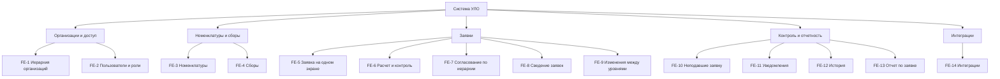

# Документ о концепции и границах кейса

| Поле | Значение |
|------|----------|
| Кейс | 05 - УЛО: управление лекарственным обеспечением |
| Индустриальный партнер | Комитет здравоохранения Волгоградской области (КЗВО) |
| Версия | `0.1-draft` |
| Дата | 2026-10-09 |
| Статус | черновик |
| Авторы | Колузаев К.М. (тимлид), Иванов Р.С., Архипов А.А. |

## 1. Введение

Краткая выжимка сути кейса: для кого система, какую проблему закрывает и чем отличается от текущего способа работы.

## 2. Бизнес-контекст и цели

### 2.1. Исходные данные

Как процесс устроен сейчас, какие потери времени / денег / качества наблюдаются, на каких фактах это основано.

### 2.2. Возможности бизнеса

Что изменится, если решение появится; какие смежные возможности откроются позже.

### 2.3. Бизнес-цели

| ID | Цель | Масштаб | Способ измерения | База | План | Обязательный порог | Срок |
|----|------|---------|------------------|------|------|--------------------|------|
| BO-1 | | | | | | | |
| BO-2 | | | | | | | |
| BO-3 | | | | | | | |

### 2.4. Видение решения

Одно-два предложения в формате: *для [пользователь], который [потребность], [имя системы] — это [тип продукта], который [ключевые возможности]. В отличие от [альтернатива], решение [отличие]*.

## 3. Стейкхолдеры

### 3.1. Профили заинтересованных лиц

| Заинтересованное лицо | Основная ценность | Отношение | Основные интересы | Ограничения |
|-----------------------|-------------------|-----------|-------------------|-------------|
| КЗВО (Комитет здравоохранения Волгоградской области, заказчик) | Прозрачное, управляемое и экономное лекарственное обеспечение | Инициатор, активный сторонник | Прослеживаемость процесса, меньше ошибок и разбирательств, недопущение дробления закупок по 44-ФЗ, целевое расходование средств, единая система вместо файлов и мессенджеров, следование плану цифровизации | Нет бюджета на новое оборудование, массовое обновление рабочих мест маловероятно; данные хранятся на серверах КЗВО и государственного уровня |
| Сотрудник-заявитель | Быстро составить корректную заявку (сейчас около 4 рабочих дней на одну) | Заинтересован | Единый экран, автоматический расчет суммы и проверка ограничений, поиск товаров в номенклатурах, напоминания об открытых сборах | Часть рабочих мест устарела (ПК 2004 г., Windows 2000) |
| Модератор заявок | Свести заявки нижестоящих организаций без ручного пересчета и потерь файлов | Заинтересован | Единая очередь заявок, замечания внутри системы вместо мессенджеров, сведение заявок, видимость неподавших, хронология | Большой объем заявок; число нижестоящих организаций заранее неизвестно (от 1 до 100+) |
| Руководитель (согласующий) | Принять решение по готовой и проверенной заявке | Нейтральное / положительное | Видеть заявку целиком, быстро одобрить или вернуть, передать выше по иерархии | Ограниченное время, ответственность за итоговую закупку; число уровней согласования не ограничено |
| Системный администратор | Выдавать пользователям нужные права без участия программистов | Заинтересован | Конструктор ролей из заложенных действий, создание пользователей своего уровня, несколько ролей у одного человека | Права только вниз по иерархии; принципиально новое действие требует доработки разработчиками |
| Подведомственные организации (больницы, аптеки и др.) | Своевременно и без претензий подать заявку | Нейтральное | Понятный порядок подачи, напоминания о сроках, свои даты внутри срока вышестоящего сбора | Число организаций неизвестно; разный уровень оснащения; сроки и лимит сбора нарушать нельзя |
| Поставщики (в т.ч. ГУП «Волгофарм») | Актуальные цены и остатки в заявках | Участник процесса | Самостоятельно вести свою номенклатуру (цены, остатки, ассортимент), сохранение истории изменений товаров | Доступ только к своей номенклатуре; сотни тысяч товаров, цены меняются часто |
| Ответственные должностные лица (разбор спорных ситуаций) | Возможность восстановить ход событий | Заинтересованы | История всех решений и действий, страница истории по каждой сущности | Система фиксирует решения, но не ищет виновных; история хранится 3 года |
| ВОМИАЦ | Работа системы в региональном контуре | Участник внедрения | Подключение и сопровождение системы (роль уточнить) | Требования к инфраструктуре не определены |
| МИС «БАРС.Здравоохранение» | Корректный обмен данными для аналитики | Внешняя система | API и тестовый стенд для обмена данными |Интеграция зависит от наличия API и тестового стенда у МИС
| Тендерный отдел | Получать проверенную потребность для проведения закупок | Потребитель результата | Сводная потребность в удобном виде | Работает вне системы: тендеры и контракты в систему не входят |

### 3.2. Матрица влияния / интереса

| Стейкхолдер | Влияние (низкое / среднее / высокое) | Интерес (низкий / средний / высокий) | Стратегия работы |
|-------------|--------------------------------------|--------------------------------------|------------------|
| КЗВО (Комитет здравоохранения Волгоградской области, заказчик) | Высокое | Высокий | Управлять тесно: регулярные согласования, приемка по критериям |
| Сотрудник-заявитель | Среднее | Высокий | Интервью, тестирование прототипа, обратная связь по удобству |
| Модератор заявок | Среднее | Высокий | Включить в проектирование, основной источник требований |
| Руководитель (согласующий) | Высокое | Средний | Вовлекать в проектирование сценария согласования, показывать прототипы |
| Системный администратор | Среднее | Высокий | Согласовать модель ролей и иерархии, показать конструктор ролей на прототипе |
| Подведомственные организации (больницы, аптеки и др.) | Низкое | Средний | Информировать, обучать перед запуском |
| Поставщики (в т.ч. ГУП «Волгофарм») | Среднее | Высокий | Вовлечь в проектирование номенклатур: согласовать состав полей, права доступа и порядок изменения цен |
| Ответственные должностные лица (разбор спорных ситуаций) | Среднее | Средний | Согласовать состав истории и срок хранения, показывать страницы истории |
| ВОМИАЦ | Среднее | Средний | Уточнить роль и требования к развертыванию, держать в курсе |
| МИС «БАРС.Здравоохранение» | Низкое | Низкий | Информировать; запросить API и тестовый стенд для интеграции
| Тендерный отдел | Среднее | Средний | Согласовать состав и формат сводной потребности, передаваемой для закупки |

## 4. Функциональные требования

### 4.1. Основные функции

| ID | Функция | Краткое описание |
|----|---------|------------------|
| FE-1 | Управление иерархией организаций | Создание организаций и подразделений в иерархии любой глубины; привязка пользователей и сборов; права и сборы распространяются только вниз |
| FE-2 | Управление пользователями и ролями | Вход по логину и паролю; пользователей создает администратор своего уровня иерархии; роль - набор заранее заложенных действий, собирается в конструкторе ролей без программистов; несколько ролей у одного пользователя; временная блокировка входа после неверных вводов пароля |
| FE-3 | Ведение номенклатур | Поставщик ведет свою номенклатуру и видит только ее; номенклатуры организаций без привязки к поставщику (без цен или с примерными ценами); произвольные свойства товаров и гибкие категории; ввод в системе и импорт из файла; проверка на дубли |
| FE-4 | Управление сборами | Вышестоящая организация создает сбор: даты, финансовый лимит сбора, допустимые категории товаров; нижестоящие организации задают свои даты внутри срока вышестоящей |
| FE-5 | Создание заявки на едином экране | Выбор товаров из номенклатур и ввод количества; на одном экране видны состав заявки, итог, остаток лимита сбора, срок и допустимые категории |
| FE-6 | Автоматический расчет и контроль ограничений | Подсчет стоимости позиций и заявки; блокировка отправки заявки выше при превышении лимита сбора, недопустимой категории товара или истекшем сроке сбора |
| FE-7 | Согласование заявок по иерархии | Маршрут любой глубины (например, врач, заведующий отделением, главный врач, комитет); статусы заявки; замечания и возврат на доработку внутри системы; передача одобренной заявки выше |
| FE-8 | Сведение заявок | Объединение одобренных заявок нижестоящих организаций в сводную заявку вышестоящей в пределах одного сбора без ручного пересчета |
| FE-9 | Согласование изменений между уровнями иерархии | Если заявку изменили на верхнем уровне, нижестоящие уровни узнают об этом и заявки приводятся в согласованное состояние (механизм определить) |
| FE-10 | Контроль неподавших заявку | Вышестоящая организация видит организации и пользователей, не сдавших заявку по сбору |
| FE-11 | Уведомления и напоминания | Электронная почта, мессенджер Max и уведомления в системе; об открытых сборах, приближении срока и статусе заявки |
| FE-12 | История изменений | История всех действий (заявки, сборы, пользователи, роли, номенклатуры, товары) хранится 3 года; у каждой сущности страница истории; записи нельзя изменить или удалить |
| FE-13 | Отчет по заявке | Кто и когда создал, кто одобрил или отклонил, товары, количество, стоимость каждого товара и общая стоимость; выгрузка в XLSX и PDF |
| FE-14 | Интеграция с внешними системами | REST API для номенклатур поставщиков и обмен с МИС «БАРС.Здравоохранение» для аналитики |

### 4.2. Дерево функций

### 4.3. Пользовательские истории / варианты использования

| Основное действующее лицо | Варианты использования |
|---------------------------|------------------------|
| Сотрудник-заявитель | UC-1. Создать заявку |
| Модератор заявок | UC-2. Проверить заявку и вернуть или передать выше; UC-3. Свести заявки в сводную; UC-4. Открыть сбор и задать ограничения; UC-5. Вести номенклатуру (номенклатуры организации); UC-6. Контролировать неподавших заявку |
| Руководитель (согласующий) | UC-7. Согласовать заявку; UC-8. Согласовать изменение заявки между уровнями иерархии |
| Системный администратор | UC-9. Управлять организациями, пользователями и ролями |
| Поставщики | UC-5. Вести номенклатуру |
| Ответственные должностные лица (разбор спорных ситуаций) | UC-10. Просмотреть историю и получить отчет по заявке |

### 4.4. Детальный сценарий (минимум один)

#### UC-1. Создать заявку

| Поле | Значение |
|------|----------|
| Автор / дата | Иванов Р.С. / 2026-10-24 |
| Основное действующее лицо | Сотрудник-заявитель |
| Дополнительные действующие лица | Модератор заявок (получатель заявки) |
| Описание | Сотрудник формирует заявку в рамках открытого сбора: выбирает товары из номенклатур, указывает количество, система считает стоимость и проверяет ограничения, после чего заявка отправляется на согласование |
| Условие-триггер | Сотрудник получил напоминание об открытом сборе, открыл список открытых сборов или получил уведомление о возврате заявки на доработку |
| Предварительные условия | PRE-1. Пользователь авторизован и имеет роль, разрешающую создавать заявки. PRE-2. Сбор открыт для организации сотрудника, срок не истек. PRE-3. В номенклатурах есть товары допустимых категорий. |
| Выходные условия | POST-1. Заявка сохранена в статусе «На согласовании». POST-2. Получатель заявки уведомлен. POST-3. Действия записаны в историю. |
| Приоритет | высокий |
| Частота использования | Каждый сбор, каждым сотрудником, составляющим заявки (периодичность сборов уточнить) |
| Бизнес-правила | BR-1. Стоимость заявки вместе с остальными заявками сбора не превышает лимит сбора. BR-2. В заявку допускаются только товары категорий, разрешенных для сбора. BR-3. Количество товара не превышает остаток, указанный поставщиком. BR-4. Отправка возможна только в сроки сбора организации; после окончания срока исправить заявку нельзя. |

**Нормальное направление**

1. Сотрудник открывает список открытых сборов своей организации и выбирает нужный.
2. Система создает черновик заявки и показывает единый экран: каталог товаров, состав заявки, итоговую стоимость, остаток лимита сбора, срок сбора и допустимые категории.
3. Сотрудник находит товар в номенклатуре, добавляет его в заявку и указывает количество.
4. Система пересчитывает стоимость позиции и заявки, проверяет BR-1, BR-2, BR-3 и показывает остаток лимита.
5. Сотрудник повторяет шаги 3-4 для остальных позиций.
6. Сотрудник нажимает «Отправить».
7. Система повторно проверяет все ограничения, включая срок (BR-4), меняет статус на «На согласовании», уведомляет получателя и записывает действия в историю.

**Альтернативные направления**

- 1.1 Заявка возвращена на доработку: сотрудник открывает ее из списка своих заявок, видит замечания, вносит правки и продолжает с шага 6.
- 3.1 Сотрудник сохраняет черновик и возвращается к нему позже.
- 3.2 Сотрудник ищет товар по названию или фильтрует по категории и номенклатуре.
- 3.3 Товар взят из номенклатуры организации без цены или с примерной ценой: система помечает позицию как ориентировочную.

**Исключения**

- 4.0.E1 Товар не относится к разрешенной категории: система не добавляет его и объясняет причину.
- 4.0.E2 Стоимость превышает остаток лимита сбора: система предупреждает, отправка блокируется до исправления.
- 4.0.E3 Количество превышает остаток у поставщика: система показывает доступное количество и просит скорректировать.
- 7.0.E1 Срок сбора истек: отправка блокируется, исправить заявку нельзя (BR-4).
- 7.0.E2 Цена или остаток товара изменились с момента добавления (поставщик изменил номенклатуру): система предупреждает и просит пересмотреть позицию.

**Другая информация**

- Все необходимое для составления заявки должно быть на одном экране, без переключения между вкладками и файлами (NFR-U1).
- Отдельного типа экстренных заявок нет: срочность задается только более коротким сроком сбора.
- Сейчас составление одной заявки занимает около 4 рабочих дней (интервью с заказчиком); сокращение времени проверяется критерием SM-1.

**Предположения**

- Сотрудник относится к одной организации.
- Перечень статусов заявки (черновик, на согласовании, возвращена на доработку, одобрена, отклонена) нужно уточнить у заказчика.
- Уведомления приходят по каналам из FE-11: электронная почта, мессенджер Max, уведомления в системе.

### 4.5. Сжатые сценарии (по образцу Вигерса)

#### UC-2. Проверить заявку и вернуть или передать выше

- Описание: модератор заявок просматривает заявки нижестоящих сотрудников, проверяет их, оставляет замечания и либо возвращает на доработку, либо передает дальше по маршруту согласования.
- Исключения: заявка уже обработана другим модератором того же уровня.
- Приоритет: высокий
- Бизнес-правила: BR-5. Замечания к заявке фиксируются только в системе. BR-7. Права и видимость распространяются только вниз по иерархии.
- Другая информация: проверяющему не нужно заново искать товары у поставщиков, так как система уже проверила лимит, категории и остатки (BR-1, BR-2, BR-3). Хронология замечаний и решений доступна в карточке заявки.

#### UC-3. Свести заявки в сводную

- Описание: модератор заявок выбирает одобренные заявки нижестоящих организаций в рамках сбора; система формирует сводную заявку без ручного пересчета и передает ее вышестоящей организации.
- Исключения: среди выбранных есть неодобренные заявки; позиции дублируются в нескольких заявках; сводная стоимость превышает лимит сбора вышестоящей организации.
- Приоритет: высокий
- Бизнес-правила: BR-1; BR-7; объединяются только одобренные заявки; одинаковые позиции суммируются по количеству.
- Другая информация: сведение идет вверх по иерархии в пределах одного сбора и исключает разрозненные закупки одних и тех же товаров (NFR-L1, RI-9). Контракты не объединяются (LI-6).

#### UC-4. Открыть сбор и задать ограничения

- Описание: организация открывает сбор: задает даты, финансовый лимит сбора и допустимые категории товаров; нижестоящие организации видят сбор и задают свои даты внутри его срока; система уведомляет участников.
- Исключения: даты нижестоящей организации выходят за срок вышестоящей; пересечение с другим открытым сбором для той же организации (уточнить).
- Приоритет: высокий
- Бизнес-правила: BR-1; BR-2; BR-6. Даты сбора нижестоящей организации лежат внутри срока вышестоящей. BR-9 (изменение ограничений фиксируется в истории).
- Другая информация: сроки и лимит нарушить нельзя (LI-7). Кто именно в организации открывает сбор, зависит от настроенных ролей (уточнить).

#### UC-5. Вести номенклатуру

- Описание: поставщик создает и изменяет товары, цены и остатки своей номенклатуры, а модератор заявок ведет номенклатуры своей организации; система сохраняет историю изменений товаров и уведомляет авторов заявок, затронутых изменением.
- Исключения: дубль или нарушение уникальности товара; ошибка формата при загрузке из файла; попытка изменить чужую номенклатуру (отклоняется).
- Приоритет: высокий
- Бизнес-правила: BR-8. Поставщик изменяет только свою номенклатуру. BR-9.
- Другая информация: в выпуске 1 ввод в системе и импорт из файла, в выпуске 2 REST API (NFR-C2). Поля товара задает тот, кто создает номенклатуру; допускаются номенклатуры организации без цен или с примерными ценами. Изменение номенклатуры не должно молча менять уже отправленные заявки (проектное решение, подтвердить с заказчиком).

#### UC-6. Контролировать неподавших заявку

- Описание: вышестоящая организация видит нижестоящие организации и пользователей, не сдавших заявку по сбору, и может отправить им напоминание.
- Исключения: у пользователя не настроен канал уведомлений (AS-3).
- Приоритет: средний
- Бизнес-правила: BR-7; ожидаемые участники определяются настройками сбора (UC-6).
- Другая информация: видимость не сдавших заявку требуется критерием SM-4. Каналы уведомлений: электронная почта, мессенджер Max, уведомления в системе.

#### UC-7. Согласовать заявку

- Описание: руководитель просматривает заявку целиком, одобряет ее или возвращает с комментарием; одобренная заявка передается на уровень выше.
- Исключения: срок сбора истек до принятия решения, одобрение невозможно (BR-4).
- Приоритет: высокий
- Бизнес-правила: BR-4; BR-5; возврат или отклонение только с комментарием (проектное решение).
- Другая информация: маршрут любой глубины: заведующий отделением, главный врач больницы, комитет области и выше. Делегирование на время отсутствия не определено (уточнить).

#### UC-8. Согласовать изменение заявки между уровнями иерархии

- Описание: руководитель верхнего уровня изменяет заявку (например, количество товара); система уведомляет нижестоящие уровни и приводит их заявки в согласованное состояние.
- Исключения: нижестоящая организация уже передала заявку выше; срок сбора нижестоящей организации истек (BR-4).
- Приоритет: высокий
- Бизнес-правила: BR-4. BR-9. Записи истории нельзя изменить или удалить, хранятся 3 года. BR-10. Изменение заявки на верхнем уровне отражается на нижестоящих (механизм определить).
- Другая информация: заказчик попросил продумать этот механизм, готового решения нет. Варианты (автоматическое обновление нижних заявок или возврат им на подтверждение) нужно согласовать с заказчиком; сценарий связан с риском RI-7.

#### UC-9. Управлять организациями, пользователями и ролями

- Описание: системный администратор создает организации и подразделения в иерархии и пользователей своего уровня, собирает роли из заранее заложенных действий в конструкторе ролей и назначает пользователю одну или несколько ролей.
- Исключения: попытка создать пользователя вне своей ветви иерархии (отклоняется); нужно действие, которого нет в системе (требуется доработка разработчиками); блокировка учетной записи после неверных вводов пароля (снимает администратор или истечение времени, NFR-S4).
- Приоритет: высокий
- Бизнес-правила: BR-7; BR-9; BR-11. Роль состоит только из заранее заложенных действий.
- Другая информация: в малых организациях один человек может совмещать несколько ролей. Администратор не видит вышестоящие и соседние организации (NFR-S5).

#### UC-10. Просмотреть историю и получить отчет по заявке

- Описание: пользователь с нужной ролью открывает страницу истории сущности (заявка, сбор, пользователь, роль, номенклатура, товар) и видит, кто, когда и что менял; для заявки формирует отчет.
- Исключения: нет прав на просмотр данных организации вне своей ветви иерархии.
- Приоритет: высокий
- Бизнес-правила: BR-7; BR-9.
- Другая информация: отчет содержит автора и время создания заявки, кто ее одобрил или отклонил, товары, количество, стоимость каждого товара и общую стоимость; выгрузка в XLSX и PDF (NFR-C4). Система фиксирует решения, но не ищет виновных: это ответственность должностных лиц.

## 5. Нефункциональные требования

| ID | Категория | Требование | Метрика / порог |
|----|-----------|------------|-----------------|
| NFR-P1 | Производительность | | |
| NFR-A1 | Доступность | | |
| NFR-S1 | Безопасность | | |
| NFR-C1 | Совместимость / IT-ландшафт | | |
| NFR-U1 | Удобство использования | | |

## 6. Границы кейса

### 6.1. In Scope

- …

### 6.2. Out of Scope

- …

### 6.3. Состав первого и последующих выпусков

| Функция | Выпуск 1 | Выпуск 2 | Выпуск 3 |
|---------|----------|----------|----------|
| FE-1 | | | |
| FE-2 | | | |

## 7. Ограничения и допущения

### 7.1. Ограничения и исключения

| ID | Формулировка |
|----|--------------|
| LI-1 | |

### 7.2. Предположения и зависимости

| ID | Тип | Формулировка |
|----|-----|--------------|
| AS-1 | допущение | |
| DE-1 | зависимость | |

### 7.3. Приоритеты проекта

| Область | Ограничения | Движущая сила | Степень свободы |
|---------|-------------|---------------|-----------------|
| Функции | | | |
| Качество | | | |
| Сроки | | | |
| Расходы | | | |
| Персонал | | | |

### 7.4. Особенности развертывания

Стек, инфраструктура, обучение пользователей, необходимые изменения смежных систем.

## 8. Риски

| ID | Риск | Вероятность (0–1) | Ущерб (1–10) | Митигация |
|----|------|-------------------|--------------|-----------|
| RI-1 | | | | |

> [!WARNING]
> Риски, которые могут сорвать приемку выпуска 1, вынесите сюда явно.

## 9. Критерии приемки

| ID | Критерий | Как проверяется | Порог | Срок |
|----|----------|-----------------|-------|------|
| SM-1 | | | | |
| AC-1 | | | | |

Партнер принимает работу, если выполнены все критерии со статусом «обязательный» и закрыты In Scope функции выпуска 1.
