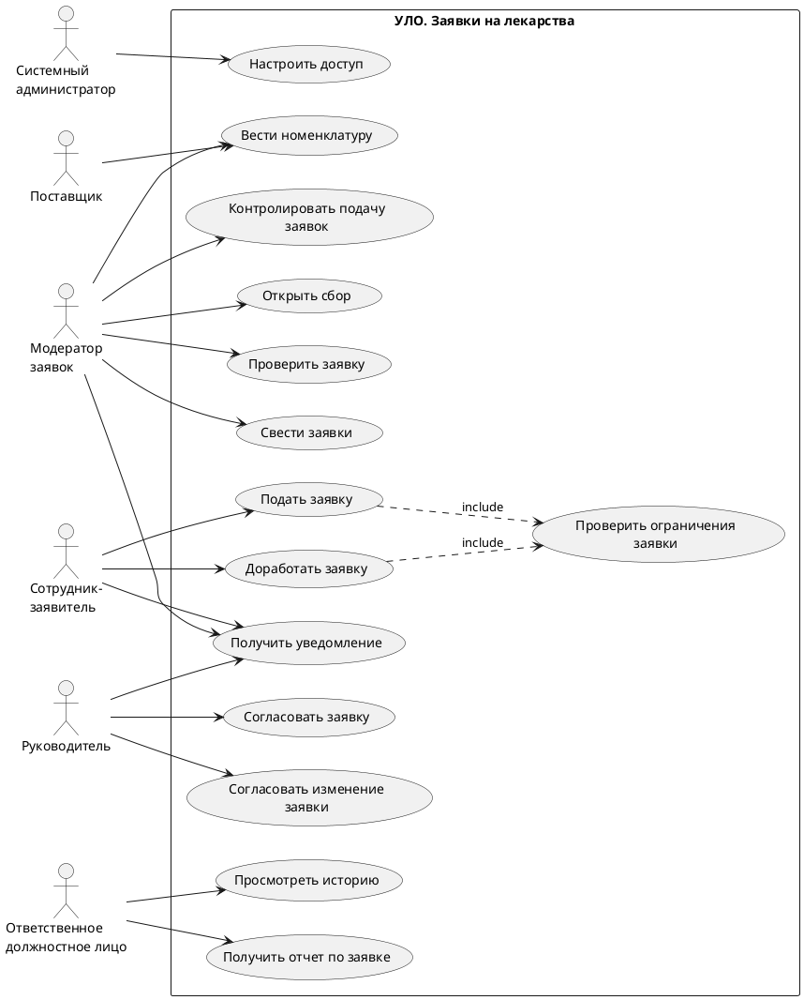
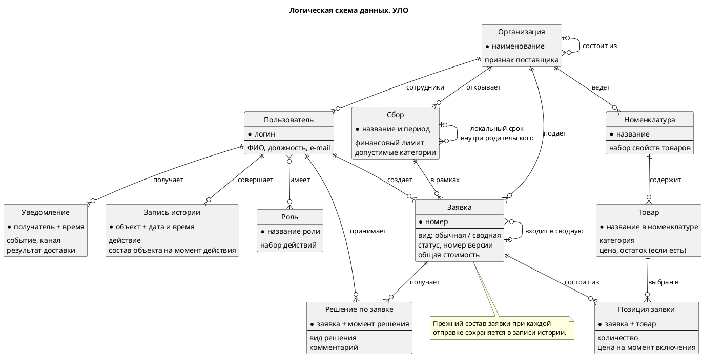

# Документ пользовательских требований. УЛО: управление лекарственным обеспечением

| | |
|------|----------|
| Кейс | 05 |
| Заказчик | Комитет здравоохранения Волгоградской области (КЗВО) |
| Команда | Колузаев К. М. (тимлид), Иванов Р. С., Архипов А. А. |
| Связанный документ концепции | [`case_concept.md`](case_concept.md) (лабораторная работа 1) |

Диаграмма прецедентов: [`diagrams/usecase.puml`](diagrams/usecase.puml).



Исходник тот же, что файл `.puml`.

## 1. Реинжиниринг дерева функций

Исходное дерево из концепции:

```text
Собрать потребность в лекарствах
├── Настроить доступ
│   ├── Создать организацию
│   ├── Создать пользователя
│   ├── Собрать роль
│   └── Назначить роль пользователю
├── Вести номенклатуру
│   ├── Создать номенклатуру
│   ├── Добавить товар
│   ├── Загрузить товары из файла
│   └── Обновить цену и остаток
├── Открыть сбор
│   ├── Задать даты, лимит и категории
│   └── Задать локальный срок нижестоящей организации
├── Подать заявку
│   ├── Выбрать товары и указать количество
│   ├── Рассчитать стоимость
│   └── Отправить на согласование
├── Проверить ограничения заявки
│   ├── Проверить категории
│   ├── Проверить остаток поставщика
│   ├── Проверить лимит сбора
│   └── Проверить срок сбора
├── Доработать заявку
│   ├── Исправить возвращенную заявку
│   └── Отозвать отправленную заявку
├── Проверить заявку
│   ├── Вернуть заявку на доработку
│   └── Передать заявку руководителю
├── Согласовать заявку
│   ├── Одобрить заявку
│   ├── Вернуть заявку на доработку
│   └── Отклонить заявку
├── Свести заявки
│   ├── Выбрать одобренные заявки
│   ├── Объединить одинаковые позиции
│   └── Проверить лимит сводной
├── Согласовать изменение заявки
│   ├── Предложить изменение заявки
│   └── Подтвердить изменение заявки
├── Контролировать подачу заявок
│   ├── Найти неподавших заявку
│   └── Напомнить неподавшим
├── Получить уведомление
│   ├── Определить адресатов
│   ├── Отправить сообщение
│   └── Сохранить результат доставки
├── Просмотреть историю
│   ├── Открыть историю объекта
│   └── Показать записи действий
└── Получить отчет по заявке
    ├── Собрать данные заявки
    └── Выгрузить в XLSX или PDF
```

| ID | Пользовательское требование | Узел дерева | Есть в дереве | Что сделано |
|---|---|---|---|---|
| EP-1 | Администратор создает организации, пользователей и роли в своей ветви иерархии и назначает роли | Настроить доступ | да | оставлен |
| EP-2 | Поставщик и модератор создают номенклатуру, добавляют и обновляют товары вручную или файлом XLSX | Вести номенклатуру | да | оставлен |
| EP-3 | Модератор открывает сбор с датами, лимитом и категориями, нижестоящие задают свои сроки внутри него | Открыть сбор | да | оставлен |
| EP-4 | Сотрудник-заявитель собирает заявку на одном экране из товаров номенклатур и отправляет ее на согласование | Подать заявку | да | оставлен |
| EP-5 | Система проверяет категории, остатки, лимит и срок сбора при подаче и доработке заявки | Проверить ограничения заявки | да | вынесен отдельным эпиком: проверку ограничений используют и подача, и доработка, а не только как шаг подачи |
| EP-6 | Сотрудник-заявитель исправляет возвращенную заявку или отзывает отправленную до начала проверки | Доработать заявку | да | оставлен |
| EP-7 | Модератор проверяет заявку и возвращает ее заявителю с комментарием либо передает руководителю | Проверить заявку | да | оставлен |
| EP-8 | Руководитель одобряет, возвращает или отклоняет заявку с комментарием | Согласовать заявку | да | оставлен |
| EP-9 | Модератор сводит одобренные заявки одного сбора в сводную заявку | Свести заявки | да | оставлен |
| EP-10 | Руководитель верхнего уровня предлагает изменение для согласования с затронутыми организациями | Согласовать изменение заявки | да | оставлен |
| EP-11 | Модератор видит организации и пользователей, не подавших заявку по сбору, и отправляет им напоминание | Контролировать подачу заявок | да | оставлен |
| EP-12 | Заявитель, модератор и руководитель получают уведомления в системе и по электронной почте | Получить уведомление | да | оставлен |
| EP-13 | Ответственное лицо просматривает историю действий по заявке, сбору, пользователю, роли, номенклатуре и товару | Просмотреть историю | да | оставлен |
| EP-14 | Ответственное лицо получает отчет по заявке с автором, решениями, товарами и стоимостью в XLSX или PDF | Получить отчет по заявке | да | оставлен |

Интеграции с внешними системами (REST API поставщиков, обмен с МИС «БАРС.Здравоохранение»), тендеры, контракты, поставки, склад и бухгалтерия в дереве концепта нет, в эпики их не добавляли: в границах кейса они вне рамок.

Новых узлов не добавляли. Узел проверки ограничений покрывает подачу и повторную отправку. В ветке «Согласовать изменение заявки» узел «Подтвердить изменение заявки» уточняется до «Применить изменение по согласованному правилу» (OQ-01).

## 2. Диаграмма и соответствие

| Узел дерева | Вариант использования | Актор |
|---|---|---|
| Настроить доступ | UC-1 Настроить доступ | Системный администратор |
| Вести номенклатуру | UC-2 Вести номенклатуру | Поставщик, Модератор заявок |
| Открыть сбор | UC-3 Открыть сбор | Модератор заявок |
| Подать заявку | UC-4 Подать заявку | Сотрудник-заявитель |
| Проверить ограничения заявки | UC-5 Проверить ограничения заявки | include из UC-4, UC-6 |
| Доработать заявку | UC-6 Доработать заявку | Сотрудник-заявитель |
| Проверить заявку | UC-7 Проверить заявку | Модератор заявок |
| Согласовать заявку | UC-8 Согласовать заявку | Руководитель |
| Свести заявки | UC-9 Свести заявки | Модератор заявок |
| Согласовать изменение заявки | UC-10 Согласовать изменение заявки | Руководитель |
| Контролировать подачу заявок | UC-11 Контролировать подачу заявок | Модератор заявок |
| Получить уведомление | UC-12 Получить уведомление | Сотрудник-заявитель, Модератор заявок, Руководитель |
| Просмотреть историю | UC-13 Просмотреть историю | Ответственное должностное лицо |
| Получить отчет по заявке | UC-14 Получить отчет по заявке | Ответственное должностное лицо |

UC-5 включается в подачу и повторную отправку заявки после доработки. Отзыв описан в EP-6 как связанное действие и выполняется без UC-5. Запись в историю и отправка уведомлений описаны в шагах сценариев.

## 3. Эпики

### EP-1. Настроить доступ

- Уровень: эпик
- Узел дерева: Настроить доступ (FE-1, FE-2)
- Бизнес-цель: BO-3
- Источник: КЗВО, системный администратор
- Приоритет: Must

**Пользовательская история.** Как системный администратор, я хочу создать организации, пользователей и роли в своей ветви иерархии и назначить роли, чтобы сотрудники получили нужные полномочия и не видели чужие организации.

**Сценарий UC-1.**

| Поле | Содержание |
|---|---|
| Акторы | Системный администратор |
| Предусловия | Администратор вошел; его права действуют на свою и нижестоящие организации |
| Триггер | Нужно добавить организацию или сотрудника либо изменить права |
| Постусловие успеха | Организации, пользователи и роли сохранены, действие записано в историю |
| Постусловие отказа | Ничего не изменено, причина показана |

Основной поток:

1. Администратор открывает организации и пользователей своей ветви.
2. Создает организацию или подразделение и указывает родительскую.
3. Создает пользователя: логин, ФИО, должность, электронная почта, организация.
4. При необходимости собирает роль из заранее заложенных действий.
5. Назначает пользователю одну или несколько ролей.
6. Система проверяет полномочия и отсутствие цикла, сохраняет изменения и пишет историю.

Альтернативы:

1. Администратор блокирует пользователя или досрочно снимает блокировку.
2. Администратор меняет сведения организации или набор действий роли.
3. Администратор отмечает организацию как поставщика.

Исключения:

1. Родитель вне ветви, цикл в иерархии или назначение прав на чужую организацию. Операция отклоняется (NFR-S5).
2. Если нужного права нет в списке доступных прав, администратор не может добавить его к роли. Новое право добавляют разработчики при обновлении системы.
3. После 5 неверных паролей за 1 минуту вход блокируется на 1 минуту, затем на 5 минут, 10 минут и 1 час (NFR-S4).

### EP-2. Вести номенклатуру

- Уровень: эпик
- Узел дерева: Вести номенклатуру (FE-3)
- Бизнес-цель: BO-1
- Источник: Поставщики, модераторы
- Приоритет: Must

**Пользовательская история.** Как поставщик или модератор организации, я хочу вести свою номенклатуру: создавать каталог, добавлять и обновлять товары, чтобы заявители выбирали товары с актуальными ценами и остатками.

**Сценарий UC-2.**

| Поле | Содержание |
|---|---|
| Акторы | Поставщик; модератор заявок |
| Предусловия | Пользователь вошел и имеет право вести эту номенклатуру |
| Триггер | Нужно создать каталог, добавить товар, изменить цену или остаток |
| Постусловие успеха | Изменения сохранены, действие записано в историю, авторы затронутых заявок уведомлены |
| Постусловие отказа | Ошибочные данные не применены, ошибки показаны |

Основной поток:

1. Пользователь открывает свою номенклатуру или создает новую и задает набор свойств товаров.
2. Добавляет товар: название, категория, свойства, цена, остаток. Либо загружает файл XLSX(с готовой номенклатурой).
3. Система проверяет поля и дубли, для файла - до загрузки.
4. Система сохраняет данные и пишет историю.
5. Если изменились цена или остаток, система уведомляет авторов заявок, затронутых изменением.

Альтернативы:

1. Организация ведет номенклатуру без цен или с ориентировочными ценами.
2. Файл больше 500 000 строк делится на несколько файлов (NFR-C6).

Исключения:

1. Дубль или ошибка формата. Операция или строка файла отклоняется, причина показана.
2. Попытка изменить чужую номенклатуру отклоняется (NFR-S7).
3. Уже отправленные заявки сохраняют прежние цены, автор получает уведомление.

### EP-3. Открыть сбор

- Уровень: эпик
- Узел дерева: Открыть сбор (FE-4)
- Бизнес-цель: BO-2, BO-3
- Источник: КЗВО, модераторы
- Приоритет: Must

**Пользовательская история.** Как модератор вышестоящей организации, я хочу открыть сбор с датами, финансовым лимитом и допустимыми категориями, чтобы нижестоящие организации работали в единых рамках.

**Сценарий UC-3.**

| Поле | Содержание |
|---|---|
| Акторы | Модератор заявок (круг уполномоченных - OQ-06); модератор нижестоящей организации |
| Предусловия | Пользователь вошел; организации заведены в иерархии |
| Триггер | Нужно собрать потребность на период |
| Постусловие успеха | Сбор опубликован нижестоящим организациям, их локальные сроки лежат внутри родительского |
| Постусловие отказа | Сбор не опубликован, причина показана |

Основной поток:

1. Модератор выбирает организацию и задает название, даты, финансовый лимит и допустимые категории.
2. Система проверяет параметры и публикует сбор нижестоящим организациям.
3. Система уведомляет участников.
4. Модератор нижестоящей организации задает свой период внутри родительского.
5. Система проверяет границы, сохраняет сроки и пишет историю.

Альтернативы:

1. Модератор редактирует открытый сбор.
2. Нижестоящая организация задает более короткий срок, чем родительский.

Исключения:

1. Дата начала позже даты окончания либо локальный срок вне родительского периода. Сохранение запрещено (BR-6).
2. Пересечение сборов одной организации. Правило не определено (OQ-04).

### EP-4. Подать заявку

- Уровень: эпик
- Узел дерева: Подать заявку (FE-5)
- Бизнес-цель: BO-1, BO-2
- Источник: Сотрудник-заявитель, КЗВО
- Приоритет: Must

**Пользовательская история.** Как сотрудник-заявитель, я хочу собрать заявку на одном экране из товаров номенклатур и отправить ее на согласование, чтобы не вести Excel и не переключаться между вкладками.

**Сценарий UC-4.**

| Поле | Содержание |
|---|---|
| Акторы | Сотрудник-заявитель |
| Предусловия | Сотрудник вошел; сбор открыт для его организации, срок не истек; в номенклатурах есть товары допустимых категорий |
| Триггер | Сотрудник открыл список сборов или получил напоминание |
| Постусловие успеха | Статус «На согласовании», получатель уведомлен, действия записаны в историю |
| Постусловие отказа | Заявка не отправлена; черновик сохранен, пока срок не истек |

Основной поток:

1. Сотрудник выбирает открытый сбор. Система создает черновик и показывает на одном экране каталог, состав заявки, итог, остаток лимита, срок и допустимые категории.
2. Сотрудник находит товар, добавляет его и указывает количество.
3. Система пересчитывает стоимость позиции и заявки.
4. Система проверяет ограничения. Это включение UC-5.
5. Сотрудник повторяет шаги 2-4 и нажимает «Отправить».
6. Система повторно проверяет ограничения (UC-5), включая срок.
7. Система меняет статус, уведомляет получателя и пишет историю.

Альтернативы:

1. Сотрудник сохраняет черновик и возвращается к нему позже.
2. Сотрудник ищет товар по названию, категории или номенклатуре. Товар без цены или с ориентировочной ценой помечается в заявке.

Исключения:

1. Сбор недоступен или срок истек. Создание и редактирование запрещены (BR-4).
2. Проверка не пройдена. Отправка блокируется, заявка остается черновиком.
3. Цена или остаток товара изменились после добавления. Система предупреждает пользователя.

### EP-5. Проверить ограничения заявки

- Уровень: эпик
- Узел дерева: Проверить ограничения заявки (FE-6)
- Бизнес-цель: BO-2
- Источник: КЗВО, сотрудник-заявитель
- Приоритет: Must

**Пользовательская история.** Как сотрудник-заявитель, я хочу проверить заявку по ограничениям сбора, чтобы не отправить заявку с превышением лимита, неверной категорией или недоступным количеством.

**Сценарий UC-5.**

| Поле | Содержание |
|---|---|
| Акторы | Сотрудник-заявитель (инициирует); проверки выполняет система |
| Предусловия | В заявке есть позиции; известны параметры сбора |
| Триггер | Позиция изменена, заявка отправляется или исправляется |
| Постусловие успеха | Все проверки пройдены, отправка разрешена |
| Постусловие отказа | Отправка заблокирована, нарушенное ограничение показано |

Основной поток:

1. Система проверяет разрешенные категории (BR-2).
2. Проверяет остаток поставщика, если он указан (BR-3).
3. Проверяет лимит сбора с учетом других заявок (BR-1).
4. Проверяет срок сбора (BR-4).
5. Показывает результат пользователю.

Альтернативы:

1. Остаток не указан. Проверка остатка пропускается, это показывается пользователю.

Исключения:

1. Недопустимая категория, превышение остатка или лимита, истекший срок. Отправка блокируется.
2. Одновременная отправка нескольких заявок не должна суммарно превышать лимит.

### EP-6. Доработать заявку

- Уровень: эпик
- Узел дерева: Доработать заявку (FE-7)
- Бизнес-цель: BO-1, BO-2
- Источник: Сотрудник-заявитель, КЗВО (замечание 5, ЛР-1)
- Приоритет: Must

**Пользовательская история.** Как сотрудник-заявитель, я хочу исправить возвращенную заявку или отозвать отправленную, пока ее не начали проверять, чтобы не создавать ее заново и снизить долю возвратов (сейчас 20-25%, цель не более 10%).

**Сценарий UC-6.**

| Поле | Содержание |
|---|---|
| Акторы | Сотрудник-заявитель |
| Предусловия | Заявка создана этим сотрудником; сбор открыт, срок не истек |
| Триггер | Сотрудник открывает возвращённую заявку, чтобы исправить её и отправить повторно |
| Постусловие успеха | Заявка отправлена повторно: номер версии увеличен, прежний состав сохранен в истории |
| Постусловие отказа | Заявка не изменена, причина показана |

Основной поток:

1. Сотрудник открывает возвращенную заявку. Система показывает замечания проверяющего.
2. Сотрудник исправляет товары или количество.
3. Система пересчитывает стоимость и проверяет ограничения. Это включение UC-5.
4. Сотрудник отправляет заявку.
5. Система повторяет проверки UC-5. Если они пройдены, она увеличивает номер версии, сохраняет прежний состав в истории, ставит «На согласовании» и уведомляет проверяющего.

Исключения:

1. Нарушено ограничение UC-5. Система не отправляет заявку повторно и показывает причину.
2. Заявка одобрена. Менять ее может только вышестоящий уровень (UC-10).

**Связанное действие — отзыв заявки.** Пока срок сбора не истёк и проверка не началась, автор может отозвать отправленную заявку. Система переводит её в «Черновик» и уведомляет проверяющего. При отзыве UC-5 не запускается. Если проверка уже началась, отзыв запрещён. Момент начала проверки требует уточнения (OQ-07).

### EP-7. Проверить заявку

- Уровень: эпик
- Узел дерева: Проверить заявку (FE-7)
- Бизнес-цель: BO-1, BO-2, BO-4
- Источник: Модератор
- Приоритет: Must

**Пользовательская история.** Как модератор заявок, я хочу проверить заявку и вернуть ее с замечаниями или передать руководителю, чтобы замечания и решения фиксировались в системе, а не в мессенджерах.

**Сценарий UC-7.**

| Поле | Содержание |
|---|---|
| Акторы | Модератор заявок; заявитель - получатель возврата |
| Предусловия | Заявка в очереди; у модератора есть доступ к ней |
| Триггер | Модератор открыл заявку из очереди |
| Постусловие успеха | Заявка возвращена с комментарием или передана руководителю, решение записано в историю |
| Постусловие отказа | Статус не изменен, причина показана |

Основной поток:

1. Модератор открывает очередь и заявку.
2. Смотрит состав, суммы, результаты автоматических проверок и прежние замечания.
3. Выбирает «Вернуть» и вводит комментарий либо «Передать выше».
4. Система меняет статус, сохраняет решение, уведомляет участника и пишет историю.

Альтернативы:

1. Заявка без замечаний сразу передается руководителю.

Исключения:

1. Возврат без комментария запрещен.
2. Заявку уже обработал другой модератор.
3. Действие вне полномочий запрещено (BR-7).

### EP-8. Согласовать заявку

- Уровень: эпик
- Узел дерева: Согласовать заявку (FE-7)
- Бизнес-цель: BO-1, BO-4
- Источник: Руководитель, КЗВО
- Приоритет: Must

**Пользовательская история.** Как руководитель, я хочу одобрить заявку, вернуть ее или отклонить с комментарием, чтобы одобренная потребность шла на следующий уровень по маршруту.

**Сценарий UC-8.**

| Поле | Содержание |
|---|---|
| Акторы | Руководитель |
| Предусловия | Заявка отправлена в срок сбора и ждет решения; у руководителя есть право согласования |
| Триггер | Руководитель открыл заявку из очереди |
| Постусловие успеха | Заявка одобрена и передана выше, возвращена или отклонена, история обновлена |
| Постусловие отказа | Решение не принято, статус не меняется |

Основной поток:

1. Руководитель открывает очередь, заявку и прежние решения.
2. Выбирает «Одобрить», «Вернуть» или «Отклонить». При возврате и отклонении пишет комментарий.
3. Перед одобрением система проверяет срок сбора. Если действие разрешено, система меняет статус: передает заявку выше, на доработку или фиксирует отклонение.
4. Система уведомляет участников и пишет историю.

Альтернативы:

1. На последнем уровне заявка получает конечный статус «Одобрена» для сведения.

Исключения:

1. Возврат или отклонение без комментария запрещены. Действие без прав запрещено.
2. После окончания срока сбора одобрение запрещено, даже если заявку подали вовремя. Дальнейший статус заявки и доступные действия требуют уточнения (OQ-05).
3. Что делает заявитель после отклонения, концепция не определяет (OQ-08).

### EP-9. Свести заявки

- Уровень: эпик
- Узел дерева: Свести заявки (FE-8)
- Бизнес-цель: BO-1, BO-3
- Источник: Модератор, КЗВО
- Приоритет: Must

**Пользовательская история.** Как модератор вышестоящей организации, я хочу свести одобренные заявки нижестоящих в сводную, чтобы передать общую потребность без ручного пересчета и без дробления закупки.

**Сценарий UC-9.**

| Поле | Содержание |
|---|---|
| Акторы | Модератор заявок |
| Предусловия | Есть одобренные заявки одного сбора; у модератора есть право сведения |
| Триггер | Модератор запустил формирование сводной |
| Постусловие успеха | Сводная создана и связана с исходными заявками, действие записано в историю |
| Постусловие отказа | Сводная не создана, исходные заявки не изменены |

Основной поток:

1. Модератор выбирает сбор. Система показывает одобренные заявки.
2. Модератор отмечает нужные заявки.
3. Система проверяет, что все заявки одного сбора и не входят в другую сводную.
4. Система объединяет одинаковые позиции, суммирует количества, пересчитывает стоимость и проверяет лимит.
5. Модератор подтверждает. Система сохраняет сводную и связи с исходными заявками и пишет историю.

Альтернативы:

1. Похожие, но не идентичные товары не объединяются без правила идентификации (OQ-03).

Исключения:

1. Неодобренная заявка, другой сбор, превышение лимита или повторное включение заявки. Операция отклоняется.

### EP-10. Согласовать изменение заявки

- Уровень: эпик
- Узел дерева: Согласовать изменение заявки (FE-9)
- Бизнес-цель: BO-4
- Источник: КЗВО, руководители
- Приоритет: Must

**Пользовательская история.** Как руководитель верхнего уровня, я хочу изменить заявку и согласовать это с нижестоящими, чтобы не оставалось противоречащих друг другу версий потребности.

**Сценарий UC-10.**

| Поле | Содержание |
|---|---|
| Акторы | Руководитель верхнего уровня; руководители нижестоящих организаций |
| Предусловия | Есть связанные заявки; у руководителя есть право инициировать изменение |
| Триггер | Верхнему уровню нужно изменить состав или количество в заявке |
| Постусловие успеха | Изменение согласовано по утверждённому правилу и отражено в связанных заявках |
| Постусловие отказа | Изменение не применено, прежнее состояние сохранено |

Основной поток:

1. Руководитель верхнего уровня выбирает заявку и указывает предлагаемое изменение состава или количества.
2. Система находит связанные заявки и показывает затронутые организации и позиции.
3. Руководитель отправляет изменение на согласование. Система уведомляет нижние уровни и пишет историю.
4. Дальнейшие действия определяются правилом согласования (OQ-01). После согласования система применяет изменение и показывает результат.

Альтернативы на согласовании:

1. Нижестоящий руководитель подтверждает изменение или возражает. При возражении изменение не применяется, причина фиксируется.
2. Система автоматически обновляет связанные заявки по согласованному правилу.

Исключения:

1. Связи определить нельзя. Заявки автоматически не переписываются.
2. Заявка уже передана выше или срок истек. Операция приостанавливается до отдельного решения.

### EP-11. Контролировать подачу заявок

- Уровень: эпик
- Узел дерева: Контролировать подачу заявок (FE-10)
- Бизнес-цель: BO-3, BO-4
- Источник: Модератор
- Приоритет: Should

**Пользовательская история.** Как модератор вышестоящей организации, я хочу видеть, кто не подал заявку по сбору, и напомнить им, чтобы они успели до срока.

**Сценарий UC-11.**

| Поле | Содержание |
|---|---|
| Акторы | Модератор заявок |
| Предусловия | Сбор открыт; определены организации, от которых ожидается заявка |
| Триггер | Модератор открыл контроль сбора |
| Постусловие успеха | Показан список подавших и неподавших, напоминание отправлено и зафиксировано |
| Постусловие отказа | Список не сформирован, причина показана |

Основной поток:

1. Модератор выбирает сбор.
2. Система получает список ожидаемых участников и сопоставляет его с поданными заявками.
3. Система показывает неподавших.
4. Модератор выбирает адресатов. Система отправляет напоминание, фиксирует результат и пишет историю.

Альтернативы:

1. Модератор напоминает всем неподавшим сразу.

Исключения:

1. Канал уведомлений не настроен. Система показывает это и не заявляет о доставке (AS-3).
2. Сбор вне области видимости модератора. Список не показывается (BR-7).

### EP-12. Получить уведомление

- Уровень: эпик
- Узел дерева: Получить уведомление (FE-11)
- Бизнес-цель: BO-1, BO-3
- Источник: Все участники процесса
- Приоритет: Must (в системе и по электронной почте)

**Пользовательская история.** Как участник процесса, я хочу получать уведомления об открытии сбора, сроках и статусе заявки, чтобы не пропустить нужное действие.

**Сценарий UC-12.**

| Поле | Содержание |
|---|---|
| Акторы | Заявитель; модератор; руководитель |
| Предусловия | Пользователь зарегистрирован; адресат и канал определены |
| Триггер | Открытие сбора, приближение срока или смена статуса заявки |
| Постусловие успеха | Уведомление передано в канал, результат сохранен |
| Постусловие отказа | Сбой доставки зафиксирован |

Основной поток:

1. В системе происходит событие.
2. Система определяет адресатов по роли и связи с объектом.
3. Формирует сообщение со ссылкой на объект.
4. Отправляет его в системе и по электронной почте и сохраняет результат.

Альтернативы:

1. Уведомление ждет в системе до следующего входа пользователя.

Исключения:

1. Адресат или канал не определены. Система фиксирует сбой.
2. Неподтвержденная доставка не считается успешной.

### EP-13. Просмотреть историю

- Уровень: эпик
- Узел дерева: Просмотреть историю (FE-12)
- Бизнес-цель: BO-4
- Источник: Ответственные должностные лица, КЗВО
- Приоритет: Must

**Пользовательская история.** Как ответственное должностное лицо, я хочу просмотреть историю действий по объекту, чтобы восстановить ход событий при разборе спорной ситуации.

**Сценарий UC-13.**

| Поле | Содержание |
|---|---|
| Акторы | Ответственное должностное лицо |
| Предусловия | Пользователь вошел и имеет доступ к объекту |
| Триггер | Пользователь открыл историю объекта |
| Постусловие успеха | Показана хронология: кто, когда и что сделал |
| Постусловие отказа | История не раскрыта, причина показана |

Основной поток:

1. Пользователь открывает заявку, сбор, пользователя, роль, номенклатуру или товар.
2. Переходит на страницу истории.
3. Система проверяет права.
4. Система показывает записи с автором, временем и действием.

Альтернативы:

1. Пользователь смотрит историю отдельной позиции товара.

Исключения:

1. Нет прав. Доступ запрещен.
2. Запись истории изменить или удалить нельзя. Срок хранения три года.

### EP-14. Получить отчет по заявке

- Уровень: эпик
- Узел дерева: Получить отчет по заявке (FE-13)
- Бизнес-цель: BO-4
- Источник: Ответственные должностные лица; тендерный отдел получает выгрузку
- Приоритет: Must

**Пользовательская история.** Как ответственное должностное лицо, я хочу получить отчет по заявке с решениями, товарами и стоимостью, чтобы передать проверенные сведения для работы вне УЛО.

**Сценарий UC-14.**

| Поле | Содержание |
|---|---|
| Акторы | Ответственное должностное лицо |
| Предусловия | Заявка существует; у пользователя есть доступ к ней |
| Триггер | Пользователь выбрал формирование отчета |
| Постусловие успеха | Отчет показан на экране и выгружен в XLSX или PDF |
| Постусловие отказа | Отчет не сформирован, причина показана |

Основной поток:

1. Пользователь открывает заявку и выбирает «Сформировать отчет».
2. Система собирает автора и дату, решения, товары, количество, цены и итог.
3. Система показывает отчет.
4. Пользователь выбирает XLSX или PDF. Система формирует файл.

Альтернативы:

1. Пользователь смотрит отчет на экране без выгрузки.

Исключения:

1. Отсутствующая или ориентировочная цена явно помечается.
2. Ошибка формирования файла показывается пользователю.

## 4. Анализ сущностей

Сущности собраны из сценариев EP-1…EP-14. На схеме только то, что пользователь различает: что создает, выбирает, согласует и просматривает. Исходник: [`diagrams/logical-data.puml`](diagrams/logical-data.puml).



| Сущность | Откуда в сценарии | Что хранит система | Ключ, как его понимает пользователь |
|---|---|---|---|
| Организация | EP-1, 3, 4, 9 | наименование, признак поставщика, положение в иерархии | наименование в структуре |
| Пользователь | EP-1 и все сценарии действий | логин, ФИО, должность, почту | логин |
| Роль | EP-1 | название и набор разрешенных действий | название роли |
| Сбор | EP-3, 4, 9, 11 | период, финансовый лимит, допустимые категории, локальные сроки | название и период |
| Номенклатура | EP-2, 4 | название, набор свойств товаров, владельца | название номенклатуры |
| Товар | EP-2, 4, 9 | название, категорию, свойства, цену и остаток при наличии | название внутри номенклатуры |
| Заявка | EP-4…EP-10, 14 | организацию, автора, сбор, вид, статус, номер версии, итог | номер заявки |
| Позиция заявки | EP-4, 5, 6, 9, 14 | товар, количество, цену на момент включения | заявка + товар |
| Решение по заявке | EP-7, 8, 14 | вид решения, комментарий, автора, время | заявка + момент решения |
| Уведомление | EP-2, 4, 6, 7, 8, 11, 12 | адресата, событие, канал, результат доставки | получатель + время |
| Запись истории | все эпики, особенно EP-13 | автора, время, объект, действие, состав объекта на момент действия | объект + дата и время |

Внешних сущностей нет. Номенклатуры поставщиков ведутся в самой системе (NFR-C2), МИС «БАРС.Здравоохранение» и ЕИС вне границ кейса, тендерный отдел получает только выгрузку отчета (EP-14). Поэтому на схеме нет пометки `<<внешний>>`.

Связи, которые следуют из постусловий, а не из «так удобнее хранить»:

- У организации может быть много дочерних, у дочерней не более одного родителя. У верхней организации родителя нет (EP-1).
- Организация имеет много пользователей, пользователь относится к одной организации (EP-1).
- Пользователь имеет несколько ролей, одна роль назначается многим пользователям: связь многие ко многим следует из EP-1. Область полномочий задается организацией пользователя и нижестоящими.
- Организация открывает много сборов. Локальный сбор нижестоящей организации связан с родительским и лежит внутри его срока (EP-3).
- Организация ведет много номенклатур, номенклатура содержит много товаров. Номенклатуру создают до добавления товаров (EP-2).
- Заявка подается от организации, создается пользователем и относится ровно к одному сбору. Заявка без сбора не создается (EP-4).
- Заявка состоит из позиций. У отправленной заявки не менее одной позиции. Один товар выбирают в разных заявках (EP-4).
- У заявки может быть несколько решений: возвратов и решений руководителя несколько. Каждое решение принимает один пользователь (EP-7, EP-8).
- Исходная заявка входит не более чем в одну сводную, сводная включает несколько исходных (EP-9).
- Уведомление получает один пользователь, запись истории совершает один пользователь (EP-12, EP-13).
- Статус заявки: черновик, на согласовании, возвращена на доработку, одобрена, отклонена. Перечень подтвердить у заказчика. Причина возврата и отклонения - комментарий решения, отдельной сущностью она не стала.

Не попали на схему и почему:

| Слово из сценария | Почему не сущность |
|---|---|
| Администратор, модератор, руководитель, заявитель, поставщик | это акторы диаграммы прецедентов; права задает сущность «Роль» |
| Категория товара | атрибут товара и сбора, отдельной картотеки у пользователя нет |
| Статус, сумма, остаток лимита, даты | атрибуты заявки или сбора |
| Версия заявки | номер хранится в заявке, прежний состав - в записи истории |
| Отчет, файл XLSX, файл PDF | результат расчета по данным заявки, не хранимая сущность |
| Тендерный отдел, тендер, контракт, поставка | вне границ кейса |
| REST API, электронная почта, Max | каналы и механизмы, не предметные объекты |

Схема логическая. Запись истории ссылается на объекты разных типов: способ ссылки определяется при проектировании. Цена в позиции заявки сохраняет значение на момент включения, поэтому изменение каталога не переписывает прошлую заявку. Правило тождества товаров при сведении требует подтверждения (OQ-03).

## 5. Проверка

Это аналитическая проверка проекта, а не протокол встречи с заказчиком.

### 5.1. Подготовка

| Роль | Кто |
|---|---|
| Аналитик | Колузаев К. М. (тимлид) |
| Заказчик | преподаватель в роли представителя КЗВО |
| Разработчик | Иванов Р. С. |
| Тестировщик | Архипов А. А. |

Чек-лист - в разделе 6.

### 5.2. Полнота

| ID | Роль | Действие | Ценность | Контекст | Полнота | Что дополнить |
|---|---|---|---|---|---|---|
| EP-1 | системный администратор | создать организации, пользователей и роли в своей ветви иерархии и назначить роли | сотрудники получили нужные полномочия и не видели чужие организации | Администратор вошел; его права действуют на свою и нижестоящие организации | частично | сброс пароля, перенос организации вместе с заявками |
| EP-2 | поставщик или модератор организации | вести свою номенклатуру: создавать каталог, добавлять и обновлять товары | заявители выбирали товары с актуальными ценами и остатками | Пользователь вошел и имеет право вести эту номенклатуру | частично | формат файла и правила дублей |
| EP-3 | модератор вышестоящей организации | открыть сбор с датами, финансовым лимитом и допустимыми категориями | нижестоящие организации работали в единых рамках | Пользователь вошел; организации заведены в иерархии | частично | пересечение сборов (OQ-04), кто открывает сбор (OQ-06) |
| EP-4 | сотрудник-заявитель | собрать заявку на одном экране из товаров номенклатур и отправить ее на согласование | не вести Excel и не переключаться между вкладками | Сотрудник вошел; сбор открыт для его организации, срок не истек; в номенклатурах есть товары допустимых категорий | частично | учет ориентировочной цены в лимите (OQ-02) |
| EP-5 | сотрудник-заявитель | проверить заявку по ограничениям сбора | не отправить заявку с превышением лимита, неверной категорией или недоступным количеством | В заявке есть позиции; известны параметры сбора | полное |  |
| EP-6 | сотрудник-заявитель | исправить возвращенную заявку или отозвать отправленную, пока ее не начали проверять | не создавать ее заново и снизить долю возвратов (сейчас 20-25%, цель не более 10%) | Заявка создана этим сотрудником; сбор открыт, срок не истек | частично | момент начала проверки (OQ-07) |
| EP-7 | модератор заявок | проверить заявку и вернуть ее с замечаниями или передать руководителю | замечания и решения фиксировались в системе, а не в мессенджерах | Заявка в очереди; у модератора есть доступ к ней | полное |  |
| EP-8 | руководитель | одобрить заявку, вернуть ее или отклонить с комментарием | одобренная потребность шла на следующий уровень по маршруту | Заявка отправлена в срок сбора и ждет решения; у руководителя есть право согласования | частично | статус и доступные действия после дедлайна (OQ-05), что после отклонения (OQ-08) |
| EP-9 | модератор вышестоящей организации | свести одобренные заявки нижестоящих в сводную | передать общую потребность без ручного пересчета и без дробления закупки | Есть одобренные заявки одного сбора; у модератора есть право сведения | частично | тождество товаров (OQ-03) |
| EP-10 | руководитель верхнего уровня | изменить заявку и согласовать это с нижестоящими | не оставалось противоречащих друг другу версий потребности | Есть связанные заявки; у руководителя есть право инициировать изменение | частично | механизм не выбран (OQ-01) |
| EP-11 | модератор вышестоящей организации | видеть, кто не подал заявку по сбору, и напомнить им | они успели до срока | Сбор открыт; определены организации, от которых ожидается заявка | частично | кто считается ожидаемым участником (OQ-06) |
| EP-12 | участник процесса | получать уведомления об открытии сбора, сроках и статусе заявки | не пропустить нужное действие | Пользователь зарегистрирован; адресат и канал определены | частично | за сколько напоминать о сроке (OQ-09) |
| EP-13 | ответственное должностное лицо | просмотреть историю действий по объекту | восстановить ход событий при разборе спорной ситуации | Пользователь вошел и имеет доступ к объекту | частично | политика после трех лет (D-06) |
| EP-14 | ответственное должностное лицо | получить отчет по заявке с решениями, товарами и стоимостью | передать проверенные сведения для работы вне УЛО | Заявка существует; у пользователя есть доступ к ней | частично | макет выгрузки |

### 5.3. Однозначность и проверяемость

| Исходное требование | Проблема | Исправленное требование |
|---|---|---|
| «Единый экран: все необходимое» (EP-4) | «Все необходимое» не проверить | На экране одновременно видны каталог, состав заявки, итог, остаток лимита, срок и допустимые категории. Переходов между вкладками и файлами нет (NFR-U1) |
| «Быстро открыть экран, пересчитать итог, найти товар» (EP-4) | Нет меры | Открытие не более 3 с, пересчет не более 1 с для 95% запросов (NFR-P1). Поиск не более 2 с при 500 000 позиций (NFR-P2) |
| «Оперативно проверить и согласовать» (EP-7, EP-8) | Нет срока | Рассмотрение на одном уровне не более 1 рабочего дня; на всех уровнях не более 5 рабочих дней (порог SM-1), цель 3 |
| «Снизить число возвратов» (EP-6, EP-7) | Нет меры | Не более 15% заявок возвращено (порог SM-2), цель не более 10%. Сейчас 20-25% |
| «Проверить остатки» (EP-5) | Не сказано, что делать без остатка | Проверять, если остаток указан; его отсутствие явно показывается |
| «Не превышать лимит» (EP-5) | Лимит общий на сбор, а не на заявку | Проверять сумму всех заявок сбора непосредственно перед отправкой |
| «Иерархия любой глубины» (EP-1) | Нет границ проверки | Новый уровень добавляется без доработки кода. При приемке проверяется иерархия до 10 уровней и до 1 000 организаций (NFR-P3) |
| «Напомнить заранее» (EP-12) | Не задано, за сколько | Допущение команды: за 1 рабочий день до окончания срока (риск RI-6). Подтвердить с КЗВО (OQ-09) |
| «Уведомить пользователя» (EP-12) | Уведомление не равно доставке | Различать «сформировано», «отправлено», «доставлено» и фиксировать сбой |

### 5.4. Непротиворечивость

| Требование A | Требование B | Конфликт | Решение |
|---|---|---|---|
| EP-4: черновик можно сохранить | EP-4, EP-6: после срока заявку менять нельзя | Черновик можно принять за доступный после срока | Сохранение и редактирование только в срок сбора |
| EP-5: лимит проверяется по заявкам сбора | EP-9: сводная суммирует заявки | Риск двойного учета | Сводная - агрегат уже учтенных заявок, а не новая независимая заявка |
| EP-6: заявитель отзывает заявку | EP-7: проверка модератором | Отзыв в момент, когда модератор открыл заявку | Отзыв допустим только до начала проверки (OQ-07) |
| EP-8: руководитель одобряет или возвращает | Статус «Отклонена» из концепции | В прежнем описании отклонения не было | Отклонение добавлено в EP-8, последствия для заявителя - OQ-08 |
| EP-9: одинаковые позиции суммируются | EP-2: свойства товаров произвольные | Совпадение названий не доказывает тождество | Объединять по согласованному ключу (OQ-03) |
| EP-13: записи истории нельзя менять и удалять | NFR-S3: данные удаленного пользователя хранятся 3 года, затем удаляются | Запрет удаления против обязанности удалить персональные данные | Неизменность действует весь срок хранения. После 3 лет записи удаляются целиком. Политику согласовать с КЗВО (D-06) |

### 5.5. Атомарность

| Исходное требование | Проблема | Как разделено или почему оставлено одним эпиком |
|---|---|---|
| FE-7 «Согласование по иерархии» | Цели трех ролей и шесть решений | Разделено: EP-6 (заявитель), EP-7 (модератор), EP-8 (руководитель) |
| FE-5 и FE-6 в одном сценарии UC-1 | Подача и проверка ограничений | Разделено на EP-4 и EP-5: проверку используют подача и доработка, поэтому она включается |
| UC-10 «Просмотреть историю и получить отчет» | Хронология и файл отчета - разные результаты | Разделено на EP-13 и EP-14 |
| UC-9 концепции (организации, пользователи, роли) | Несколько действий администратора | Оставлено одним эпиком EP-1: цель одна, настроить доступ в своей ветви. Создание организации, пользователя, роли и назначение - второй уровень дерева и шаги сценария |
| EP-2 «Вести номенклатуру» | Создание каталога, добавление, загрузка и обновление товаров | Оставлено одним эпиком: у всех действий один актор, один объект и одно постусловие |
| EP-8 «Согласовать заявку» | Одобрить, вернуть, отклонить | Оставлено одним эпиком: это три исхода одного решения руководителя, у них один актор и один сценарий |
| EP-10 «Согласовать изменение заявки» | Согласование затрагивает несколько организаций | Оставлено одним эпиком с общим результатом. Механизм согласования открыт (OQ-01) |
| FE-14 «Интеграция с внешними системами» | Разные интеграции и сроки | Вне границ кейса, в эпики не включено |

### 5.6. Трассируемость

| ID | Требование | Источник | Бизнес-цель | Узел дерева | Вариант использования | Статус |
|---|---|---|---|---|---|---|
| EP-1 | Настроить доступ | КЗВО, системный администратор | BO-3 | Настроить доступ | UC-1 | проверено |
| EP-2 | Вести номенклатуру | Поставщики, модераторы | BO-1 | Вести номенклатуру | UC-2 | проверено |
| EP-3 | Открыть сбор | КЗВО, модераторы | BO-2, BO-3 | Открыть сбор | UC-3 | проверено |
| EP-4 | Подать заявку | Сотрудник-заявитель, КЗВО | BO-1, BO-2 | Подать заявку | UC-4 | проверено |
| EP-5 | Проверить ограничения заявки | КЗВО, сотрудник-заявитель | BO-2 | Проверить ограничения заявки | UC-5 | проверено |
| EP-6 | Доработать заявку | Сотрудник-заявитель, КЗВО (замечание 5, ЛР-1) | BO-1, BO-2 | Доработать заявку | UC-6 | частично, OQ-07 |
| EP-7 | Проверить заявку | Модератор | BO-1, BO-2, BO-4 | Проверить заявку | UC-7 | проверено |
| EP-8 | Согласовать заявку | Руководитель, КЗВО | BO-1, BO-4 | Согласовать заявку | UC-8 | проверено |
| EP-9 | Свести заявки | Модератор, КЗВО | BO-1, BO-3 | Свести заявки | UC-9 | проверено |
| EP-10 | Согласовать изменение заявки | КЗВО, руководители | BO-4 | Согласовать изменение заявки | UC-10 | частично, OQ-01 |
| EP-11 | Контролировать подачу заявок | Модератор | BO-3, BO-4 | Контролировать подачу заявок | UC-11 | проверено |
| EP-12 | Получить уведомление | Все участники процесса | BO-1, BO-3 | Получить уведомление | UC-12 | Max вне границ кейса |
| EP-13 | Просмотреть историю | Ответственные должностные лица, КЗВО | BO-4 | Просмотреть историю | UC-13 | проверено |
| EP-14 | Получить отчет по заявке | Ответственные должностные лица; тендерный отдел получает выгрузку | BO-4 | Получить отчет по заявке | UC-14 | проверено |

### 5.7. Приоритет

| ID | Требование | Приоритет | Обоснование |
|---|---|---|---|
| EP-1 | Настроить доступ | Must | Без иерархии и ролей нет маршрутов согласования и областей доступа (NFR-S1, NFR-S5) |
| EP-2 | Вести номенклатуру | Must | Без номенклатур в заявку нечего добавить, заявки остаются в Excel |
| EP-3 | Открыть сбор | Must | Без сбора нет сроков и лимита, которые нельзя нарушать (LI-7) |
| EP-4 | Подать заявку | Must | Без нее заявки остаются в Excel и чатах, BO-3 = 0%, подготовка по-прежнему около 4 рабочих дней |
| EP-5 | Проверить ограничения заявки | Must | Заказчик запрещает превышать лимиты, сроки и категории (LI-7) |
| EP-6 | Доработать заявку | Must | Без доработки возвращенную заявку приходится создавать заново, BO-2 не достигается |
| EP-7 | Проверить заявку | Must | Без проверки заявки не проходят маршрут, не достигаются BO-2 и BO-4 |
| EP-8 | Согласовать заявку | Must | Без решения руководителя заявка не становится одобренной и не попадает в сведение (UC-9) |
| EP-9 | Свести заявки | Must | Без сведения остаются ручной пересчет и риск дробления закупки (RI-9, NFR-L1) |
| EP-10 | Согласовать изменение заявки | Must | Без согласования версии потребности расходятся (RI-7); механизм не готов до решения OQ-01 |
| EP-11 | Контролировать подачу заявок | Should | Без контроля срок отслеживается вручную, но процесс не блокируется |
| EP-12 | Получить уведомление | Must | Без уведомлений участники пропускают сборы, возвраты и решения |
| EP-13 | Просмотреть историю | Must | Без истории после спорной закупки нельзя восстановить, кто что сделал (BO-4) |
| EP-14 | Получить отчет по заявке | Must | Без отчета нельзя передать проверенные сведения тендерному отделу |

EP-10: важность Must, но разработка механизма не готова до закрытия OQ-01.

### 5.8. Ревью

По согласованию с преподавателем использованы замечания ревью из ЛР-1. В таблице указано, где они отражены в ЛР-2.

| Замечание | Кто | Решение | Что изменено |
|---|---|---|---|
| Нет сценария доработки возвращенной заявки | заказчик, ревью 4 ЛР-1 | принято | Добавлен EP-6 |
| «Дашборд должников» не определен | заказчик, ревью 4 ЛР-1 | принято | EP-11 описывает контроль неподавших заявку |
| Статус и история обязательны для каждой заявки | заказчик, ревью 4 ЛР-1 | принято | Статус - атрибут заявки, история - EP-13 |
| Мобильное приложение не запрашивалось | заказчик, ревью 4 ЛР-1 | принято | В эпики и на диаграмму не включено |
| Поставщик ведет номенклатуру сам, а не получает копию | Архипов А. А., ревью 3 ЛР-1 | принято | EP-2: ведение в интерфейсе и импорт файла, REST API вне границ кейса |
| Модерацию выполняет модератор, а не администратор | Архипов А. А., ревью 3 ЛР-1 | принято | EP-7: актор - модератор, администратор только в EP-1 |

### 5.9. Разбор с помощью ИИ

Промпт: «Проанализируй эпики EP-1…EP-14 системы УЛО на неполноту, противоречия, неоднозначность и составные формулировки. Проверь, что функции вне границ кейса не выданы за функции кейса, а сущности и связи выводятся из сценариев. Не придумывай ответы за заказчика: спорное помечай как открытые вопросы. Для каждого замечания предложи исправление».

Результат проверки будет добавлен после прогона: название модели, её ответ и решения по замечаниям.

| Замечание | Тип | Принято | Куда внесено |
|---|---|---|---|

### 5.10. Протокол

| ID | Дефект | Тип | Рекомендация | Статус |
|---|---|---|---|---|
| D-01 | Дерево функций в концепте (4.2) было названо существительными, цели не показаны действием | форма | Переписать дерево глаголами от общей цели к действию актора и обновить концепт | исправлено |
| D-02 | FE-7 объединяла цели трех ролей | атомарность | EP-6, EP-7, EP-8 | исправлено |
| D-03 | Цели доработки и отзыва заявки (UC-11) не имели узла в дереве | пробел | Добавить узел EP-6 | исправлено |
| D-04 | FE-6 «Расчет и контроль» смешивала расчет и проверку, общую для подачи и доработки | атомарность | Выделить EP-5, включаемый в EP-4 и EP-6 | исправлено |
| D-05 | Не было отклонения заявки, хотя статус «Отклонена» есть в концепции | неполнота | Добавить отклонение в EP-8 | исправлено, OQ-08 открыт |
| D-06 | Запрет менять записи истории противоречит удалению персональных данных через 3 года (NFR-S3) | противоречие | Согласовать политику после 3 лет с КЗВО | открыт |
| D-07 | Не было уведомления авторов заявок при смене цены или остатка | неполнота | Шаг 5 и исключение 3 в EP-2 | исправлено |
| D-08 | Диаграмма прецедентов перегружена деталями: на ней действия второго уровня вместо целей | читаемость | Оставить цели первого уровня, действия вынести в дерево и шаги сценария | исправлено |
| D-09 | В таблице сверки не было формулировок пользовательских требований | неполнота | Добавить колонку «Пользовательское требование» по образцу | исправлено |
| D-10 | Для §5.8 требовалось определить источник замечаний | процесс | Использовать согласованное преподавателем ревью ЛР-1 | закрыт |

### 5.11. Открытые вопросы

| ID | Вопрос | Почему нельзя решить предположением | Эпики |
|---|---|---|---|
| OQ-01 | Как изменение сверху согласуется с нижними уровнями: автообновление или подтверждение? | Заказчик обозначил проблему, но не выбрал механизм | EP-10 |
| OQ-02 | Как ориентировочная цена учитывается в лимите? | Товары без цены разрешены, правила лимита нет | EP-4 |
| OQ-03 | По какому ключу товары считаются одинаковыми при сведении? | Свойства каталогов могут различаться | EP-9 |
| OQ-04 | Допустимы ли пересекающиеся сборы одной организации? | В ЛР-1 отмечено «уточнить» | EP-3 |
| OQ-05 | Какой статус и какие действия доступны для заявки, которая ждёт решения после дедлайна? | Одобрение после срока запрещено. Дальнейшая обработка не определена | EP-8 |
| OQ-06 | Кто открывает сбор и кто считается ожидаемым участником? | Матрица ролей не приведена | EP-3, EP-11 |
| OQ-07 | Когда проверка заявки считается начатой? | Концепция допускает отзыв до начала проверки, момент не задан | EP-6 |
| OQ-08 | Что происходит с отклоненной заявкой? | Статус «Отклонена» есть, действий после него нет | EP-8 |
| OQ-09 | За сколько до срока напоминать о сборе? | Значения в концепции нет, 1 рабочий день - допущение | EP-12 |

## 6. Чек-лист

да - выполнено; частично - формулировка есть, но нужно закрыть открытый вопрос (5.2, 5.11).

| № | Критерий | EP-1 | EP-2 | EP-3 | EP-4 | EP-5 | EP-6 | EP-7 | EP-8 | EP-9 | EP-10 | EP-11 | EP-12 | EP-13 | EP-14 |
|---|---|---|---|---|---|---|---|---|---|---|---|---|---|---|---|
| 1 | Роль | да | да | да | да | да | да | да | да | да | да | да | да | да | да |
| 2 | Действие | да | да | да | да | да | да | да | да | да | да | да | да | да | да |
| 3 | Ценность | да | да | да | да | да | да | да | да | да | да | да | да | да | да |
| 4 | Однозначно | частично | частично | частично | частично | да | частично | да | частично | частично | частично | частично | частично | частично | частично |
| 5 | Проверяемо | частично | частично | частично | частично | да | частично | да | частично | частично | частично | частично | частично | частично | частично |
| 6 | Атомарно | да | да | да | да | да | да | да | да | да | да | да | да | да | да |
| 7 | Не противоречит другим | да | да | да | да | да | частично | да | частично | частично | да | да | да | частично | да |
| 8 | Уникальный ID | да | да | да | да | да | да | да | да | да | да | да | да | да | да |
| 9 | Источник | да | да | да | да | да | да | да | да | да | да | да | да | да | да |
| 10 | Приоритет | да | да | да | да | да | да | да | да | да | да | да | да | да | да |
| 11 | Реализуемо | частично | частично | частично | частично | да | частично | да | частично | частично | частично | частично | частично | частично | частично |
| 12 | Актуально | да | да | да | да | да | да | да | да | да | да | да | да | да | да |

«Частично» не означает исключение эпика из перечня: до разработки нужно закрыть соответствующий открытый вопрос. В первую очередь это EP-10, EP-8, EP-4, EP-9 и EP-3.

## 7. Перечень после проверки

| ID | Итоговая формулировка | Приоритет | Состояние |
|---|---|---|---|
| EP-1 | Администратор создает организации, пользователей и роли в своей ветви иерархии и назначает роли | Must | уточнить: сброс пароля, перенос организации вместе с заявками |
| EP-2 | Поставщик и модератор создают номенклатуру, добавляют и обновляют товары вручную или файлом XLSX | Must | уточнить: формат файла и правила дублей |
| EP-3 | Модератор открывает сбор с датами, лимитом и категориями, нижестоящие задают свои сроки внутри него | Must | уточнить: пересечение сборов (OQ-04), кто открывает сбор (OQ-06) |
| EP-4 | Сотрудник-заявитель собирает заявку на одном экране из товаров номенклатур и отправляет ее на согласование | Must | уточнить: учет ориентировочной цены в лимите (OQ-02) |
| EP-5 | Система проверяет категории, остатки, лимит и срок сбора при подаче и доработке заявки | Must | готово |
| EP-6 | Сотрудник-заявитель исправляет возвращенную заявку или отзывает отправленную до начала проверки | Must | уточнить: момент начала проверки (OQ-07) |
| EP-7 | Модератор проверяет заявку и возвращает ее заявителю с комментарием либо передает руководителю | Must | готово |
| EP-8 | Руководитель одобряет, возвращает или отклоняет заявку с комментарием | Must | уточнить: статус и доступные действия после дедлайна (OQ-05), что после отклонения (OQ-08) |
| EP-9 | Модератор сводит одобренные заявки одного сбора в сводную заявку | Must | уточнить: тождество товаров (OQ-03) |
| EP-10 | Руководитель верхнего уровня предлагает изменение для согласования с затронутыми организациями | Must | уточнить: механизм не выбран (OQ-01) |
| EP-11 | Модератор видит организации и пользователей, не подавших заявку по сбору, и отправляет им напоминание | Should | уточнить: кто считается ожидаемым участником (OQ-06) |
| EP-12 | Заявитель, модератор и руководитель получают уведомления в системе и по электронной почте | Must | уточнить: за сколько напоминать о сроке (OQ-09) |
| EP-13 | Ответственное лицо просматривает историю действий по заявке, сбору, пользователю, роли, номенклатуре и товару | Must | уточнить: политика после трех лет (D-06) |
| EP-14 | Ответственное лицо получает отчет по заявке с автором, решениями, товарами и стоимостью в XLSX или PDF | Must | уточнить: макет выгрузки |

Вне границ кейса: REST API поставщиков, обмен с МИС «БАРС.Здравоохранение», тендерные процедуры, контракты, поставки, складской и бухгалтерский учет, перенос архивных заявок из Excel.

Условия готовности к согласованию: заказчик решает OQ-01…OQ-09 или назначает сроки, разработчик и тестировщик проверяют сценарии и чек-лист.
