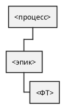

# Документ функциональных требований

Вариант:  
Команда:  
Источник: `Документ пользовательских требований.md`  
Дата:

## 1. Декомпозиция

| История | Функциональные требования |
|---|---|
| EP-1 Настроить доступ | ФТ-1.1…ФТ-1.4 |
| EP-2 Вести номенклатуру | ФТ-2.1…ФТ-2.3 |
| EP-3 Открыть сбор | ФТ-3.1, ФТ-3.2 |
| EP-4 Подать заявку | ФТ-4.1…ФТ-4.3 |
| EP-5 Проверить ограничения заявки | ФТ-5.1 |
| EP-6 Доработать заявку | ФТ-6.1, ФТ-6.2 |
| EP-7 Проверить заявку | ФТ-7.1, ФТ-7.2 |
| EP-8 Согласовать заявку | ФТ-8.1, ФТ-8.2 |
| EP-9 Свести заявки | ФТ-9.1 |
| EP-10 Согласовать изменение заявки | ФТ-10.1, ФТ-10.2 |
| EP-11 Контролировать отправку напоминаний | ФТ-11.1, ФТ-11.2 |
| EP-12 Получить уведомление | ФТ-12.1, ФТ-12.2 |
| EP-13 Просмотреть историю | ФТ-13.1, ФТ-13.2 |
| EP-14 Получить отчет по заявке | ФТ-14.1, ФТ-14.2 |

## 2. Спецификация функций

### ФТ-1.1

- Формулировка: Система должна…
- История-источник:
- Актор:
- Вход:
- Результат:
- Ошибочный вход:
- Приоритет MoSCoW:
- Обоснование приоритета:

```text
Given:
When:
Then:
```

## 3. Схема декомпозиции

Исходник: `diagrams/decomposition.puml`. Идентификаторы на схеме те же, что в разделе 2.



## 4. Оценки сложности

| ID | Тип (EI, EO, EQ, ILF, EIF) | Сложность и почему | Функциональные точки | Карты покера | Пользовательские поинты | Что раздувает оценку |
|----|----------------------------|--------------------|----------------------|--------------|-------------------------|----------------------|
| ФТ-1.1 | | | | | | |

Сумма функциональных точек:  
Сумма пользовательских поинтов:

Внутренние и внешние группы данных, посчитанные один раз:

| Группа данных | ILF или EIF | Сложность | Точки | Какие функции её используют |
|---------------|-------------|-----------|-------|-----------------------------|
| | | | | |

## 5. Матрица трассировки

Колонка нефункциональных требований заполняется в лабораторной работе 4.

| ID | Тип | Источник | Связанные ФТ | Приоритет | Критерий приёмки | FP | Поинты |
|----|-----|----------|--------------|-----------|------------------|----|--------|
| | Пользовательское | | | | | | |

## 6. Выводы

Какие функции дают основной объём в точках. Какие функции дороги в поинтах при небольшом объёме данных. Что из этого команда берёт в ближайший выпуск.
