# Документ функциональных требований. УЛО: управление лекарственным обеспечением

| | |
|------|----------|
| Кейс | 05 |
| Заказчик | Комитет здравоохранения Волгоградской области (КЗВО) |
| Команда | Колузаев К. М. (тимлид), Иванов Р. С., Архипов А. А. |

Источник - эпики EP-1…EP-14 из лабораторной 2. Схема декомпозиции: [`diagrams/decomposition.puml`](diagrams/decomposition.puml).

```plantuml
@startwbs decomposition
* УЛО
** EP-1 Настроить доступ
*** ФТ-1.1 Сохранить организацию
*** ФТ-1.2 Назначить доступ
*** ФТ-1.3 Управлять блокировкой
*** ФТ-1.4 Собрать роль
** EP-2 Вести номенклатуру
*** ФТ-2.1 Создать каталог
*** ФТ-2.2 Сохранить товар
*** ФТ-2.3 Импортировать XLSX
** EP-3 Открыть сбор
*** ФТ-3.1 Открыть сбор
*** ФТ-3.2 Открыть локальный сбор
** EP-4 Подать заявку
*** ФТ-4.1 Сохранить черновик
*** ФТ-4.2 Отправить заявку
*** ФТ-4.3 Показать экран заявки
** EP-5 Проверить ограничения заявки
*** ФТ-5.1 Проверить ограничения
** EP-6 Доработать заявку
*** ФТ-6.1 Повторно отправить версию
*** ФТ-6.2 Отозвать заявку
** EP-7 Проверить заявку
*** ФТ-7.1 Подтвердить проверку
*** ФТ-7.2 Вернуть с проверки
-- EP-8 Согласовать заявку
--- ФТ-8.1 Записать решение руководителя
--- ФТ-8.2 Завершить просроченное рассмотрение
-- EP-9 Свести заявки
--- ФТ-9.1 Сформировать сводную
-- EP-10 Согласовать изменение заявки
--- ФТ-10.1 Предложить изменение
--- ФТ-10.2 Применить согласованное изменение
-- EP-11 Контролировать отправку напоминаний
--- ФТ-11.1 Определить получателей
--- ФТ-11.2 Показать результат рассылки
-- EP-12 Получить уведомление
--- ФТ-12.1 Рассчитать момент напоминания
--- ФТ-12.2 Доставить уведомление
-- EP-13 Просмотреть историю
--- ФТ-13.1 Показать историю объекта
--- ФТ-13.2 Очистить историю по сроку
-- EP-14 Получить отчет по заявке
--- ФТ-14.1 Сформировать отчёт
--- ФТ-14.2 Выгрузить отчёт
@endwbs
```



Функциональные точки - нескорректированные, учебный подсчёт. Группы данных посчитаны один раз.

| Группа | Тип | Почему низкая сложность | Точки | Кто использует |
|---|---|---|---|---|
| Организации | ILF (Internal Logical File) | одна группа без подгрупп, поля: название, родитель, ключ организации, статус организации как поставщика | 7 | ФТ-1.1 |
| Пользователи | ILF | 2 подгруппы (Пользователи организаций; пользователи поставщиков), 7 полей: логин, ФИО, должность, почта, организация или поставщик, блокировка, назначенная роль | 7 | ФТ-1.2, ФТ-1.3, ФТ-11.1, ФТ-12.2, ФТ-13.1, ФТ-14.1, ФТ-14.2 |
| Роли | ILF | 2 подгруппы (Роли; действия, входящие в роли), 2 поля: роль и действие | 7 | ФТ-1.2, ФТ-1.4, ФТ-11.1 |
| Номенклатуры и товары | ILF | 2 подгруппы (Каталоги и товары), 9 полей: владелец, каталог, набор свойств, ID товара, название, категория, свойства, цена, остаток | 7 | ФТ-2.1, ФТ-2.2, ФТ-2.3, ФТ-4.1, ФТ-4.3, ФТ-5.1 |
| Сборы | ILF | одна группа без подгрупп, поля: организация, родитель, название, начало, окончание, лимит, категории | 7 | ФТ-3.1, ФТ-3.2, ФТ-4.1, ФТ-4.2, ФТ-4.3, ФТ-5.1, ФТ-6.1, ФТ-6.2, ФТ-8.1, ФТ-8.2, ФТ-9.1, ФТ-10.2, ФТ-11.1, ФТ-11.2, ФТ-12.1 |
| Заявки, позиции и решения | ILF | 4 подгруппы (Заявки; позиции; решения; предложения изменений), 16 полей: номер, автор, организация, сбор, вид, версия, статус, товар, количество, цена, итог, источник, решение, комментарий, момент, предложение изменения | 7 | ФТ-2.2, ФТ-4.1, ФТ-4.2, ФТ-4.3, ФТ-5.1, ФТ-6.1, ФТ-6.2, ФТ-7.1, ФТ-7.2, ФТ-8.1, ФТ-8.2, ФТ-9.1, ФТ-10.1, ФТ-10.2, ФТ-14.1, ФТ-14.2 |
| Уведомления | ILF | одна группа без подгрупп, поля: событие, объект, получатель, канал, время, результат | 7 | ФТ-2.2, ФТ-4.2, ФТ-6.1, ФТ-6.2, ФТ-7.1, ФТ-7.2, ФТ-8.1, ФТ-10.1, ФТ-11.2, ФТ-12.2 |
| История | ILF | одна группа без подгрупп, поля: объект, действие, момент, автор, сохранённый состав | 7 | ФТ-1.1, ФТ-1.2, ФТ-1.3, ФТ-1.4, ФТ-2.1, ФТ-2.2, ФТ-2.3, ФТ-3.1, ФТ-3.2, ФТ-4.2, ФТ-6.1, ФТ-6.2, ФТ-7.1, ФТ-7.2, ФТ-8.1, ФТ-8.2, ФТ-9.1, ФТ-10.1, ФТ-10.2, ФТ-13.1, ФТ-13.2 |

Сумма по данным: 56. Внешних интерфейсных файлов (EIF) нет: внешние каталоги через API вне границ кейса, номенклатуры ведутся в самой системе.

## 1. Декомпозиция

| История | Функциональные требования |
|---------|---------------------------|
| US-1 | ФТ-1.1: Система должна… |

## 2. Спецификация функций

### ФТ-1.1

- Формулировка: Система должна…
- История-источник:
- Актор:
- Вход:
- Результат:
- Ошибочный вход:
- Приоритет MoSCoW:
- Обоснование приоритета:

```text
Given:
When:
Then:
```

## 3. Схема

Файл [`diagrams/decomposition.puml`](diagrams/decomposition.puml) перечисляет те же ФТ, что раздел 2. Расхождений нет.

## 4. Сводка оценок

| ID | Тип | Точки | Поинты |
|---|---|---|---|
| ФТ-1.1 | EI | 3 | 3 |
| ФТ-1.2 | EI | 6 | 8 |
| ФТ-1.3 | EI | 3 | 5 |
| ФТ-1.4 | EI | 3 | 3 |
| ФТ-2.1 | EI | 3 | 3 |
| ФТ-2.2 | EI | 6 | 5 |
| ФТ-2.3 | EI | 4 | 5 |
| ФТ-3.1 | EI | 4 | 5 |
| ФТ-3.2 | EI | 4 | 5 |
| ФТ-4.1 | EI | 6 | 5 |
| ФТ-4.2 | EI | 4 | 8 |
| ФТ-4.3 | EO | 5 | 5 |
| ФТ-5.1 | EO | 5 | 8 |
| ФТ-6.1 | EI | 6 | 8 |
| ФТ-6.2 | EI | 4 | 3 |
| ФТ-7.1 | EI | 4 | 5 |
| ФТ-7.2 | EI | 6 | 3 |
| ФТ-8.1 | EI | 6 | 5 |
| ФТ-8.2 | EI | 6 | 8 |
| ФТ-9.1 | EI | 6 | 8 |
| ФТ-10.1 | EI | 6 | 5 |
| ФТ-10.2 | EI | 6 | 13 |
| ФТ-11.1 | EQ | 3 | 3 |
| ФТ-11.2 | EQ | 3 | 2 |
| ФТ-12.1 | EO | 4 | 3 |
| ФТ-12.2 | EO | 5 | 8 |
| ФТ-13.1 | EQ | 4 | 3 |
| ФТ-13.2 | EI | 3 | 3 |
| ФТ-14.1 | EO | 5 | 5 |
| ФТ-14.2 | EO | 5 | 5 |
| Данные | ILF 7×8 | 56 | не оцениваются покером отдельно |

Сумма точек: 3+6+3+3+3+6+4+4+4+6+4+5+5+6+4+4+6+6+6+6+6+6+3+3+4+5+4+3+5+5+63 = 194. Сумма поинтов: 3+8+5+3+3+5+5+5+5+5+8+5+8+8+3+5+3+5+8+8+5+13+3+2+3+8+3+3+5+5 = 158.

ФТ-10.2 и ФТ-5.1 дают 6 и 5 точек, но 13 и 8 поинтов: транзакция небольшая по полям, а работа дорога из-за атомарного изменения нескольких версий и конкуренции за общий лимит. ФТ-12.1 и ФТ-13.1 наоборот лёгкие в поинтах (3), хотя несут 4 точки: полей достаточно, правил немного. Поэтому точки и поинты не сортируют функции одинаково.

## 5. Матрица

Колонка нефункциональных требований пустая до лабораторной 4.

| ID | Источник | ФТ | Приоритет | Приёмка | Точки функций | Поинты |
|---|---|---|---|---|---|---|
| EP-1 | КЗВО, системный администратор | 1.1, 1.2, 1.3, 1.4 | Must | организация под родителем; роль собрана и назначена; блокировка на минуту; поставщик в списке поставщиков | 15 | 19 |
| EP-2 | Поставщики, модераторы | 2.1, 2.2, 2.3 | Must | каталог со свойством; цена 90 в каталоге и 80 в отправленной позиции; строка импорта с причиной отказа | 13 | 13 |
| EP-3 | КЗВО, модераторы | 3.1, 3.2 | Must | два пересекающихся сбора; локальный период внутри родительского | 8 | 10 |
| EP-4 | Сотрудник-заявитель, КЗВО | 4.1, 4.2, 4.3 | Must | экран с итогом и остатком лимита; черновик на 160 рублей; статус «На согласовании» | 15 | 18 |
| EP-5 | КЗВО, сотрудник-заявитель | 5.1 | Must | превышение лимита на 500 блокирует отправку | 5 | 8 |
| EP-6 | Сотрудник-заявитель, КЗВО | 6.1, 6.2 | Must | версия увеличена, прежний состав в истории; отзыв до подтверждения | 10 | 11 |
| EP-7 | Модератор | 7.1, 7.2 | Must | версия передана руководителю; возврат с замечанием | 10 | 8 |
| EP-8 | Руководитель, КЗВО | 8.1, 8.2 | Must | статус «Одобрена»; автоматическое отклонение по сроку | 12 | 13 |
| EP-9 | Модератор, КЗВО | 9.1 | Must | 100 упаковок в сводной, связи с исходными заявками | 6 | 8 |
| EP-10 | КЗВО, руководители | 10.1, 10.2 | Must | предложение 60 вместо 40, итог 80 после подтверждения | 12 | 18 |
| EP-11 | Модератор | 11.1, 11.2 | Should | получатели по правам; результат по каналам | 6 | 5 |
| EP-12 | Все участники процесса | 12.1, 12.2 | Must | напоминание за два часа при десятичасовом сборе; два канала раздельно | 9 | 11 |
| EP-13 | Ответственные должностные лица, КЗВО | 13.1, 13.2 | Must | обе версии в хронологии; запись удалена через три года | 7 | 6 |
| EP-14 | Ответственные должностные лица; тендерный отдел получает выгрузку | 14.1, 14.2 | Must | отчёт на экране и в PDF или XLSX с итогом 160 | 10 | 10 |

56 точки данных в строки историй не раскладывались повторно: они общие.

## 6. Выводы

Все 14 эпиков разложены на 30 функций: 25 Must и 5 Should (ФТ-1.3, ФТ-2.3, ФТ-6.2, ФТ-11.1, ФТ-11.2). Эпик EP-11 помечен Should: без него основной процесс не блокируется, а контроль результатов рассылки и адресатов может выполняться вручную. Остальные эпики имеют приоритет Must, поскольку обеспечивают прохождение заявки по маршруту от подачи до сведения.

Объём процессов составляет 138 функциональных точек, объём данных - 8 × 7 = 56 точки. Общий объём системы - 194 точки. Сумма поинтов - 158. Наибольший объём по функциональным точкам у эпиков EP-1 и EP-4 - по 15 точек. Самая высокая оценка трудоёмкости в поинтах у EP-1 (19), затем у EP-4 и EP-10 (по 18). Наибольший вес транзакции - 6 точек; он присвоен десяти функциям: ФТ-1.2, ФТ-2.2, ФТ-4.1, ФТ-6.1, ФТ-7.2, ФТ-8.1, ФТ-8.2, ФТ-9.1, ФТ-10.1 и ФТ-10.2.

Функциональные точки и поинты не совпадают, поскольку измеряют разные характеристики системы. Функциональные точки отражают объём функций и данных, а поинты - предполагаемую сложность и риск реализации. Самая трудоёмкая функция по оценке в поинтах - ФТ-10.2 (13): несколько версий исходных заявок и сводная должны изменяться согласованно в рамках одной операции. При этом её функциональный вес составляет 6 точек, как и у ряда других транзакций. Эпик EP-10 набирает 18 поинтов при 12 функциональных точках, а EP-4 - 18 поинтов при 15 функциональных точках: в EP-4 заявка собирается из нескольких групп данных и требует единого экрана с пересчётом. Группы данных дают в сумме 56 функциональные точки, но отдельно в поинтах не оцениваются, что также объясняет различие итоговых показателей.