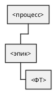

# Документ функциональных требований

Вариант:  
Команда:  
Источник: `Документ пользовательских требований.md`  
Дата:

## 1. Декомпозиция

| История | Функциональные требования |
|---|---|
| EP-1 Настроить доступ | ФТ-1.1…ФТ-1.4 |
| EP-2 Вести номенклатуру | ФТ-2.1…ФТ-2.3 |
| EP-3 Открыть сбор | ФТ-3.1, ФТ-3.2 |
| EP-4 Подать заявку | ФТ-4.1…ФТ-4.3 |
| EP-5 Проверить ограничения заявки | ФТ-5.1 |
| EP-6 Доработать заявку | ФТ-6.1, ФТ-6.2 |
| EP-7 Проверить заявку | ФТ-7.1, ФТ-7.2 |
| EP-8 Согласовать заявку | ФТ-8.1, ФТ-8.2 |
| EP-9 Свести заявки | ФТ-9.1 |
| EP-10 Согласовать изменение заявки | ФТ-10.1, ФТ-10.2 |
| EP-11 Контролировать отправку напоминаний | ФТ-11.1, ФТ-11.2 |
| EP-12 Получить уведомление | ФТ-12.1, ФТ-12.2 |
| EP-13 Просмотреть историю | ФТ-13.1, ФТ-13.2 |
| EP-14 Получить отчет по заявке | ФТ-14.1, ФТ-14.2 |

## 2. Спецификация

### ФТ-1.1

- Формулировка: система должна сохранять организацию с выбранным родителем, как при создании, так и при смене родителя, либо же организацию поставщика.
- История: EP-1. Актор: Системный администратор. Вход: название, родитель. Результат: отделение отображается непосредственно под больницей; действие записано в истории.
- Ошибочный вход: при пустом названии, цикле в иерархии или родителе вне ветви администратора отклонить изменение и показать причину.
- Примечание: корневая организация (КЗВО) создаётся разработчиками при развёртывании системы и этой функцией не создаётся. 
- Приоритет: Must. Без организации нет иерархии, маршрутов согласования и областей доступа.

```text
Given: Администратор вошёл; его права действуют на свою и нижестоящие организации
When: администратор добавляет отделение к больнице своей ветви
Then: отделение отображается непосредственно под больницей; действие записано в истории
```

Тип: EI, низкая, DET 3, FTR 2 (организации, история). 3 точки. Покер: 3, 3, 3, итог 3. Раздувает проверка цикла и принадлежности родителя к ветви администратора.

### ФТ-1.2

- Формулировка: система должна сохранять пользователя и назначенные ему роли из разрешённых действий в пределах доступной ему области.
- История: EP-1. Актор: Системный администратор. Вход: логин, ФИО, должность, почта, организация или поставщик, роли, действия. Результат: сотруднику доступны действия обеих ролей в разрешённой области; действие записано в истории.
- Ошибочный вход: при неизвестном действии отказать в назначении.
- Приоритет: Must. Без пользователя и ролей сотрудник не получает доступ.

```text
Given: Администратор вошел; его права действуют на свою и нижестоящие организации
When: администратор назначает сотруднику две роли
Then: сотруднику доступны действия обеих ролей в разрешённой области; действие записано в истории
```

Тип: EI, высокая, DET 8, FTR 3 (пользователи, роли, история). 6 точек. Покер: 5, 8, 8; повтор 8, 8, 8, итог 8. Раздувает совмещение ролей и область доступа.

### ФТ-1.3

- Формулировка: система должна применять действующую блокировку входа и разрешать администратору её досрочное снятие.
- История: EP-1. Актор: Системный администратор. Вход: логин, действие, момент попытки. Результат: первая блокировка действует минуту; при последующих срабатываниях интервалы составляют 5 минут, 10 минут и час; снятие блокировки записано в истории.
- Ошибочный вход: при попытке снять чужую блокировку отказать.
- Приоритет: Should. Организации, пользователи и роли настраиваются и без этого, но без досрочного снятия блокировки сотрудник остаётся без доступа до конца интервала.

```text
Given: Администратор вошел; его права действуют на свою и нижестоящие организации
When: после пяти неверных паролей за минуту пользователь повторяет вход
Then: первая блокировка действует минуту; при последующих срабатываниях интервалы составляют 5 минут, 10 минут и час
```

Тип: EI, низкая, DET 4, FTR 2 (пользователи, история). 3 точки. Покер: 5, 5, 5, итог 5. Раздувает проверка временных границ.

### ФТ-1.4

- Формулировка: система должна позволять администратору собрать роль из заранее заложенных действий и сохранить её для назначения.
- История: EP-1. Актор: Системный администратор. Вход: название роли, набор действий. Результат: роль с выбранными действиями появляется в списке ролей и доступна для назначения; действие записано в истории.
- Ошибочный вход: действие, которого нет в заложенном перечне, добавить в роль нельзя.
- Приоритет: Must. Без роли нечего назначать пользователю.

```text
Given: администратор вошёл; его права действуют на свою и нижестоящие организации; в перечне есть действия «создавать заявки» и «просматривать историю»
When: администратор сохраняет роль «Заявитель» с этими двумя действиями
Then: роль «Заявитель» с двумя действиями есть в списке ролей и доступна для назначения; действие записано в истории
```

Тип: EI, низкая, DET 3, FTR 2 (роли, история). 3 точки. Покер: 3, 3, 5, итог 3. Раздувает сверка набора действий с заложенным перечнем.

### ФТ-2.1

- Формулировка: система должна создавать номенклатуру владельца с набором свойств товаров.
- История: EP-2. Актор: Поставщик или модератор заявок. Вход: название, владелец, свойства. Результат: свойство доступно при вводе товара в этом каталоге; действие записано в истории.
- Ошибочный вход: отклонить изменение каталога чужого владельца.
- Приоритет: Must. Без каталога некуда добавить товар.

```text
Given: Пользователь вошел и имеет право вести эту номенклатуру
When: поставщик сохраняет каталог с полем «дозировка»
Then: свойство доступно при вводе товара в этом каталоге; действие записано в истории
```

Тип: EI, низкая, DET 4, FTR 2 (номенклатуры и товары, история). 3 точки. Покер: 3, 3, 3, итог 3. Раздувает пользовательские свойства.

### ФТ-2.2

- Формулировка: система должна позволять поставщику или модератору заявок вручную добавлять и обновлять товары в номенклатуре, которой пользователь имеет право управлять, с указанием названия, категории, свойств, цены и остатка; цена и остаток могут отсутствовать в соответствии с типом номенклатуры.
- История: EP-2. Актор: Поставщик или модератор заявок. Вход: ID товара, каталог, название, категория, свойства, цена, остаток. Результат: каталог показывает 90; в уже отправленной позиции сохранено 80, для затронутого автора сформировано событие уведомления; действие записано в истории.
- Ошибочный вход: при пустой цене отклонить запись и показать причину.
- Приоритет: Must. Без товара с ценой нечего выбрать в заявке.

```text
Given: Пользователь вошел и имеет право вести эту номенклатуру
When: владелец меняет цену с 80 на 90
Then: каталог показывает 90; в уже отправленной позиции сохранено 80, для затронутого автора сформировано событие уведомления; действие записано в истории
```

Тип: EI, высокая, DET 8, FTR 4 (номенклатуры и товары, заявки, позиции и решения, уведомления, история). 6 точек. Покер: 5, 5, 5, итог 5. Раздувает связь цены с версиями заявок.

### ФТ-2.3

- Формулировка: система должна проверять строки XLSX и принимать корректные товары в выбранную номенклатуру.
- История: EP-2. Актор: Поставщик или модератор заявок. Вход: файл, каталог, ID товара, название, категория, свойства, цена, остаток. Результат: корректная строка принята, для второй указана причина отказа; действие записано в истории.
- Ошибочный вход: при нечитаемом файле вывести ошибку формата.
- Приоритет: Should. Каталог можно вести вручную, импорт ускоряет наполнение каталога до 500 000 строк.

```text
Given: Пользователь вошел и имеет право вести эту номенклатуру
When: поставщик загружает файл с одной корректной строкой и одной без цены
Then: корректная строка принята, для второй указана причина отказа; действие записано в истории
```

Тип: EI, средняя, DET 9, FTR 2 (номенклатуры и товары, история). 4 точки. Покер: 3, 8, 5; повтор 5, 5, 5, итог 5. Раздувает построчная проверка и диагностика ошибок.

### ФТ-3.1

- Формулировка: система должна позволять сотруднику с правом создания сбора создавать и публиковать сбор своей организации с указанием названия, периода, финансового лимита и допустимых категорий товаров.
- История: EP-3. Актор: Сотрудник с правом создания сбора. Вход: организация, название, начало, окончание, лимит, категории. Результат: оба сбора доступны в заданные периоды; действие записано в истории.
- Ошибочный вход: отклонить обратный интервал или создание от чужой организации.
- Приоритет: Must. Без сбора нет срока, лимита и допустимых категорий.

```text
Given: Пользователь вошел; организации заведены в иерархии
When: уполномоченный сотрудник открывает второй сбор с пересекающимися сроками
Then: оба сбора доступны в заданные периоды; действие записано в истории
```

Тип: EI, средняя, DET 7, FTR 2 (сборы, история). 4 точки. Покер: 5, 5, 5, итог 5. Раздувает область полномочий и календарь.

### ФТ-3.2

- Формулировка: система должна позволять сотруднику нижестоящей организации задавать локальный период сбора в пределах периода родительского сбора и разрешать их сокращение.
- История: EP-3. Актор: Сотрудник с правом создания сбора. Вход: организация, родительский сбор, начало, окончание. Результат: локальный сбор опубликован и связан с родительским; действие записано в истории.
- Ошибочный вход: если локальный период выходит за границы родительского сбора или дата начала позже даты окончания, система отклоняет сохранение и показывает причину.
- Приоритет: Must. Без локального сбора нижестоящая организация не работает в своих рамках.

```text
Given: Родительский сбор действует с 1 по 30 ноября
When: сотрудник дочерней организации задаёт локальный период с 2 по 20 ноября
Then: локальный сбор опубликован и связан с родительским; действие записано в истории
```

Тип: EI, средняя, DET 5, FTR 2 (сборы, история). 4 точки. Покер: 5, 5, 5, итог 5. Раздувает проверка вложенных периодов.

### ФТ-4.1

- Формулировка: система должна сохранять выбранные товары и количества в черновике автора с ценами на момент включения.
- История: EP-4. Актор: Сотрудник-заявитель. Вход: сбор, ID товара, количество, автор. Результат: при повторном открытии видны две упаковки и итог 160 рублей.
- Ошибочный вход: закрытый или чужой сбор недоступен для создания и редактирования заявки.
- Приоритет: Must. Без черновика заявку нельзя собрать и продолжить позже.

```text
Given: Сотрудник вошел; есть право создания заявок, сбор открыт его организацией, срок не истек; в номенклатурах есть товары допустимых категорий
When: заявитель добавляет две упаковки по 80 рублей и сохраняет черновик
Then: при повторном открытии видны две упаковки и итог 160 рублей
```

Тип: EI, высокая, DET 6, FTR 3 (заявки, позиции и решения, номенклатуры и товары, сборы). 6 точек. Покер: 5, 5, 5, итог 5. Раздувает снимок цены и сохранение без отправки.

### ФТ-4.2

- Формулировка: система должна передавать заявку на согласование после повторной проверки ограничений EP-5.
- История: EP-4. Актор: Сотрудник-заявитель. Вход: номер, версия, действие отправки. Результат: статус «На согласовании», отправка отражена в истории, получателю направлено уведомление.
- Ошибочный вход: при нарушении ограничения сохранить черновик и показать причину.
- Приоритет: Must. Без отправки заявка не входит в маршрут согласования.

```text
Given: Сотрудник вошел; есть право создания заявок, сбор открыт его организацией, срок не истек; в номенклатурах есть товары допустимых категорий
When: автор отправляет допустимую заявку своей организации до срока
Then: статус «На согласовании», отправка отражена в истории, получателю направлено уведомление
```

Тип: EI, средняя, DET 4, FTR 4 (заявки, позиции и решения, сборы, история, уведомления). 4 точки. Покер: 5, 8, 8; повтор 8, 8, 8, итог 8. Раздувает согласованность статуса, истории и оповещения.

### ФТ-4.3

- Формулировка: система должна показывать на одном экране каталог допустимых товаров, состав заявки, итоговую стоимость, остаток лимита сбора с учётом других заявок, срок сбора и допустимые категории, а также пересчитывать итоговую стоимость и остаток лимита при изменении позиций заявки.
- История: EP-4. Актор: Сотрудник-заявитель. Вход: сбор, строка поиска. Результат: видны каталог с ценой, состав заявки, итог и остаток лимита с учётом других заявок сбора, срок и допустимые категории.
- Ошибочный вход: закрытый или чужой сбор не открывается.
- Приоритет: Must. Без единого экрана заявитель не видит итог и остаток лимита, заявки остаются в Excel.

```text
Given: сотрудник вошёл; сбор открыт его организацией, срок не истёк; лимит 10000, другие заявки заняли 8000; в черновике две упаковки товара по 80 рублей
When: заявитель открывает заявку
Then: на одном экране видны цена 80, состав «две упаковки», итог 160, остаток лимита 1840, срок и допустимые категории
```

Тип: EO, средняя, DET 12, FTR 3 (номенклатуры и товары, сборы, заявки, позиции и решения). 5 точек. Покер: 5, 5, 8; повтор 5, 5, 5, итог 5. Раздувает пересчёт итога и остатка лимита вместе с другими заявками сбора.

### ФТ-5.1

- Формулировка: система должна проверять допустимость категории товара, доступное количество, общий лимит и срок сбора при изменении позиций заявки, а также повторно проверять все ограничения при её отправке. При нарушении ограничения система должна показывать причину и блокировать отправку заявки.
- История: EP-5. Актор: Сотрудник-заявитель, проверку выполняет система. Вход: сбор, товар, количество, цена, остаток, срок, сумма других заявок. Результат: система показывает превышение на 500 и блокирует отправку; при параллельной отправке лимит также соблюдается.
- Ошибочный вход: при неизвестном остатке пропустить только проверку остатка и показать это автору.
- Приоритет: Must. Без проверки заявка может нарушить лимит, категорию или срок.

```text
Given: В заявке есть позиции; известны параметры сбора
When: при лимите 10000 и занятых 8000 автор добавляет товар на 2500
Then: система показывает превышение на 500 и блокирует отправку; при параллельной отправке лимит также соблюдается
```

Тип: EO, средняя, DET 7, FTR 3 (сборы, номенклатуры и товары, заявки, позиции и решения). 5 точек. Покер: 5, 13, 8; повтор 8, 8, 8, итог 8. Раздувает общий лимит при одновременной работе.

<a id="ft-5-1-fp"></a>

#### Референс метода на ФТ-5.1 

Ниже на проверке ограничений показан весь незакрытый подсчёт одной функции. Остальные функции этого документа записаны коротко: тип, сложность и вес. Считаются они теми же шагами. Это нескорректированные точки по упрощённой схеме IFPUG. Коэффициент поправки сюда не входит.

**Шаг 1. Элементарный процесс.** Считается законченное действие, которое пользователь отличает от соседних и после которого данные в согласованном состоянии. Дробление одного действия на «проверить категорию» и «проверить лимит» четыре точки не даёт.

Для ФТ-5.1 процесс один: при изменении позиции или отправке заявки система проверяет категорию, остаток, общий лимит и срок и либо разрешает продолжить, либо блокирует отправку и называет нарушенное ограничение. Отдельной операции «проверить лимит» у заявителя нет.

**Шаг 2. Тип транзакции.** Основное намерение выбирает одну клетку:

| Намерение | Тип |
|---|---|
| Принять данные и изменить хранимую группу | EI, внешний вход |
| Отдать данные наружу, и при этом вычислить поле, сформировать документ или сопроводить выход изменением данных | EO, внешний выход |
| Отдать данные наружу без вычисления и без изменения хранимых групп | EQ, внешний запрос |

ФТ-5.1 отдаёт наружу результат проверки, и он не копия одной записи: общий лимит складывается из позиции этой заявки и других заявок сбора, превышение вычисляется. Это EO. EQ не подходит, потому что есть вычисление. EI не подходит, потому что этот шаг хранилище не меняет.

**Шаг 3. Число групп данных.** Для транзакции это FTR, file types referenced: сколько разных ILF и EIF процесс читает или меняет. Одну группу дважды не считают. Проверка прав, константа и подпись к полю группой не являются.

FTR = |{уникальные ILF и EIF, которые процесс читает или меняет}|

| Группа | Тип группы | Зачем процессу | Берём в FTR |
|---|---|---|---|
| Сборы | ILF | лимит, срок, допустимые категории | да |
| Номенклатуры и товары | ILF | категория и остаток товара | да |
| Заявки, позиции и решения | ILF | позиции этой и других заявок сбора | да |
| Пользователи | ILF | автор известен по входу, права - сквозная проверка | нет |
| Роли | ILF | права - сквозная проверка | нет |
| История | ILF | проверка ничего не записывает | нет |
| Уведомления | ILF | проверка уведомление не создаёт | нет |

FTR = 3.

**Шаг 4. Число полей.** Для транзакции это DET, data element types: поля, которые различает пользователь, плюс одно поле на всю способность процесса вернуть сообщение.

DET = N_полей + N_сообщение

N_полей - число разных пользовательских полей на входе и на выходе процесса. Одно и то же поле, пришедшее из двух групп, считается один раз. Служебный ключ, который пользователь не видит, и разметка экрана в N_полей не входят.

N_сообщение равно 1, если процесс умеет сообщить об ошибке или подтверждении, и 0, если такого сообщения нет. Несколько текстов ошибок остаются одним полем.

| № | Поле | Откуда | В DET |
|---|---|---|---|
| 1 | сбор | ввод | да |
| 2 | товар | ввод | да |
| 3 | количество | ввод | да |
| 4 | нарушенное ограничение | вывод | да |
| 5 | превышение лимита | вывод, вычисляется | да |
| 6 | остаток лимита | вывод, вычисляется | да |
| 7 | сообщение о нарушении или о неизвестном остатке | одно сообщение на процесс | да, это N_сообщение |
| - | цена и остаток товара, сумма других заявок | система берёт из хранилища, пользователь их не вводит | нет |
| - | внутренний номер заявки | пользователь его не называет | нет |

N_полей = 6, N_сообщение = 1.

DET = 6 + 1 = 7.

**Шаг 5. Сложность по матрице.** Для EI строки матрицы другие, чем для EO и EQ. Берётся матрица своего типа.

Внешний вход, EI:

| FTR | DET 1–4 | DET 5–15 | DET 16 и больше |
|---|---|---|---|
| 0–1 | низкая | низкая | средняя |
| 2 | низкая | средняя | высокая |
| 3 и больше | средняя | высокая | высокая |

Внешний выход и внешний запрос, EO и EQ:

| FTR | DET 1–5 | DET 6–19 | DET 20 и больше |
|---|---|---|---|
| 0–1 | низкая | низкая | средняя |
| 2–3 | низкая | средняя | высокая |
| 4 и больше | средняя | высокая | высокая |

ФТ-5.1 - это EO, поэтому вторая матрица. FTR = 3 попадает в строку «2–3», DET = 7 попадает в столбец «6–19». Клетка - средняя сложность.

Группа данных, когда её оценивают отдельно, считается не через FTR, а через RET, record element types: сколько логических подгрупп пользователь видит внутри файла. Одна карточка без подгрупп даёт RET = 1. Матрица ILF и EIF:

| RET | DET 1–19 | DET 20–50 | DET 51 и больше |
|---|---|---|---|
| 1 | низкая | низкая | средняя |
| 2–5 | низкая | средняя | высокая |
| 6 и больше | средняя | высокая | высокая |

К ФТ-5.1 эта матрица не применяется: сборы, номенклатуры и заявки уже оценены в таблице данных в начале документа. Здесь они только ссылки процесса.

**Шаг 6. Вес.** Вес W зависит от типа и сложности:

| Тип | Низкая | Средняя | Высокая |
|---|---|---|---|
| EI | 3 | 4 | 6 |
| EO | 4 | 5 | 7 |
| EQ | 3 | 4 | 6 |
| ILF | 7 | 10 | 15 |
| EIF | 5 | 7 | 10 |

FP_i = W(тип_i, сложность_i)

FP(ФТ-5.1) = W(EO, средняя) = 5.

**Шаг 7. Что в эти 5 точек не входит.** Нескорректированный объём системы - сумма весов всех транзакций и всех групп данных, каждая группа один раз:

UFP = Σ FP_транзакций + Σ FP_групп

Вклад ФТ-5.1 в эту сумму равен 5, а не сумме с файлами, которые он читает:

FP(ФТ-5.1) ≠ W(EO, средняя) + W(ILF «сборы») + W(ILF «номенклатуры и товары») + W(ILF «заявки»)

5 ≠ 5 + 7 + 7 + 7.

По семь точек трёх групп стоят в таблице данных и второй раз к функции не прибавляются.

Скорректированный объём в этой лабораторной не считается. Его формула, чтобы было видно, что именно отброшено:

AFP = UFP × VAF, VAF = 0,65 + 0,01 × Σ характеристик системы

Характеристики системы и VAF относятся к ограничениям качества. Их место в лабораторной работе 4, в точки функций они не подставляются. Для ФТ-5.1 итогом метода остаются 5 нескорректированных функциональных точек.

### ФТ-6.1

- Формулировка: система должна сохранять исправления неподтверждённой, возвращённой или отклонённой заявки и отправлять новую версию после проверки.
- История: EP-6. Актор: Сотрудник-заявитель. Вход: номер, версия, товары, количества. Результат: номер заявки сохраняется, версия увеличена, прежний состав доступен в истории.
- Ошибочный вход: при подтверждении версии другим пользователем отклонить устаревшую правку.
- Приоритет: Must. Без повторной отправки возвращённую заявку приходится создавать заново.

```text
Given: Заявка создана этим сотрудником; сбор открыт, срок не истек
When: автор до срока исправляет отклонённую заявку и повторно отправляет её
Then: номер заявки сохраняется, версия увеличена, прежний состав доступен в истории
```

Тип: EI, высокая, DET 6, FTR 4 (заявки, позиции и решения, сборы, история, уведомления). 6 точек. Покер: 8, 8, 8, итог 8. Раздувает повторная подача и конфликт версий.

### ФТ-6.2

- Формулировка: система должна возвращать отправленную заявку автора в черновик до подтверждения и окончания срока.
- История: EP-6. Актор: Сотрудник-заявитель. Вход: номер, автор, действие отзыва. Результат: заявка в черновике, проверяющему направлено уведомление; отзыв записан в истории.
- Ошибочный вход: после подтверждения или срока отклонить отзыв.
- Приоритет: Should. Историю выполняет ФТ-6.1: неподтверждённую заявку можно исправить без отзыва, отзыв нужен только для возврата в черновик.

```text
Given: Заявка создана этим сотрудником; сбор открыт, срок не истек
When: автор отзывает ещё не подтверждённую версию
Then: заявка в черновике, проверяющему направлено уведомление; отзыв записан в истории
```

Тип: EI, средняя, DET 3, FTR 4 (заявки, позиции и решения, сборы, история, уведомления). 4 точки. Покер: 3, 3, 3, итог 3. Раздувает две границы допустимости отзыва.

### ФТ-7.1

- Формулировка: система должна фиксировать подтверждение модератором версии заявки, передавать её руководителю и запрещать автору изменять переданную версию.
- История: EP-7. Актор: Модератор заявок (сотрудник с правом модерации). Вход: номер, версия, решение. Результат: версия передана руководителю и закрыта для исправления автором.
- Ошибочный вход: при повторном подтверждении уже обработанной версии показать её состояние.
- Приоритет: Must. Без подтверждения заявка не доходит до руководителя.

```text
Given: Сбор открыт, заявка относится к организации пользователя, у него есть право модерации
When: пользователь своей организации с правом модерации нажимает «Подтвердить»
Then: версия передана руководителю и закрыта для исправления автором
```

Тип: EI, средняя, DET 4, FTR 3 (заявки, позиции и решения, история, уведомления). 4 точки. Покер: 5, 5, 5, итог 5. Раздувает разделение просмотра и подтверждения.

### ФТ-7.2

- Формулировка: система должна возвращать заявку автору с замечанием модератора.
- История: EP-7. Актор: Модератор заявок (сотрудник с правом модерации). Вход: номер, версия, решение, комментарий. Результат: автор видит причину и может исправить заявку в срок.
- Ошибочный вход: при пустом комментарии отказать в возврате.
- Приоритет: Must. Без возврата замечания модератора остаются вне системы.

```text
Given: Сбор открыт, заявка относится к организации пользователя, у него есть право модерации
When: модератор возвращает заявку с замечанием о количестве
Then: автор видит причину и может исправить заявку в срок
```

Тип: EI, высокая, DET 5, FTR 3 (заявки, позиции и решения, история, уведомления). 6 точек. Покер: 3, 3, 3, итог 3. Раздувает возврат и доставка причины.

### ФТ-8.1

- Формулировка: система должна позволять руководителю принимать решение по заявке, поступившей на согласование в его организации, фиксировать одобрение, возврат или отклонение с обязательным комментарием при возврате или отклонении и передавать одобренную заявку на следующий уровень иерархии.
- История: EP-8. Актор: Руководитель. Вход: номер, версия, решение, комментарий. Результат: заявка получает статус «Одобрена» и доступна для сведения; при возврате или отклонении автор видит комментарий.
- Ошибочный вход: при отсутствии права или обязательного комментария сохранить прежний статус.
- Приоритет: Must. Без решения руководителя заявка не становится одобренной и не попадает в сведение.

```text
Given: Для решения пользователя сбор открыт, заявка ожидает согласования в его организации и у пользователя есть право согласования
When: руководитель последнего уровня одобряет своевременную заявку
Then: заявка получает статус «Одобрена» и доступна для сведения; при возврате или отклонении автор видит комментарий
```

Тип: EI, высокая, DET 6, FTR 4 (заявки, позиции и решения, сборы, история, уведомления). 6 точек. Покер: 5, 5, 5, итог 5. Раздувает три исхода и проверка маршрута.

### ФТ-8.2

- Формулировка: система должна автоматически отклонять поданную заявку без итогового решения в момент закрытия сбора.
- История: EP-8. Актор: Система по времени события. Вход: сбор, окончание, номер, статус. Результат: статус «Отклонена», в истории причина «Истёк срок сбора», редактирование и повторная отправка закрыты.
- Ошибочный вход: при повторной обработке сохранить уже зафиксированный итог.
- Приоритет: Must. Без автоматического решения заявка после срока остаётся без итогового статуса.

```text
Given: своевременно поданная заявка ожидает итогового решения
When: наступает конец сбора при заявке на согласовании
Then: статус «Отклонена», в истории причина «Истёк срок сбора», редактирование и повторная отправка закрыты
```

Тип: EI, высокая, DET 5, FTR 3 (сборы, заявки, позиции и решения, история). 6 точек. Покер: 3, 5, 8; повтор 8, 8, 8, итог 8. Раздувает одновременные истечение срока и решение руководителя.

### ФТ-9.1

- Формулировка: система должна сводить выбранные одобренные заявки одного родительского сбора и его локальных сборов по системному ID товара.
- История: EP-9. Актор: Модератор заявок. Вход: сбор, номера заявок, ID товаров, количества, зафиксированные цены. Результат: в сводной 100 упаковок, стоимость равна сумме исходных строк, сохранены связи с обеими заявками.
- Ошибочный вход: при повторном включении или чужом сборе отклонить операцию; суммы сводной повторно лимит не занимают.
- Приоритет: Must. Без сведения остаются ручной пересчёт и риск дробления закупки.

```text
Given: Есть одобренные заявки одного родительского сбора (включая его локальные сборы); у модератора есть право сведения
When: в двух исходных строках одного ID указаны 60 и 40 упаковок
Then: в сводной 100 упаковок, стоимость равна сумме исходных строк, сохранены связи с обеими заявками
```

Тип: EI, высокая, DET 6, FTR 3 (сборы, заявки, позиции и решения, история). 6 точек. Покер: 5, 8, 8; повтор 8, 8, 8, итог 8. Раздувает группировка и защита от двойного учёта.

### ФТ-10.1

- Формулировка: система должна регистрировать предложение руководителя об изменении конкретных исходных позиций сводной потребности, определять затронутые организации и уведомлять их о предложенных изменениях.
- История: EP-10. Актор: Руководитель и представители затронутых организаций. Вход: сводная, исходная заявка, ID товара, новое количество. Результат: затронутой организации видны исходное и новое количества; действующий итог по-прежнему 100.
- Ошибочный вход: при отсутствии связи с исходной позицией отклонить предложение.
- Приоритет: Must. Без предложения нижестоящие не узнают об изменении.

```text
Given: Есть связанные заявки; у руководителя есть право инициировать изменение
When: руководитель предлагает уменьшить первую из двух строк с 60 до 40
Then: затронутой организации видны исходное и новое количества; действующий итог по-прежнему 100
```

Тип: EI, высокая, DET 6, FTR 3 (заявки, позиции и решения, история, уведомления). 6 точек. Покер: 5, 5, 5, итог 5. Раздувает определение затронутых участников.

### ФТ-10.2

- Формулировка: система должна применять новые версии исходных заявок и пересчитывать сводную после подтверждения всеми затронутыми организациями.
- История: EP-10. Актор: Руководитель и представители затронутых организаций. Вход: предложение, версия, организация, решение, причина. Результат: новые исходные версии и сводная сохранены вместе, итог 80.
- Ошибочный вход: при возражении зафиксировать причину и оставить прежний итог; по истечении срока изменение не применять.
- Приоритет: Must. Без применения согласованного изменения версии потребности расходятся.

```text
Given: Есть связанные заявки; у руководителя есть право инициировать изменение
When: все затронутые подтвердили замену 60 на 40 при второй строке 40
Then: новые исходные версии и сводная сохранены вместе, итог 80
```

Тип: EI, высокая, DET 7, FTR 3 (заявки, позиции и решения, сборы, история). 6 точек. Покер: 8, 13, 21; повтор 13, 13, 13, итог 13. Раздувает атомарное изменение нескольких версий.

### ФТ-11.1

- Формулировка: система должна формировать и показывать модератору список пользователей организации сбора, имеющих право создания, обновления или модерации заявок, включая пользователей, уже подавших заявку.
- История: EP-11. Актор: Модератор. Вход: организация, сбор, права. Результат: видны оба пользователя; сотрудник другой организации исключён.
- Ошибочный вход: при сборе вне области доступа закрыть список.
- Приоритет: Should. Отбор получателей нужен модератору для контроля рассылки; напоминания (EP-12) и согласование заявок работают и без него.

```text
Given: Открыт сбор своей организации
When: модератор проверяет адресатов при двух подходящих пользователях, один уже подал заявку
Then: видны оба пользователя; сотрудник другой организации исключён
```

Тип: EQ, низкая, DET 5, FTR 3 (пользователи, роли, сборы). 3 точки. Покер: 3, 3, 3, итог 3. Раздувает объединение прав и границы организации.

### ФТ-11.2

- Формулировка: система должна показывать модератору результаты напоминаний по получателям и каналам.
- История: EP-11. Актор: Модератор. Вход: сбор, адресат, канал, результат. Результат: видны получатель, канал и зафиксированный сбой.
- Ошибочный вход: при отсутствии получателей показать пустой список.
- Приоритет: Should. Рассылка выполняется и без экрана результатов, но модератору нужен контроль сбоев.

```text
Given: Открыт сбор своей организации
When: модератор открывает результат рассылки с одной ошибкой почты
Then: видны получатель, канал и зафиксированный сбой
```

Тип: EQ, низкая, DET 5, FTR 2 (уведомления, сборы). 3 точки. Покер: 2, 2, 2, итог 2. Раздувает отображение существующих результатов.

### ФТ-12.1

- Формулировка: система должна определять время напоминания по длительности сбора: за 3 календарных дня до окончания, если продолжительность сбора составляет не менее 3 дней; если сбор длится меньше 3 дней - в момент, когда до окончания остаётся 20% его общей продолжительности.
- История: EP-12. Актор: Система по времени события. Вход: начало, окончание. Результат: напоминание назначено за два часа до конца; для сбора от трёх дней применяется срок в три календарных дня.
- Ошибочный вход: для некорректного интервала планирование отклоняется.
- Приоритет: Must. Без расчёта момента напоминание не отправляется вовремя.

```text
Given: заданы начало и окончание сбора
When: система планирует напоминание для десятичасового сбора
Then: напоминание назначено за два часа до конца; для сбора от трёх дней применяется срок в три календарных дня
```

Тип: EO, низкая, DET 4, FTR 1 (сборы). 4 точки. Покер: 3, 3, 3, итог 3. Раздувает граница двух календарных правил.

### ФТ-12.2

- Формулировка: система должна направлять уведомления в системе, по электронной почте и в МАХ при открытии сбора, наступлении срока или изменении состояния объекта.
- История: EP-12. Актор: Получатель уведомления. Вход: событие, адресат, канал, объект, сообщение. Результат: сообщение доступно в системе и отправлено по почте, результаты каналов сохранены отдельно.
- Ошибочный вход: при сбое одного канала записать ошибку этого канала.
- Приоритет: Must. Без доставки уведомление не доходит до участника.

```text
Given: Пользователь зарегистрирован; адресат и канал определены
When: наступает срок напоминания для адресата с электронной почтой
Then: сообщение доступно в системе и отправлено по почте, результаты каналов сохранены отдельно
```

Тип: EO, средняя, DET 6, FTR 2 (пользователи, уведомления). 5 точек. Покер: 5, 8, 8; повтор 8, 8, 8, итог 8. Раздувает два канала и независимые результаты.

### ФТ-13.1

- Формулировка: система должна отображать хронологию действий по доступному объекту с автором, временем и состоянием на момент действия.
- История: EP-13. Актор: Ответственное должностное лицо. Вход: тип объекта, ID объекта. Результат: отображаются обе версии в хронологическом порядке с авторами и временем.
- Ошибочный вход: при отсутствии доступа скрыть записи.
- Приоритет: Must. Без показа истории нельзя восстановить ход событий.

```text
Given: Пользователь вошел и имеет доступ к объекту
When: ответственное лицо открывает историю заявки после повторной отправки
Then: отображаются обе версии в хронологическом порядке с авторами и временем
```

Тип: EQ, средняя, DET 7, FTR 2 (история, пользователи). 4 точки. Покер: 3, 3, 3, итог 3. Раздувает восстановление предыдущих версий.

### ФТ-13.2

- Формулировка: система должна удалять запись истории целиком через три года с момента действия.
- История: EP-13. Актор: Система по времени события. Вход: момент действия, момент окончания хранения. Результат: первая запись удалена целиком, новая сохранена и доступна в истории.
- Ошибочный вход: пользовательская попытка досрочного удаления отклоняется; любая пользовательская попытка изменить запись также отклоняется.
- Приоритет: Must. Без удаления по сроку система нарушает правило хранения трёх лет.

```text
Given: в истории есть записи разного возраста
When: наступает трёхлетний срок одной записи при наличии более новой записи
Then: первая запись удалена целиком, новая сохранена и доступна в истории
```

Тип: EI, низкая, DET 2, FTR 1 (история). 3 точки. Покер: 3, 3, 3, итог 3. Раздувает точная граница хранения.

### ФТ-14.1

- Формулировка: система должна формировать по доступной заявке отчёт с автором, решениями, товарами, количествами, ценами и итогом.
- История: EP-14. Актор: Ответственное должностное лицо. Вход: номер, автор, решения, товар, количество, цена, итог. Результат: на экране видны автор, решения, две единицы и итог 160.
- Ошибочный вход: при неизвестном номере показать сообщение и не раскрывать данные.
- Приоритет: Must. Без отчёта нечего передавать тендерному отделу.

```text
Given: Заявка существует; у пользователя есть доступ к ней
When: ответственное лицо открывает отчёт по двум единицам товара с ценой 80
Then: на экране видны автор, решения, две единицы и итог 160
```

Тип: EO, средняя, DET 9, FTR 2 (заявки, позиции и решения, пользователи). 5 точек. Покер: 5, 5, 5, итог 5. Раздувает объединение состава заявки и решений.

### ФТ-14.2

- Формулировка: система должна выгружать сведения и рассчитанный итог отчёта в выбранном пользователем формате XLSX или PDF.
- История: EP-14. Актор: Ответственное должностное лицо. Вход: номер, формат, товары, количества, цены, итог. Результат: скачивается PDF с теми же строками и итогом, что на экране; выбор XLSX даёт таблицу с теми же данными.
- Ошибочный вход: при сбое формирования сообщить об ошибке без выдачи неполного файла.
- Приоритет: Must. Без выгрузки сведения нельзя передать для работы вне системы.

```text
Given: Заявка существует; у пользователя есть доступ к ней
When: пользователь выбирает PDF и нажимает «Выгрузить»
Then: скачивается PDF с теми же строками и итогом, что на экране; выбор XLSX даёт таблицу с теми же данными
```

Тип: EO, средняя, DET 10, FTR 2 (заявки, позиции и решения, пользователи). 5 точек. Покер: 3, 5, 5; повтор 5, 5, 5, итог 5. Раздувает два представления одного отчёта.

## 3. Схема декомпозиции

Исходник: `diagrams/decomposition.puml`. Идентификаторы на схеме те же, что в разделе 2.



## 4. Оценки сложности

| ID | Тип (EI, EO, EQ, ILF, EIF) | Сложность и почему | Функциональные точки | Карты покера | Пользовательские поинты | Что раздувает оценку |
|----|----------------------------|--------------------|----------------------|--------------|-------------------------|----------------------|
| ФТ-1.1 | | | | | | |

Сумма функциональных точек:  
Сумма пользовательских поинтов:

Внутренние и внешние группы данных, посчитанные один раз:

| Группа данных | ILF или EIF | Сложность | Точки | Какие функции её используют |
|---------------|-------------|-----------|-------|-----------------------------|
| | | | | |

## 5. Матрица трассировки

Колонка нефункциональных требований заполняется в лабораторной работе 4.

| ID | Тип | Источник | Связанные ФТ | Приоритет | Критерий приёмки | FP | Поинты |
|----|-----|----------|--------------|-----------|------------------|----|--------|
| | Пользовательское | | | | | | |

## 6. Выводы

Какие функции дают основной объём в точках. Какие функции дороги в поинтах при небольшом объёме данных. Что из этого команда берёт в ближайший выпуск.
